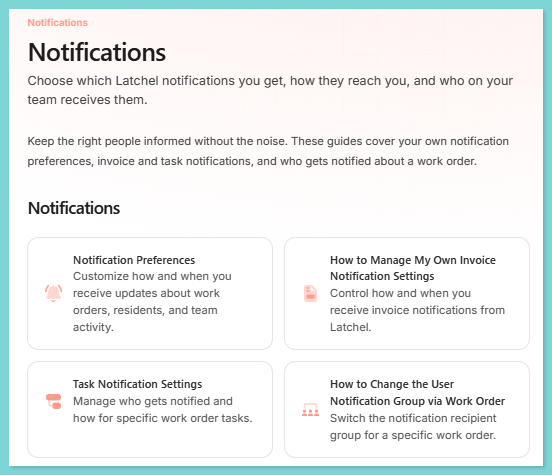
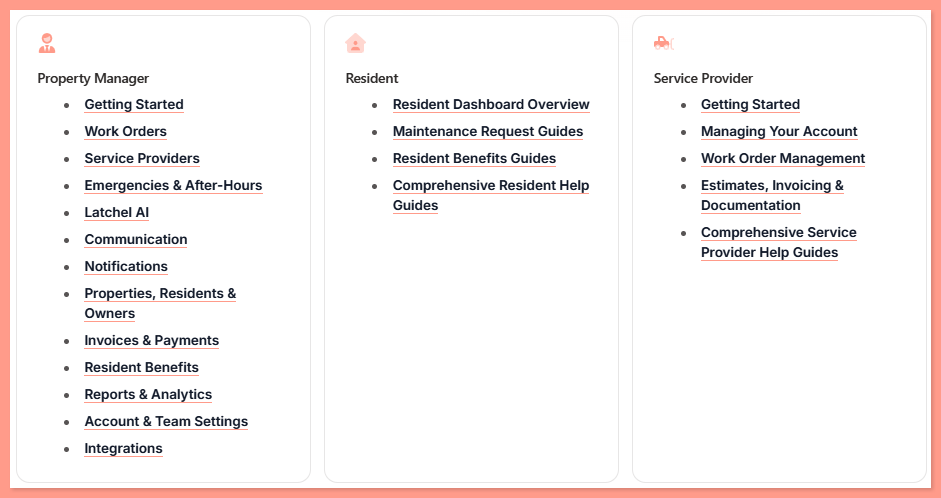
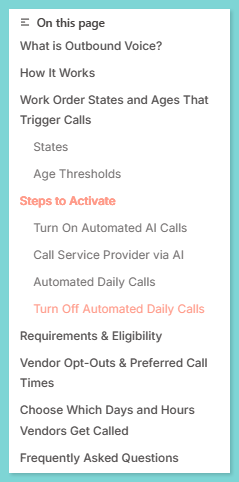
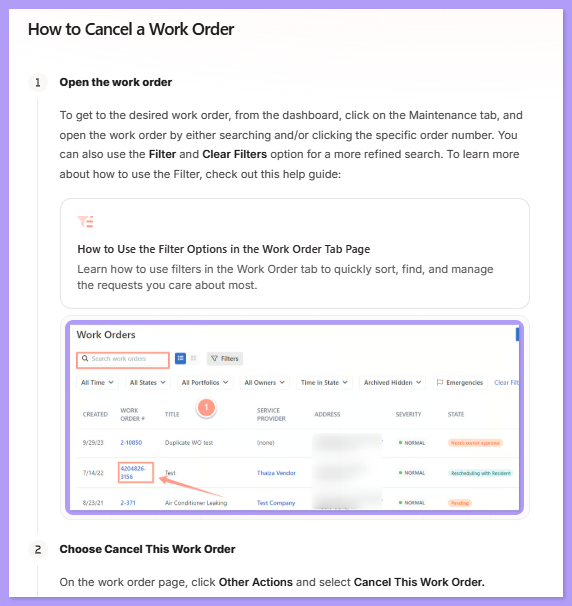
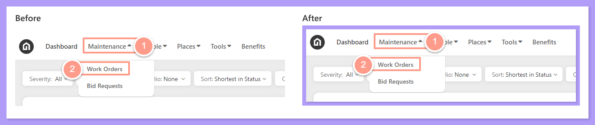
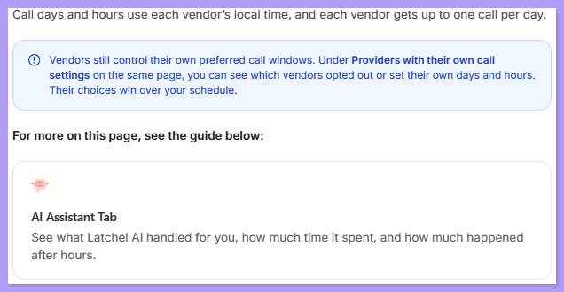
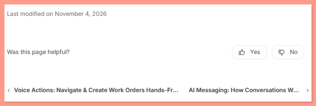

Public help articles are the guides property managers (PMs), residents and service providers read on **help.latchel.com**. Data Support owns them. In November 2026 we audited all public guides and made them uniform; this SOP sets out those standards so every new or updated article matches the rest of the Help Center.

<Check>
  **In other words:**

  Put the article in the right tab and group, and give it a card on that group's overview. Use Heading 2 for main sections. Write instructions as Steps, with each screenshot inside its step, framed and bordered. Link to another guide only where the text tells the reader to check it, and do it with a card. Don't add a "Related guides" list at the bottom. Then check, publish through a pull request, and confirm it's live.
</Check>

<Tip>
  **Model guide:** [Outbound Voice for Vendors](https://help.latchel.com/s/topic/0TO5e000000h9wqGAA/outbound-voice) follows every rule on this page. When in doubt, copy how it's built.
</Tip>

## **Where an Article Goes**

Every public article sits in one of three tabs, and in exactly one group inside that tab.

| Tab | Folder | Who it's for |
| --- | --- | --- |
| **Property Manager** | `s/topic/0TO5e000000h9wqGAA/` | PMs and their teams |
| **Resident** | `s/topic/0TO5e000000h9wrGAA/` | Residents |
| **Service Provider** | `s/topic/0TO5e000000h9wpGAA/` | Service providers and vendors |

The **Property Manager** tab has 13 groups, in the order a PM meets them:

| Group | What goes in it |
| --- | --- |
| **Getting Started** | Welcome, dashboard tour, search, Quick View, Help Center access, contacting Latchel |
| **Work Orders** | Basics, creating and editing, statuses, approvals, files, projects and inspections, tasks |
| **Service Providers** | The PM's vendor list, skills and priority, territories, assigning to work orders, the Latchel Contracted Network, removing |
| **Emergencies & After-Hours** | Emergency process, escalations, pre-dispatch, schedules, Contact Rotation |
| **Latchel AI** | AI features and Intake Settings |
| **Communication** | Phone numbers, calls, SMS and tagging, owner communication |
| **Notifications** | Notification preferences and settings |
| **Properties, Residents & Owners** | Properties, residents, portfolios, owners, configuration inheritance |
| **Invoices & Payments** | Invoices, paying service providers, subscription and policies |
| **Resident Benefits** | Setting up and sharing resident benefits |
| **Reports & Analytics** | Latchel Analytics, Analytics+, exports |
| **Account & Team Settings** | Company settings, portal, white label, budget limits, users and teams |
| **Integrations** | Property management system integrations, Data Sync, API |

Keep each article in the group where a reader would look for it. A guide written for PMs stays in the Property Manager tab, even when it's about residents. For example, *How to Access and View a Resident Public Dashboard* is in **Properties, Residents & Owners**.

### **Three Places to Update When You Add an Article**

1. **The navigation (`docs.json`).** Add the page to its group. A page that isn't listed there doesn't show in the sidebar.
2. **The group's overview page.** Every article needs a card on the first page of its group. Copy the card format already on that page.
3. **The Help Center home page (`home.mdx`).** Only when you add, rename or remove a *group*. The Property Manager card on the home page lists the groups in sidebar order.

<Frame>
  
</Frame>

<Frame>
  
</Frame>

## **Page Setup**

Start every article with this frontmatter:

```mdx
---
title: "How to Cancel a Work Order"
description: "One sentence on what the reader can do with this guide."
---
```

- **Title:** what the reader wants to do, in title case. Start how-to guides with "How to…". Don't add "(New Experience)" to new titles.
- **Description:** one sentence. It shows under the title and in search results.
- **Overview pages** also get `sidebarTitle: "Overview"`.
- Public pages use the default layout. Don't use `mode: wide`.

## **Headings**

Headings build the **On this page** menu on the right, so readers can jump to a section.

- **Heading 2** (`## **Section Title**`) for every main section.
- **Heading 3** (`### **Sub-section**`) only for a real sub-section inside a Heading 2.
- **Heading 4** (`#### **…**`) only for a sub-sub-section that belongs to the Heading 3 above it, sitting between two Heading 3 siblings.
- Keep enumerated titles as written, for example "A. The Details Tab" or "Step 1 - Configuring the Vendor Options".
- **Don't use bold text as a section title.** Bold text doesn't show in the **On this page** menu.

<Frame>
  
</Frame>

<Note>
  The writing guide in the repository (`.mintlify/AGENTS.md`) still says to use `###` for section titles and includes a "Related guides" section in its template. Where it disagrees with this page, follow this page.
</Note>

## **Writing Instructions as Steps**

Write every task the reader does as a `<Steps>` block, with a Heading 2 above it.

```mdx
## **How to Cancel a Work Order**

<Steps>
  <Step title="**Open the work order**" icon="1" iconType="sharp-solid" stepNumber={1} titleSize="p">
    From the dashboard, click **Maintenance** and open the work order.

    <Frame>
      
    </Frame>
  </Step>
  <Step title="**Choose Cancel This Work Order**" icon="2" iconType="sharp-solid" stepNumber={2} titleSize="p">
    On the work order page, click **Other Actions** and select **Cancel This Work Order**.
  </Step>
</Steps>
```

- **Step title:** short and in the imperative, 2–8 words, in bold, with `titleSize="p"`. For example "Open the work order" or "Leave a note and submit".
- **Step body:** the full instruction, followed by that step's screenshots, notes, tips and cards.
- **Numbering:** `icon` and `stepNumber` count up from 1 in each set of steps.
- **One task per set of steps.** If a guide covers several tasks (for example add an invoice, remind the service provider, complete without an invoice), give each task its own set of steps, numbered from 1, with a short intro line above it.
- **A numbered list inside a step drops its numbers** ("1.", "a.") and reads as extra information under the step.
- **When not to use steps:**
  - A section with only **one** instruction stays as normal text. A set of steps needs at least 2 steps.
  - A list of **options** (choose A or B) stays a list, inside the one step it belongs to.
  - Descriptions, definitions, FAQs and videos stay outside steps.

<Frame>
  
</Frame>

## **Images**

- **Put every image in a `<Frame>`.**
- **Put each screenshot inside the step it belongs to**, right after the instruction.
- **Give every screenshot a colored border**, the same as the rest of the Help Center:
  - Colors: **#B19CF8** (purple), **#7ED5D5** (teal) and **#FF9B8A** (coral). Rotate them in that order down the article.
  - The border is part of the image file: a flat colored margin around the screenshot (about 19 px on a full-width screenshot), with a soft shadow along the bottom and right edges.
- **Show the current interface.** Replace screenshots and videos that show an old menu or layout.
- **Blur personal information** (names, emails, phone numbers, addresses) before uploading.
- Upload images to the `images/` folder with a descriptive file name.
- Small inline icons and animated GIFs don't need a border.

<Frame>
  
</Frame>

<Tip>
  Ask Claude to add the border to a screenshot before you upload it. It uses the same tool that bordered the existing 1,110 screenshots, so new images match exactly.
</Tip>

## **Linking to Other Guides**

Link to another guide **only where the text tells the reader to check it**, and use a **card**, not a hyperlink in the sentence.

```mdx
**For more on this page, see the guide below:**

<Card title="AI Assistant Tab" color="#ff9b8a" icon="message-bot" iconType="duotone" href="/s/topic/0TO5e000000h9wqGAA/ai-assistant-tab">
  See what Latchel AI handled for you, how much time it spent, and how much happened after hours.
</Card>
```

- **Lead-in:** point to the card, for example "…see the guide below:" or "Check out this help guide:".
- **Card contents:** use the guide's title, and copy its icon and one-line description from its card on the group overview page, so a guide looks the same everywhere.
- **Placement:**
  - Inside a step, the card stays in that step.
  - If the pointer is in a Note, Tip or Warning, put the card right after that box.
- **A guide named in passing,** inside a list of facts, can stay a plain link.

<Frame>
  
</Frame>

### **No "Related Guides" at the Bottom**

Don't end an article with a "Related guides" or "Other articles" list. Every page already has previous and next links at the bottom that lead to the guides around it in the same group.

<Frame>
  
</Frame>

## **Videos**

- Put a video near the top, under its own Heading 2, for example "Quick Video Tutorial: Start Here!".
- A video doesn't replace the steps. The written steps and screenshots must cover the whole task too.
- Re-record a video when the interface it shows changes.

## **How to Publish an Article**

<Steps>
  <Step title="**Write or update the article**" icon="1" iconType="sharp-solid" stepNumber={1} titleSize="p">
    Make the change in the **LatchelEngineering/mintlify** repository, in the Mintlify web editor or on a GitHub branch. For changes from **#product-release** or **#help-guide-requests**, use the morning release routine instead (see the guide below).

    <Card title="How to Update Help Guides From Product Releases" color="#ff9b8a" icon="rocket-launch" iconType="duotone" href="/latchel-admin/Data-Support-Team/Help-Center/how-to-update-help-guides-from-product-releases">
      The weekday routine that drafts help guide updates from product releases and help guide requests.
    </Card>
  </Step>
  <Step title="**Check it against this page**" icon="2" iconType="sharp-solid" stepNumber={2} titleSize="p">
    Go through the checklist below before you open a pull request.
  </Step>
  <Step title="**Preview and validate**" icon="3" iconType="sharp-solid" stepNumber={3} titleSize="p">
    Open the pull request's Mintlify preview link and read the article as a reader would: the sidebar, the **On this page** menu, the steps, images and cards. If you work locally, run `mint validate` to confirm the build passes.
  </Step>
  <Step title="**Open a pull request**" icon="4" iconType="sharp-solid" stepNumber={4} titleSize="p">
    In the description, say what changed and why. The **Data Support Lead** reviews and merges it. Merging is what publishes the change.
  </Step>
  <Step title="**Confirm it's live and announce it**" icon="5" iconType="sharp-solid" stepNumber={5} titleSize="p">
    After the merge, open the article on **help.latchel.com** to confirm the change is live. Then post the update in **#help-center-announcements** and update the **Help Center Status Report**.
  </Step>
</Steps>

## **Checklist Before Publishing**

| Check | Done when |
| --- | --- |
| **Location** | The article is in the right tab and group, is listed in `docs.json`, and has a card on its group's overview page. |
| **Frontmatter** | It has a clear `title` and a one-sentence `description`. |
| **Headings** | Main sections are Heading 2, no bold text is used as a section title, and every section shows in the **On this page** menu. |
| **Steps** | Every task with 2 or more actions is in `<Steps>`, with short bold titles and `titleSize="p"`. |
| **Images** | Every image is in a `<Frame>`, sits inside its step, has a colored border, shows the current interface, and has personal information blurred. |
| **Links** | Pointers to other guides are cards with a lead-in, and there's no "Related guides" list at the bottom. |
| **Build** | The preview looks right and `mint validate` passes. |

## **Tools and Links**

| Tool | What it's for |
| --- | --- |
| **Model guide:** [Outbound Voice for Vendors](https://help.latchel.com/s/topic/0TO5e000000h9wqGAA/outbound-voice) | An article that follows every rule on this page. |
| **Help Guide Quality Audit** ([Google Sheet](https://docs.google.com/spreadsheets/d/10uPZ66McBfVKclZnPNz9Wr0ZV_PXwHymHn84iCZBhRk/edit)) | The November 2026 audit of every public guide, with one tab per check. Use it as the baseline. |
| **Help Center Status Report** ([Google Sheet](https://docs.google.com/spreadsheets/d/1ChMku13lVWoYPSHHm16mnOVmRc_Fnwec8T6qeufTS_Y/edit)) | Tracks guide ages and release updates. |
| **GitHub: [LatchelEngineering/mintlify](https://github.com/LatchelEngineering/mintlify/pulls)** | Where pull requests are reviewed and merged. |
| **Slack:** **#help-center-announcements** | Where published updates are announced. |
