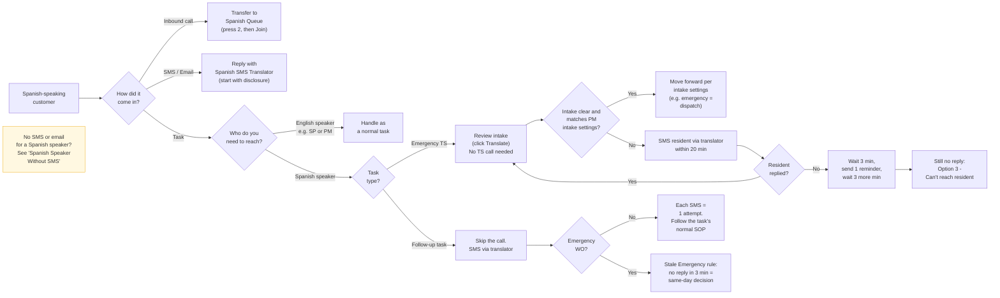

## 🧠 What This Process Is Trying to Solve

<Note>
We want to prevent delays, confusion, and poor customer experiences when Spanish-speaking customers reach out via SMS, email, or phone. Associates handle Spanish SMS, emails, and troubleshooting tasks themselves using the approved translation tool. Inbound Spanish calls are transferred to our Spanish call center partner.
</Note>

## 🗺️ Quick Flow

## 📋 Step-by-Step Process

### Calls

<Note>
**What happened prior to this step?**

You are either starting your assignment on handling inbound calls or have ended a call and are receiving a new one.
</Note>

#### Process Overview

After accepting the call, you will be informed that the call is a Spanish call. Any Spanish-speaking caller — resident, SP, or other customer — is live-transferred directly to our Spanish call center partner (Sunshine Call Center) via the Spanish Queue quick connect in Amazon Connect.

**Steps**

1. Accept the call. Once it connects, close the number pad.
2. Let the caller know they're being connected: "One moment, please. I'm going to transfer you to a Spanish-speaking representative." (In English — no Spanish required from the associate.)
3. Click **Quick Connects**.
   1. 
4. Double-click **Spanish Queue**. This dials our Spanish call center partner.
5. Open the number pad again: click the ⋯ (three dots) at the bottom, then **Number pad**.
6. Press **2** — this is the Spanish option. Skipping it means the caller won't reach a Spanish-speaking agent.
   1. 
7. Close the number pad.
8. Click **Join** to connect the caller with the Spanish agent.
   1. 
9. Confirm both sides are connected, then end your own call. The caller stays connected to the Spanish agent.
   1. 

### **SMS/Email (Includes Emergency Admin)**

Spanish SMS and email associates follow the same workflow: associates assist the customer directly using the approved translation tool. Do not wait for an available Spanish-speaking teammate before responding. This applies to all **Conversations**: click **Mark as Handled** before replying and paste the translated message into the thread (see [Job Aid: Handling Resident & Service Provider Conversations](https://help.latchel.com/latchel-admin/Service-Operations/Production-Documentation/Job-Aid-Handling-Resident-and-SP-Conversations-AI-Messaging-Beta)).

1. When an associate receives an SMS in Spanish, they respond right away using the [**<u>Spanish SMS Translator</u>**](https://claude.ai/public/artifacts/35daba8e-9963-4de9-82bb-74d3999cb190 "https://claude.ai/public/artifacts/35daba8e-9963-4de9-82bb-74d3999cb190"), starting with the following disclosure: **"Hola [Customer's Name], estamos utilizando una herramienta de traducción para comunicarnos con usted. Pedimos disculpas por cualquier error y agradecemos su paciencia. ¿En qué podemos ayudarle?"** _(English: "Hello [Customer's Name], we are using a translation tool to communicate with you. We apologize for any errors and appreciate your patience. How can we assist you?")_
   1. For Spanish email requests, use the disclosure only when the email does not include enough information to understand the request. If the email request is clear, respond by addressing the stated issue directly and take the appropriate action needed to resolve or move the concern forward.
2. Continue the conversation using the Spanish SMS Translator until the request is resolved or a clear next step is identified.
3. For email requests where the requester is not the customer, such as an admin or other third-party email, associates may handle the request and reach out directly to the customer for a response.
   1. If the customer has no SMS or email contact, follow **“Spanish Speaker Without SMS”** below.
4. If the customer stops responding, apply the standard unresponsive-client rule from [**<u>How to: Handle SMS/Webchat Contacts (New Support Framework)</u>**](https://help.latchel.com/latchel-admin/Service-Operations/Production-Documentation/How-to-Handle-SMS-Webchat-Contacts-New-Support-Framework#how-to-handle-sms-webchat-contacts-new-support-framework "https://latchel.atlassian.net/wiki/spaces/OPS/pages/759431202/How+to+Handle+SMS+Webchat+Contacts+New+Support+Framework#%E2%9D%97Handling-Unresponsive-or-Upset-Client") — no response after 3 minutes, send your wrap-up message and move on (Conversations have no close step).
5. Once the conversation is complete, update the thread to confirm whether communication with the customer was successful and document the customer response or next step taken.

### Troubleshooting Tasks – Spanish-Speaking Resident

<Warning>
  Do not defer the task or wait for a Spanish-speaking associate. Handle it yourself.
</Warning>

**No troubleshooting call is required for Spanish-speaking residents.** This is an exception to the normal TS process. Review the intake, and use SMS through the Spanish SMS Translator only if you need more information.

1. Keep the task assigned to the TS group. Do not forward the work order to the PM just because the resident speaks Spanish. Follow the steps below first.
2. **Review the intake.** Read the work order details, the pre-dispatch notes, and the intake conversation. If the intake is in Spanish, click **Translate** to see it in English.
   1. **If the details are clear and match the PM’s intake settings,** you do not need to call or message the resident. Move forward based on the intake settings, the same as any other work order. For example, if it is an emergency, dispatch.
   2. **If you need more information,** message the resident in **Conversations** using the [Spanish SMS Translator](https://claude.ai/public/artifacts/35daba8e-9963-4de9-82bb-74d3999cb190). Start with the disclosure message. Send your first message within **20 minutes** of the work order being created or escalated to emergency. Once you have the information, go back to step 2.1.
3. **If the resident does not reply:**
   1. Wait **3 minutes** after your message. Then send one reminder through the translator: _“Hi [Name], we are following up on your maintenance request. Please reply to this message so we can help you.”_
   2. Wait **3 more minutes**. If there’s still no reply, treat the resident as unreachable. Follow **Option 3 – Can’t reach resident** in [How to: Handle Emergency Work Orders](/latchel-admin/Service-Operations/Production-Documentation/How-to-Handle-Emergency-Work-Orders), starting from “Check for additional phone numbers”. For Spanish-speaking residents, these 2 messages replace the 3 call attempts.
4. Add **Spanish** to the task subject so the next associate knows to use the translator. This label does **not** mean the task should wait for a Spanish speaker.
5. Document what you sent, what the resident said, and the action you took in the work order notes.

### Follow-Up Tasks – Spanish-Speaking Resident/SPs/Owners/PMs (e.g., resident reports issue unresolved, service provider follow-ups)

1. First check who the task is for. If the person you need to reach speaks English (for example, an SP or PM), handle it as a normal task.
2. If you need to reach the Spanish-speaking contact, skip the phone call. Message them in **Conversations** using the Spanish SMS Translator, starting with the disclosure message. This also applies to tasks where the SOP says to always call first (for example, tasks created from a resident review).
3. **Non-emergency work orders:** Each SMS counts as one contact attempt. Then follow the task’s normal SOP, including what to do when the contact doesn’t reply (for example, [Job Aid: Handling Tasks assigned to the Resident Follow Up Group](/latchel-admin/Service-Operations/Production-Documentation/Job-Aid-Handling-Tasks-assigned-to-the-Resident-Follow-Up-Group)).
4. **Emergency work orders:** Follow the **Stale Emergency rule** in [Informational: Basic Service Ops Guidelines and Rules](/latchel-admin/Service-Operations/Production-Documentation/Informational-Basic-Service-Ops-Guidelines-and-Rules). Your one SMS counts as the one attempt. If the contact hasn’t replied **3 minutes** after your message, make the same-day decision right away. Do not defer to the next day.
5. If the contact’s number can’t receive texts, follow **“Spanish Speaker Without SMS”** below.

### Spanish Speaker Without SMS (phone only)

Use this only when you need to reach a Spanish-speaking contact and they have no SMS or email.

1. Check for other residents on the work order who can receive texts or speak English. If you find one, contact them.
2. If not, call the resident **once**. Ask: **“¿Hay alguien que hable inglés?”** _(Is there someone who speaks English?)_ If yes, continue the call in English.
3. If not, read this slowly: **“Hola, le llamamos de Latchel, el equipo de mantenimiento de [PM Company Name]. Para recibir ayuda en español, por favor llámenos al [PM’s Latchel Communication Phone Number]. Gracias.”** _(English: “Hello, we’re calling from Latchel, the maintenance team for [PM Company Name]. For help in Spanish, please call us at [PM’s Latchel Communication Phone Number]. Thank you.”)_ To find this number, see [Informational: Basic Service Ops Guidelines and Rules](https://help.latchel.com/latchel-admin/Service-Operations/Production-Documentation/Informational-Basic-Service-Ops-Guidelines-and-Rules).
4. If no one answers, leave the same message as a voicemail.
5. When they call back, the call reaches Spanish support through the normal inbound process.
6. If the issue is PD/EH, don’t wait for the callback. Follow the PD/EH process.
7. Document the call and the outcome in the work order notes.

### **FAQ**

<Accordion title="What if the resident is not an English or Spanish Speaker?">
  1. Call the resident and ask if someone who speaks English is available. If yes, continue in English.
  2. If no one speaks English, call the other residents listed on the work order. If one of them speaks English, continue with them and make them the primary contact if needed.
  3. If you can’t reach anyone who speaks English, message the resident in **Conversations** in their language using Google Translate. If they can’t receive texts, send an email instead. Message to translate: _“Hello [Name]! We are using a translation tool, so we apologize for any errors. Is there someone available who can speak English so we can help you?”_
  4. If they reply with a contact who speaks English, call that person.
  5. If there’s no reply after **3 minutes**, or you still can’t understand the issue:
     - **Emergency TS task:** Follow **Option 3 – Can’t reach resident** in [How to: Handle Emergency Work Orders](https://help.latchel.com/latchel-admin/Service-Operations/Production-Documentation/How-to-Handle-Emergency-Work-Orders).
     - **Emergency follow-up task:** Follow the **Stale Emergency rule** in [Informational: Basic Service Ops Guidelines and Rules](https://help.latchel.com/latchel-admin/Service-Operations/Production-Documentation/Informational-Basic-Service-Ops-Guidelines-and-Rules).
     - **Non-emergency follow-up task:** Follow the task’s no-reply steps in [Job Aid: Handling Tasks assigned to the Resident Follow Up Group](https://help.latchel.com/latchel-admin/Service-Operations/Production-Documentation/Job-Aid-Handling-Tasks-assigned-to-the-Resident-Follow-Up-Group).
  6. Do not forward the work order to the PM only because of the language barrier. Forward it only if the steps in step 5 lead there.
  7. Document all contact attempts and outcomes in the work order notes, following [How to: Write Effective Notes](https://help.latchel.com/latchel-admin/Service-Operations/Production-Documentation/How-to-Write-Effective-Notes).
</Accordion>

#### Switching to Spanish

In order to help you switch from English to Spanish, we have included below a few blurbs:

<Accordion title="Blurbs">
|  |  |
| :-- | :-- |
| **How to answer the call and introduce yourself** | Hola, [nombre del residente]. Le atiende [tu nombre] de la línea de mantenimiento en una llamada que puede ser grabada o monitoreada. ¿Cómo le puedo ayudar? |
| **How to paraphrase the customer request** | De acuerdo [nombre del residente], solo para confirmar [+ parafrasear]. ¿Es correcto? / ¿comprendí bien? |
| **How to ask the customer to wait while you research something.** | Entiendo/ de acuerdo [nombre del residente]. Déme oportunidad de revisar rápidamente la información relacionada con su solicitud. Gracias por su paciencia. |
| **Place the call on hold** | [nombre del residente], permitame revisar con el equipo de [nombre del equipo o área] para poder dar una respuesta más rapida/detallada a su solicitud. ¿Me permite ponerle en espera unos minutos? Esto es para agilizar la llamada. |
| **How to introduce the next steps.** | Me gustaría confirmar con usted los siguientes pasos a seguir, que son: Con gusto, los siguientes pasos a seguir son: |
| **How to offer further assistance.** | ¿Algo más en lo que pueda ayudarle? ¿Algo más que pueda hacer por usted? Además de [problema/solicitud], hay algo más en lo que podamos ayudarle? |
| **How to finalize the call.** | Gracias por llamar a mantenimiento, mi nombre es [tu nombre], que tenga un excelente [día/tarde/noche]. |
| **How to handle an irate customer.** | Tiene toda la razón [nombre del residente], y en efecto, hubo un [problema] con su solicitud, déme oportunidad de revisar rápidamente la información relacionada. [Nombre del residente], comprendo perfectamente su molestia. Ya me encuentro revisando la información relacionada para poder darle una solución. Lamentamos mucho que haya tenido este inconveniente. |
</Accordion>

## 🎯 **When to Break This SOP**

**Do not break or deviate from this SOP on your own authority.** Always escalate to an Ops Support specialist or follow explicit instructions if you believe an exception is necessary.

## 💡 **If You Think This SOP Could Be Improved...**

Noticed something clunky or confusing in this process? Or had a situation that wasn't covered here? Or tried something new that didn't work?\
👉 Share your suggestion in the [SOP Feedback Form](https://slack.com/shortcuts/Ft07C0TDU4N9/9439ee41aae76a4a602b6c186ce4a6cd) or tell your manager— **we want your input!**
