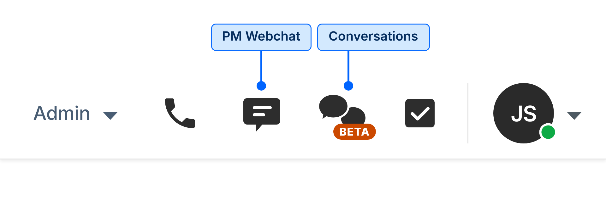
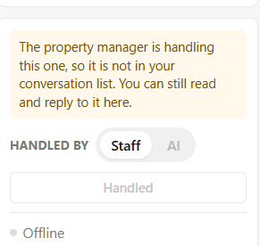
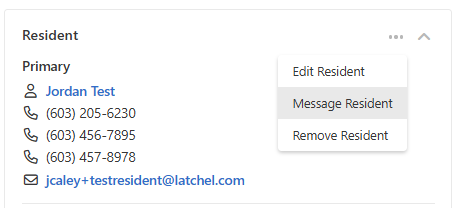
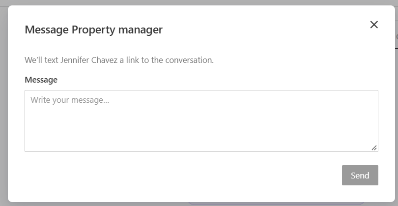
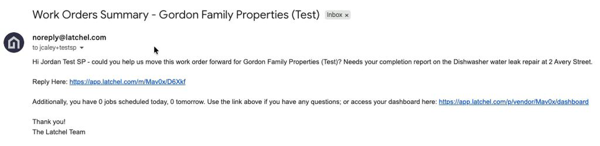

## 🧠 What This Process Is Trying to Solve

<Note>
  We want to prevent missed, delayed, or duplicated replies now that text messages are handled in Conversations for all customers. Only PM web chats stay in the legacy SMS icon. This job aid shows you how to claim and reply to inbound Conversations and how to send outbound messages, so that no two associates work the same thread and nothing sits unanswered.
</Note>

<Info>
  🆕 **Updated November 3, 2026:** Don't handle resident or SP replies on **PM-managed** work orders. See step 2 (Check who manages the WO) and **Replies on PM-managed work orders** below.
</Info>

<Info>
  🔔 Before You Start:

  For all customers, text messages from residents, SPs, Property Managers and Owners are in the Conversations icon. Only PM web chats stay in the legacy SMS icon and follow [How to: Use Text Message (SMS/Webchat) Functions (in Latchel Console)](/latchel-admin/Service-Operations/Production-Documentation/How-to-Use-Text-Message-SMS-Webchat-Functions-In-Latchel-Console).

  Both have **equal priority**, so always work the **oldest** unhandled message first by timestamp, across both icons.

  On **PM-managed** work orders, the PM's team handles resident and SP replies, even if Ops posted in the thread earlier.

  🛑 **NOTE:** The legacy SMS icon will soon be replaced by a **Webchat Support** icon. Until then, keep handling PM web chats in the SMS icon.
</Info>

## 📋 Step-by-Step Process

### Handling Inbound Messages

1. Go to **Conversations → Team**. New messages stay unhandled until someone claims them.
2. **Check who manages the WO** (before you claim it)

   1. Open the tagged work order and check **Managed by (in the plugin)**.

      1. 
      2. Conversation shows below warning at the right part of the panel just above the Handled by tab.

         1. 
   2. **Managed by Latchel:** continue to step 3 (Claim it).
   3. **Managed by PM:** don't claim or reply. Move on to the next message.
      - You should no longer get notifications for these threads. If you do, submit a bug report using [this link](https://app.latchel.com/admin/bug-reports).
      - 🛑 **Exception:** possible PD/EH replies don't come to this queue. The system creates a task for the Troubleshooting team to assess. If a new emergency comes up some other way, follow the emergency process.
2. **Claim it**
   1. Click **Mark as Handled** **before** replying. Replying also marks it handled, but claiming first prevents double replies.
   2. 🛑 **NOTE**: **Before you click**, check for _"[name] is typing…"_. If you see it, move on to another message since someone is already about to handle it.
   3. 🛑 **NOTE**: If the message needs no reply (e.g., it just says "Thank you"), clicking Mark as Handled is all you need to do.
3. Scroll the full thread (AI, associate and customer messages) and confirm the tagged WO. Only ask for what's genuinely missing.
4. Assist the customer using [How to: Handle Conversations/Webchat](/latchel-admin/Service-Operations/Production-Documentation/How-to-Handle-SMS-Webchat-Contacts-New-Support-Framework), then reply in the thread with the appropriate next step or resolution.
   1. 🛑 **NOTE:** In some cases, you can hand the next reply to Latchel AI. See the FAQ **"**[When can I switch Handled by to AI?](#when-can-i-switch-handled-by-to-ai)**"**
5. **Document it:** You don't need to log the conversation manually, since it's saved in the WO **Conversations** tab. If you updated the work order because of the Conversation, leave a detailed WO note explaining the action and why, following [How to: Write Effective Notes](/latchel-admin/Service-Operations/Production-Documentation/How-to-Write-Effective-Notes).
6. **No end step**: There is no End Conversation or close option. If the customer writes again about the same work order, the thread reopens as unhandled, and anyone who previously replied in it gets a notification _(an unread message bubble)_. If none of them respond within 10 minutes, it's marked red in Team for anyone to pick up.
   1. 🛑 **NOTE:** This applies only to **Latchel-managed** work orders.

<Warning>
  **⏱️ 10-minute aging tag:** If a resident or SP message goes 10 minutes without a staff reply, the thread is highlighted in red in Team. Any team member can pick it up.
</Warning>

<Warning>
  **Replies on PM-managed work orders**

  - Don't handle resident or SP replies on work orders **Managed by PM**, even if you posted in the thread earlier (for example, after you de-escalated an emergency or handed it to the PM).
  - Only get involved again if an emergency comes back or a new one develops. If a reply is flagged as a potential PD/EH, the system creates a **Troubleshooting task** to assess it. The WO severity isn't changed automatically. The troubleshooter escalates it to Emergency if needed.
  - You should no longer get notifications for these threads. If you do, submit a bug report using [this link](https://app.latchel.com/admin/bug-reports).
</Warning>

### What a Latchel AI Handoff Looks Like

When Latchel AI can't handle a resident or SP message, or the customer asks for a person, it hands the Conversation to our **Team** queue. This is what you see in the thread, from top to bottom (example: a resident reports a furnace pilot that keeps blowing out and gas building up in the unit).

| What you see in the thread | What it means | What to do |
| --- | --- | --- |
| **Customer message**, e.g. _"The problem is not fixed. The tech said it is actually dangerous because gas is building up inside the unit when the pilot gets blown out."_ | The message that triggered the handoff. | Read it, then read the full thread above it. |
| **AI: _N_ actions** (expandable) and a status line, e.g. **Now Pending · Automatic** | The actions Latchel AI already took on the work order, such as changing its status. | Expand it so you know what changed before you act. Don't redo or undo these actions without a reason. |
| **Internal · The assistant asked for a person:** followed by a summary | Latchel AI's handoff note: why it needs a person and what it learned (e.g. safety issue, root cause the resident reported, a vulnerable occupant, freezing temperatures). Only staff can see it. | Read this first. It's your briefing. Use it to decide severity and next steps, and don't ask the customer for details already in it. |
| **Latchel AI's last message** to the customer, e.g. _"I've recorded it as not fixed… I've asked someone on the team to pick it up. If you smell gas at any point, leave the home and call 911 or your gas utility from outside."_ | The customer already knows a person is taking over and may already have safety guidance. | Don't send a separate greeting or acknowledgment. Don't contradict safety guidance Latchel AI already gave. |
| **A team member has joined the conversation.** and **Internal · Marked handled by [your name]** | You claimed the thread (Mark as Handled or your first reply). | Check for _"[name] is typing…"_ before you claim. |
| **Your reply** | The customer's next message from a person. | Send one complete reply with the answer or next step. Then take the action on the work order. |

<Tip>
  **Example of a strong first reply** for the handoff above:

  _"Hi [Resident Name], I'm sorry the issue isn't fixed. Please don't relight the pilot. If you smell gas, leave the home and call 911 or your gas utility from outside. We're contacting the service provider now to get someone back out as soon as possible, and we'll update you here. Someone from our team may also call you, so please keep your phone nearby."_

  Avoid splitting this into several short messages (a greeting, then an apology, then an update). One clear message is easier for the customer to follow.
</Tip>

<Warning>
  **Safety handoffs:** If the handoff note or thread describes a possible emergency (gas, no heat in freezing temperatures, active leaks, a vulnerable occupant), check the work order severity and follow the emergency process. If you're assigned to SMS only, create the TS task so a troubleshooter acts on it, per [Cross-Training & Queue Scope](/latchel-admin/Service-Operations/Production-Documentation/Informational-Basic-Service-Ops-Guidelines-and-Rules#cross-training-and-queue-scope) and the [Latchel Harmonia Judgment Override Policy](/latchel-admin/Service-Operations/Production-Documentation/Latchel-Harmonia-Judgment-Override-Policy).
</Warning>

### Sending Outbound Messages

<Info>
  **Who can you message from Conversations?** Outbound Conversations are used to message **Residents, Service Providers and Property Managers**.

  **PM web chats are different:** web chats started by a Property Manager are **not** handled here. Keep handling them in the legacy **SMS** icon (soon to be replaced by the **Webchat Support** icon), per [How to: Use Text Message (SMS/Webchat) Functions (in Latchel Console)](/latchel-admin/Service-Operations/Production-Documentation/How-to-Use-Text-Message-SMS-Webchat-Functions-In-Latchel-Console).
</Info>

#### 1. How to get there?

<AccordionGroup>
  <Accordion title="Option A: From the WO Conversations tab">
    1. Open the **work order** and go to the **Conversations** tab. Select the **Resident**, **Service provider** or **Property manager** tab. Click **"Message (customer name)"**.
    2. Type in your message and hit sent.
  </Accordion>

  <Accordion title="Option B: From the user's profile or WO tab">
    1. Go to the user's profile or tab in the work order (Resident, SP or PM). Click the option to message them (e.g., **Message Resident/SP or Message icon in the PM's profile**).
       
    2. Enter your message.
       1. 
    3. Send the message.
  </Accordion>
</AccordionGroup>

#### 2. Taking Action

1. The customer gets an SMS with a link to the Conversation.
2. **Document it:** You don't need to log the conversation manually, since it's saved in the WO **Conversations** tab. If you updated the work order because of the Conversation, leave a detailed WO note explaining the action and why, following [How to: Write Effective Notes](/latchel-admin/Service-Operations/Production-Documentation/How-to-Write-Effective-Notes).
3. When the customer replies to a message handled by **Staff**, the thread appears in your **My messages** and as unhandled in **Team**. Follow **Handling Inbound Messages** from Step 2 (Check who manages the WO). If you chose **Latchel AI**, it responds first and transfers to a person if needed.

## ✅ Quick Do's and Don'ts

<table>
  <colgroup>
    <col width="350" />
    <col width="325" />
  </colgroup>
  <thead>
    <tr>
      <th>Do</th>
      <th>Don't</th>
    </tr>
  </thead>
  <tbody>
    <tr>
      <td>Work the **oldest** unhandled message in **Team** first, by timestamp.</td>
      <td>Don't pick newer threads because they look quicker.</td>
    </tr>
    <tr>
      <td>Check **Managed by** before you claim a message. Only step in on a PM-managed WO if an emergency comes back or a new one develops.</td>
      <td>Don't reply to resident or SP messages on PM-managed WOs.</td>
    </tr>
    <tr>
      <td>Check for _"[name] is typing…"_, then click **Mark as Handled** before you reply.</td>
      <td>Don't jump into a thread where someone is typing, or assume opening a thread claims it.</td>
    </tr>
    <tr>
      <td>Read the whole thread (Latchel AI, associate and customer messages) before replying, and only ask for what's genuinely missing.</td>
      <td>Don't make the customer repeat what they already told Latchel AI or a teammate.</td>
    </tr>
    <tr>
      <td>Reply with the answer or next step right away. Latchel AI already told the customer they're being passed to a person.</td>
      <td>Don't send a separate acknowledgment message.</td>
    </tr>
    <tr>
      <td>Send the CSAT link at the end of the interaction **only when you're messaging a Property Manager**.</td>
      <td>Don't send the CSAT link to residents, service providers or owners. Don't send it to a PM when you're only requesting photos or the conversation is still open.</td>
    </tr>
    <tr>
      <td>Leave a WO note when the conversation led you to change the work order.</td>
      <td>Don't copy the conversation into notes, tag it, or look for End Conversation.</td>
    </tr>
  </tbody>
</table>

## 🚫 What Not to Do

- Don't manually tag Conversations or look for End Conversation.
- Don't reply to resident or SP messages on PM-managed work orders.
- Don't reply without clicking Mark as Handled first, or jump into a thread where someone is typing.
- Don't assume opening a thread claims it.
- Don't treat Conversations as lower priority than SMS.
- Don't look for a separate Transcripts tab. History lives in the WO **Conversations** tab (formerly Transcripts).

## ❓ Frequently Asked Questions

<AccordionGroup>
  <Accordion title="What are Conversations?">
    When a resident or SP replies to one of our SMS notifications, they get a link to a chat thread that opens in their phone's browser. In the thread they can chat with us and take dashboard actions like scheduling, creating invoices and leaving a review. There is one thread per user per work order, and threads are tagged to the work order automatically.

    
  </Accordion>

  <Accordion title="Which customers are affected?">
    All customers. Text messages from residents, SPs, Property Managers and Owners are in Conversations, and Latchel AI answers residents and SPs only. PM web chats stay in the legacy SMS icon (soon to be replaced by the Webchat Support icon), with the same process as before (see [How to: Use Text Message (SMS/Webchat) Functions (in Latchel Console)](/latchel-admin/Service-Operations/Production-Documentation/How-to-Use-Text-Message-SMS-Webchat-Functions-In-Latchel-Console)).
  </Accordion>

  <Accordion title="Which messages does Latchel AI handle, and which come to us?">
    Latchel AI only answers **resident and SP** messages, and only where it is active:

    - **Autopilot customers:** all resident and SP messages, during the free trial.
    - **All other customers:** only on **Latchel-managed** work orders. Messages on PM-managed work orders go straight to the PM's team.
    - **Property Managers and Owners**: never. Our team answers their texts in Conversations, and PM web chats stay in the legacy SMS icon.

    Where it is active, Latchel AI answers unless the customer asks for a person or it's something the AI can't handle (e.g., leasing or other out-of-scope questions). When that happens, the conversation is transferred based on who manages the work order:

    - **Managed by Latchel** → Latchel team's messages (our **Team** queue)
    - **Managed by the PM** → PM team's messages
  </Accordion>

  <Accordion title="When can I switch Handled by to AI?">
    Conversations from our Team queue are already set to **Staff**. You can switch **Handled by** to **AI** (or choose **Latchel AI** when sending a message) when the customer's next reply is something Latchel AI can handle in the Conversation. For example:

    - **Requesting photos.** You've asked the resident for photos of the issue, including when a PM asked us to collect them.
    - **Asking an SP to book or reschedule.** You've asked an unresponsive SP to schedule the appointment using the link.
    - **Sending an update that needs no reply.** For example, the "moved your work order into our review process" message after a resident reports an unresolved issue, or a status update after reaching voicemail.

    **Keep it on Staff** when:

    - you need the customer's answer to decide the next step (e.g., "Can you tell us what happened?"),
    - the work order is an emergency, unless you're only waiting on photos
    - it's time-sensitive,
    - you're coordinating something that involves the PM, like telling bid SPs to hold off.

    If Latchel AI can't handle the reply, it transfers the Conversation back to a person.
  </Accordion>

  <Accordion title="How do I know a message needs a reply, or that someone else is already on it?">
    New messages come in as unhandled in **Team** until someone clicks **Mark as Handled**. Sending a reply also marks it handled. You'll see "[name] is typing…" if a teammate is already working on it. Once you reply, the thread will also appear in **My messages**.

    The **Conversations** indicator shows new messages in threads you've participated in, plus **Team** threads no one is working on yet.
  </Accordion>

  <Accordion title="I messaged the resident on an emergency, then de-escalated it or handed it to the PM. The resident replied. Do I answer?">
    No. Once the WO is **Managed by PM**, the PM's team handles replies. Only step in if a new emergency comes up. If the reply is a potential PD/EH, the system creates a task for the Troubleshooting team.
  </Accordion>

  <Accordion title="Can I assign a Conversation to someone or end it?">
    No. There's no assigning and no End Conversation option. Anyone can open any Conversation, and opening it doesn't mark it as handled.
  </Accordion>

  <Accordion title="Where do I see a work order's full message history?">
    In the WO's **Conversations** tab. It shows each resident and SP thread, but automated notifications are not shown there yet.
  </Accordion>

  <Accordion title="What if a customer starts talking about a different work order in the same thread?">
    Escalate to Operations Support Specialists. Ops Support will escalate  to the escalation channel.
  </Accordion>

  <Accordion title="Do I still send the CSAT link or an acknowledgment message?">
    - **CSAT link**: Only for Property Managers. Don't send the CSAT link to residents, service providers or owners. The new Conversations experience makes it unnecessary. For PM interactions, keep sending it per [How to: Handle Conversations/Webchat](/latchel-admin/Service-Operations/Production-Documentation/How-to-Handle-SMS-Webchat-Contacts-New-Support-Framework).
    - **Acknowledgment message:** Not needed. When Latchel AI transfers a Conversation, it already tells the resident or SP they're being passed to a person. Review the thread and reply with your answer.

    -1.png "Image (1) 1")
  </Accordion>

  <Accordion title="What happens automatically, without any action from me?">
    1. **Customer texts back instead of clicking the link:** An autoresponder tells them to click the conversation link to chat with Latchel. The text they sent is saved in their Conversation thread, so nothing is lost. Don’t tell the customer their message wasn’t received.
    2. **The phone number belongs to more than one user, or we don't recognize it:** Latchel AI asks them to identify themselves and starts a thread.
    3. **They want to reach us without the SMS link:** They can open Conversations from their dashboard, under **Action Menu → Talk to Us About this Work Order**.
  </Accordion>

  <Accordion title="Does AI Messaging change automated notifications?">
    No. Automated outbound notifications (appointment reminders, scheduling links, troubleshooting rating texts, video call links, etc.) are not affected.
  </Accordion>

  <Accordion title="How do I report issues or suggestions for Latchel AI?">
    1. **Latchel AI shares private PM information** (name, phone number, email): Note the Conversation and WO, capture a video showing what was shared, and submit a bug report using [this link](https://app.latchel.com/admin/bug-reports) (also pinned in #bug-report). See [Handling Property Manager’s Private Information](https://help.latchel.com/latchel-admin/Service-Operations/Production-Documentation/Informational-Basic-Service-Ops-Guidelines-and-Rules#private-property-manager/owner-handling-private-information).
    2. **Any other issue:** Submit a bug report.
    3. **Suggestions:** Submit a feature request in #svc-ops-requests per [How to: Use the Serv Ops Intake Workflows](https://help.latchel.com/latchel-admin/Service-Operations/Production-Documentation/How-to-Use-the-Serv-Ops-Intake-Workflows).
    4. **Latchel AI is down or not responding:** Operations Support Specialists report it in #tech-high-sev-escalations immediately, including the issue, impact and steps already taken.
  </Accordion>

  <Accordion title="A Property Manager asks about AI Messaging or Conversations">
    Share the [AI Messaging help guide](https://help.latchel.com/s/topic/0TO5e000000h9wqGAA/ai-messaging). PMs also see an in-app pop-up linking to it.
  </Accordion>

  <Accordion title="A PM or SP complains about the link or wants to text a real person">
    Reply with the version that matches who is complaining. You can adjust the greeting to fit the conversation, but keep the key points.

    **Property Manager** (includes performance stats)

    > _Thank you for your feedback. We built the new messaging experience to enable vendors and residents to take more actions via chat (schedule, build invoices, leave reviews, etc.), receive instant replies, and move work orders forward faster. So far, 75% of invoices now come in within about 3 days, down from 6, and 75% of jobs get a vendor scheduled within 2 days, down from 3._
    >
    > _With one thread per user per work order, the full message history can be easily referenced. Any text sent to us is ingested into the message thread, and you can always ask to speak with a live team member._
    >
    > _We know it’s a change from texting, though, and we’re listening to feedback like yours as we refine this new feature._

    **Service Provider** (no stats)

    > _Thanks for the feedback! The new messaging lets you do more right in chat: schedule jobs, submit invoices, and get instant replies, so work orders move faster and you get paid sooner. Every work order has one thread, so the full history is always in one place. Any text you send us still lands in that thread, and you can ask for a live team member anytime. We know it’s a change from texting, and we’re using feedback like yours to keep improving it._

    🛑 **NOTE:** Never send the PM version to a Service Provider. The percentages are for PMs only. Shared with a vendor, they can read like Latchel is tracking or judging vendor speed.

    **If the PM still complains after your reply,** escalate to the Product Support (PS) team following [How to Escalate to Product Support](https://help.latchel.com/latchel-admin/Service-Operations/Production-Documentation/How-to-Escalate-to-Product-Support).

    If the PM wants AI responses or AI voice calls turned off, follow **“A PM wants to turn off AI responses or AI voice calls”** instead.
  </Accordion>

  <Accordion title="A PM wants to turn off AI responses or AI voice calls">
    1. Escalate every request to turn off AI text responses or AI voice calls straight to the Product Support (PS) team, following [How to Escalate to Product Support](https://help.latchel.com/latchel-admin/Service-Operations/Production-Documentation/How-to-Escalate-to-Product-Support). Include the PM name, PM company, which they want off (AI text responses, AI voice calls, or both) and the reason. Don't remove any product yourself.
    2. Let the PM know that if AI text responses are turned off, their team will handle every resident and service provider message.
    3. 🛑 **Exception:** If the PM only wants AI voice calls stopped for **one specific vendor**, no escalation is needed. They can turn it off themselves in that vendor's settings.

    <Note>
      Don't send the PM a help guide instead of escalating. The [AI Messaging](https://help.latchel.com/s/topic/0TO5e000000h9wqGAA/ai-messaging) and [Outbound Voice](https://help.latchel.com/s/topic/0TO5e000000h9wqGAA/outbound-voice) guides tell PMs to email [success@latchel.com](mailto:success@latchel.com) to turn AI off, so escalating to PS saves the PM that extra step.
    </Note>
  </Accordion>

  <Accordion title="Does Latchel AI answer Property Manager or Owner messages?">
    No. Latchel AI only answers residents and Service Providers. Property Manager and Owner texts are in Conversations and handled by our team. PM web chats stay in the legacy SMS icon and are handled per [How to: Use Text Message (SMS/Webchat) Functions (in Latchel Console)](https://help.latchel.com/latchel-admin/Service-Operations/Production-Documentation/How-to-Use-Text-Message-SMS-Webchat-Functions-In-Latchel-Console).
  </Accordion>
</AccordionGroup>

## 🎯 When to Break This SOP

**Do not break or deviate from this SOP on your own authority.** Always escalate to an Ops Support specialist or follow explicit instructions if you believe an exception is necessary.

## 💡 If You Think This SOP Could Be Improved...

Noticed something clunky or confusing, or a situation that wasn't covered? 👉 Share it in the [SOP Feedback Form](https://slack.com/shortcuts/Ft07C0TDU4N9/9439ee41aae76a4a602b6c186ce4a6cd) — **we want your input!**
