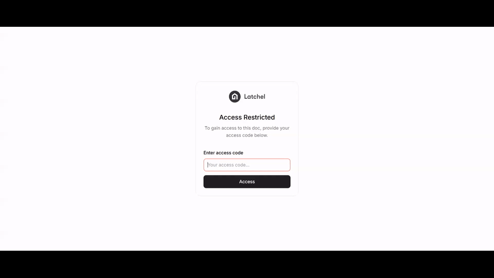
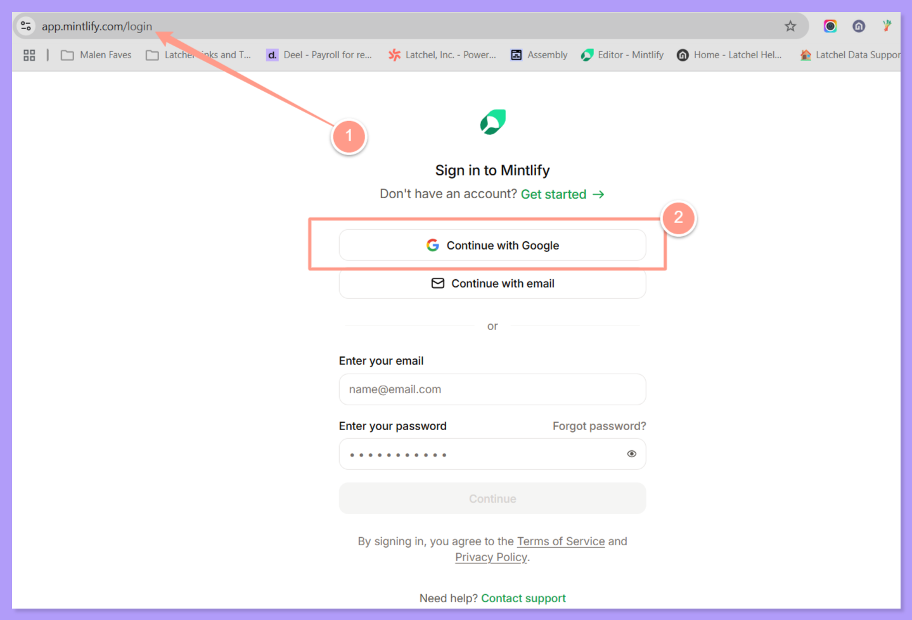
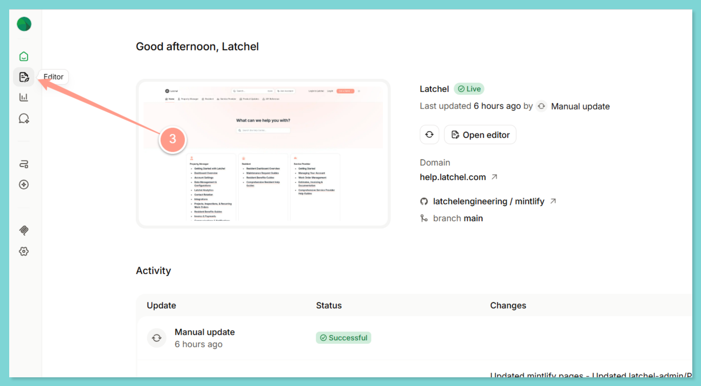
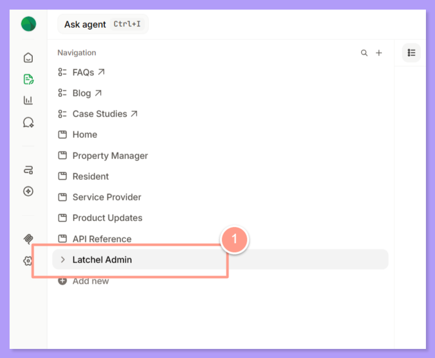
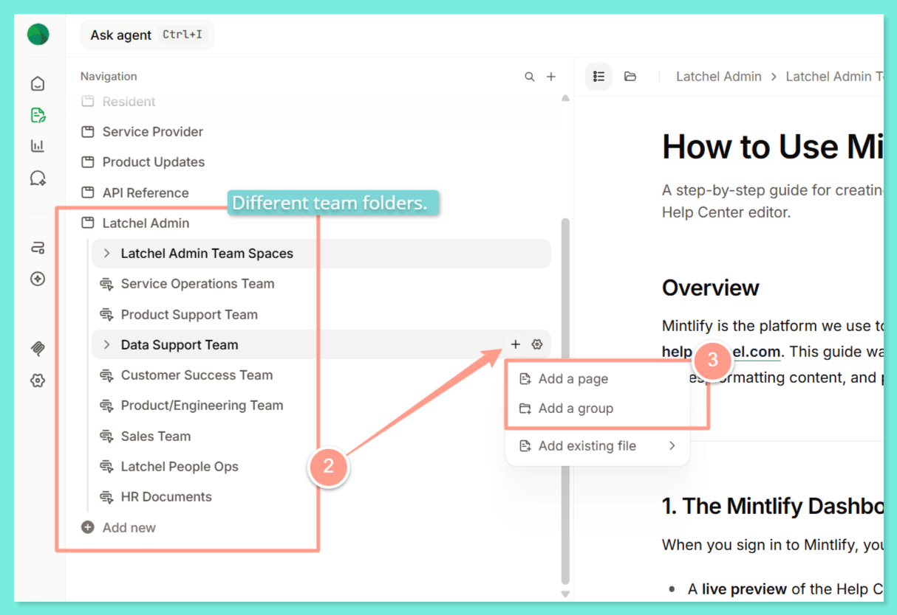
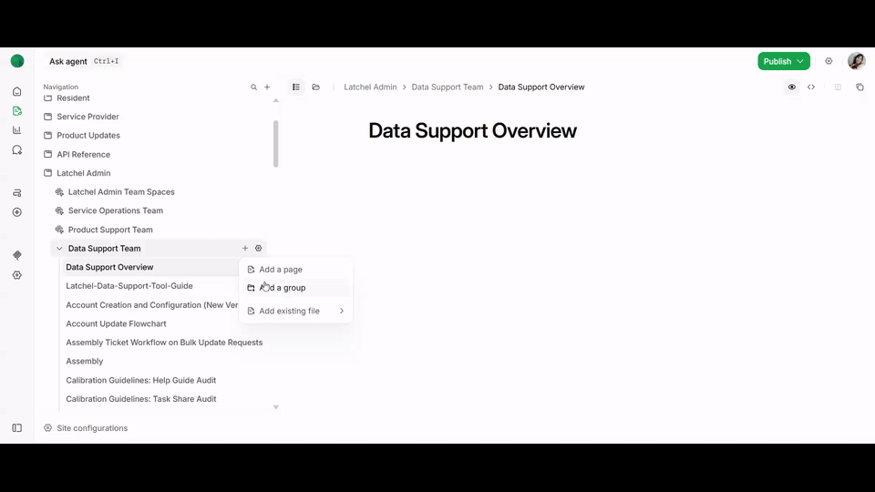
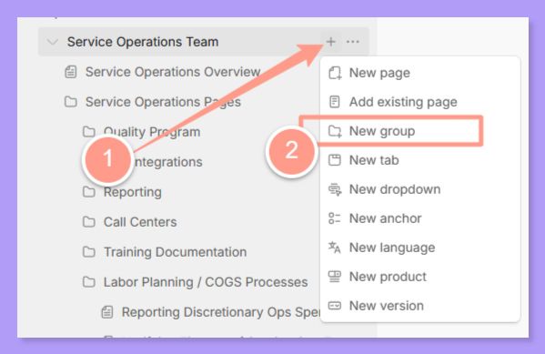
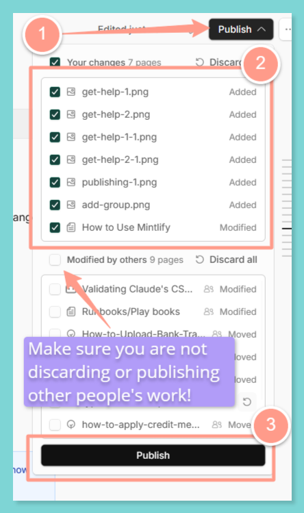
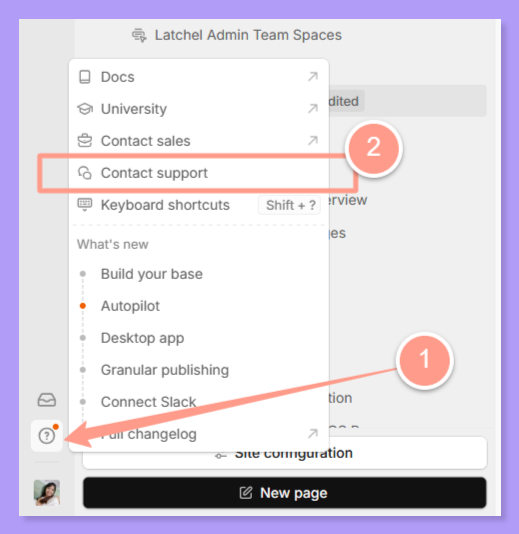
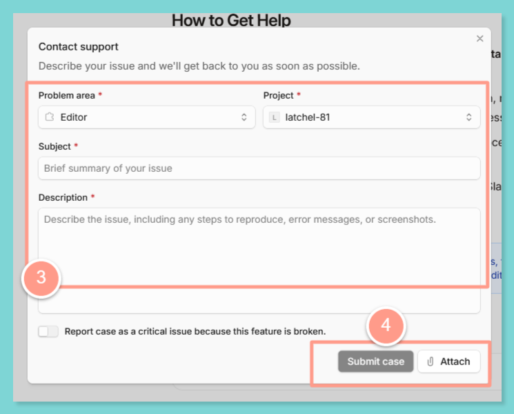

This guide shows Latchel team editors how to create, organize, edit and publish SOPs in the private **Latchel Admin** section of the help center.

<Check>
  **In other words:** Put every page in your team's folder under **Latchel Admin**, keep it in **Navigation**, check it before you publish, and nothing goes live until you click **Publish**.
</Check>

## **How to Log In to the Private Space in the Help Center**

If you are a Latchel employee and want to read your team's SOPs, follow these steps.

<Steps>
  <Step title="Open the private space.">
    Go to [help.latchel.com/login](https://help.latchel.com/login), or click the floating sign-in icon at the lower right corner of the home page.
  </Step>
  <Step title="Sign in with your Latchel email.">
    <Danger>
      Always use your Latchel email. Any other account can't see the private Latchel Admin section.
    </Danger>
  </Step>
  <Step title="Go to Latchel Admin.">
    From the home page, click **Latchel Admin** to see every Latchel team space. Open a team space from its tile or from the dropdown menu on the left sidebar.

    <Frame>
      
    </Frame>
  </Step>
</Steps>

As you read a page, use the menu on the right side to jump to a section. Only titles set as a heading appear in that menu.

---

<Danger>
  **The rest of this guide is for Latchel admins who manage their team spaces.**
</Danger>

## **How to Open the Mintlify Editor**

<Steps>
  <Step title="Go to app.mintlify.com/latchel/latchel-81 and sign in with Google using your Latchel email.">
    <Frame>
      
    </Frame>

    <Note>
      If you are your team's SOP editor and haven't been invited to Mintlify yet, message Malen Macasaquit ([malen@latchel.com](mailto:malen@latchel.com)).
    </Note>
  </Step>
  <Step title="Click Editor to see the list of pages.">
    <Frame>
      
    </Frame>
  </Step>
  <Step title="Stay on the Publishing tab.">
    The **Publishing** tab shows your SOPs inside their team folders.

    <Frame>
      
    </Frame>
  </Step>
</Steps>

<Info>
  Viewers can read pages and leave comments. Only **editors** can publish, move or delete pages.
</Info>

## **Where Your Pages Live**

The editor sidebar has two areas.

| Area | What it holds |
| --- | --- |
| **Navigation** | Every page that shows on help.latchel.com. Your team folder sits under **Latchel Admin**. |
| **Files** | Pages, images and videos that aren't in Navigation. Readers can't find these on the site. |

**Latchel Admin** is the private section of the help center. A script keeps Latchel Admin pages hidden from customers, so only Latchel employees signed in with their Latchel email can see them. Everything outside Latchel Admin is public.

<Warning>
  **Two rules for every page**

  1. **Keep it in Navigation.** A page left in **Files** exists, but it doesn't show on the site or in search.
  2. **Keep it under Latchel Admin, in your team's folder.** A page outside Latchel Admin goes to the public help center.
</Warning>

## **How to Create a New Page**

<Steps>
  <Step title="Expand the Latchel-Admin folder and find your team folder.">
    <Frame>
      
    </Frame>
  </Step>
  <Step title="Click the + sign beside your team folder's name.">
    - **Add a page** creates a page directly inside your team folder.
    - **Add a folder** creates a sub-folder so you can group related pages.

    <Tip>
      If you have several pages on one topic, group them in a folder.
    </Tip>

    <Frame>
      
    </Frame>
  </Step>
  <Step title="Type the title of your article and press Enter.">
    A blank page with your title appears. You can now write your content.

    <Warning>
      The title creates the page's URL. Use a hyphen "**-**" between words, never a space.
    </Warning>

    <Frame>
      
    </Frame>
  </Step>
  <Step title="After you publish, open the live page and check its URL.">
    The URL should follow your folder structure and match the page title. If it doesn't, for example if it still shows a test title, fix it under **More options › Page settings › URL**, then publish again.
  </Step>
</Steps>

## **How to Add a Page to a Group or Folder**

| You have | Do this |
| --- | --- |
| A new page | Click the **\+** on the group itself, then **New page**. The page is created inside that group. |
| A page in **Files** | Drag it into your group in Navigation, or open its menu and choose **Move to navigation**. |
| A whole folder in **Files** | Drag the folder into Navigation. It's added as a group with all its pages. |

To drop a page or a new sub-folder between two pages, drag it until the **blue line** shows where it will land, then let go.

## **How to Turn a Page into a Folder**

Use this when a single page has grown into a topic with several sub-pages.

<Steps>
  <Step title="Create a new group or folder where the page sits now.">
    Click the **\+** beside your team folder and choose **New group**.

    <Frame>
      
    </Frame>
  </Step>
  <Step title="Set a landing page for the folder.">
    The landing page is the overview readers see when they open the folder. You can do this by just adding a new page following the same steps in #1.
  </Step>
  <Step title="Drag the existing page and its related pages into the folder.">
    Watch for the blue line so each page lands inside the folder, then publish.
  </Step>
</Steps>

<Tip>
  You can also give a folder an icon and a color, and turn pages into tab drop-downs when you need separate versions, for example by language or product.
</Tip>

## **How to Edit an Existing Page**

<Steps>
  <Step title="Open the page.">
    Click it in the sidebar, or press **Ctrl+K** and search for it.
  </Step>
  <Step title="Click into the text and type.">
    The editor works like a Google Doc. Type **/** to add headings, steps, callouts and other blocks.
  </Step>
  <Step title="Fix anything the editor flags.">
    You can fix errors on the page itself, in **Source mode** (**Ctrl+Shift+S**), or by asking the editor's AI assistant.
  </Step>
</Steps>

<Note>
  The editor saves your changes as you type, but readers only see them after you **Publish**.
</Note>

Made a mistake? Open **More options › Version history**, pick an earlier version, then click **Restore this version**.

## **Formatting Tips**

<AccordionGroup>
  <Accordion title="Headings">
    Use **Heading 2** for section titles. Headings build the "On this page" menu on the right side of every article.
  </Accordion>

  <Accordion title="Bold and italic text">
    Don't leave a space between the word and the closing asterisks. `**Save**` turns bold, but `**Save **` shows the asterisks on the live page.
  </Accordion>

  <Accordion title="Bullets and numbered lists">
    Press **Enter** for a new item and **Tab** to indent a sub-item. Don't type the numbers or dashes yourself.
  </Accordion>

  <Accordion title="Dollar signs">
    A dollar sign can break the page when it publishes. Type a backslash before it: `\$100` shows as \$100.
  </Accordion>

  <Accordion title="Callouts">
    Type `/info`, `/tip`, `/note`, `/warning`, `/danger` or `/check`. Click the three dots on a callout to change its icon, color and title.
  </Accordion>

  <Accordion title="Images">
    Put your cursor at the end of the sentence the image belongs to, then add the image there, under its sub-topic. Drag an image to move it, and use the blue line to see where it will land. Add a **Frame** (`/frame`) first for a clean border.
  </Accordion>

  <Accordion title="Videos">
    Video uploads have a size limit. Record the video in **Loom** instead, then type `/embed` and paste the Loom link. YouTube links work too.
  </Accordion>

  <Accordion title="FAQs and long details">
    Use an **Accordion** or **Accordion Group** for FAQs so readers expand only what they need. Use **Tabs** to show options side by side.
  </Accordion>

  <Accordion title="Tables">
    Keep tables to 3 columns so they display well on every screen.
  </Accordion>
</AccordionGroup>

## **How to Move Pages from One Group to Another**

Moving a page or folder in Navigation doesn't break its URL.

- **Drag and drop:** in Navigation, drag the page onto its new group. Use the blue line to place it.
- **Use Move:** open the page's menu and choose **Move**, or press **Ctrl+Shift+P**. Search for the group, then select it.
- **Move several pages:** **Shift**-click a range or **Ctrl**-click each page, then drag them together.

<Warning>
  **Move to files** takes a page off the site. Keep moves inside your team folder under Latchel Admin, then publish to apply them.
</Warning>

## **How to Hide Pages Instead of Deleting Them**

If a page or folder isn't ready, or is no longer needed, hide it from the navigation instead of deleting it. You can hide one page or a whole folder at once.

<Danger>
  Deleted pages can't be recovered. Hide a page instead, so you can bring it back later.
</Danger>

A hidden page no longer shows in the sidebar, but anyone with its direct link can still open it.

## **How to Publish**

<Steps>
  <Step title="Click Publish at the top right corner of the editor.">
    <Frame>
      
    </Frame>
  </Step>
  <Step title="Review the list of changed pages.">
    Click a page to compare it with the live version. Make sure the list only has your changes.
  </Step>
  <Step title="Click Publish to confirm.">
    The site updates in about 30 seconds to a few minutes.
  </Step>
  <Step title="Open the live page and check it.">
    Check the URL, the headings, the images and the links.
  </Step>
</Steps>

<Note>
  **Is Publish greyed out?** One of your pages has a formatting error. Hover over **Publish** to see how many, then fix those pages.

  **Did the publish fail?** Click **View build log** and send a screenshot to Malen Macasaquit.
</Note>

## **Before You Publish: Checklist**

- The page is in **Navigation**, in your team folder under **Latchel Admin**.
- The title is clear, and the URL uses hyphens instead of spaces.
- Section titles are set as **Heading 2**.
- Images are in a Frame and easy to read.
- There are no passwords, API keys or logins anywhere on the page.
- Screenshots show no customer personal details.
- Dollar signs have a backslash before them.
- Every link opens the right page.
- Only your own changes are in the Publish list.

## **Pro-Tips**

| Shortcut or feature | What it does |
| --- | --- |
| **Ctrl+K** | Search for any page |
| **Ctrl+Shift+M** | Comment on highlighted text and @mention a teammate |
| **Ctrl+Shift+E** | Suggest edits on someone else's page for them to accept |
| **Edit together** | Several teammates can work on one page at once |
| **@mintlify** | Ask the editor's AI assistant in a comment to tidy or rewrite text |
| **Ctrl+\\** | Hide the sidebar to give your page more room |

Comments and suggestions stay in the editor. Readers never see them.

## **How to Get Help**

- **Bugs and feature requests:** submit them through the **Contact support** option in the Mintlify dashboard.

<Frame>
  
</Frame>

<Frame>
  
</Frame>

- **Critical or urgent issues:** if something important is broken, message Malen Macasaquit. Malen coordinates directly with Latchel's Customer Success Manager at Mintlify.
- **Missing SOPs from Confluence:** if one of your team's procedures didn't make it to Mintlify, tell Malen and it will be migrated for you.
- **Questions and tips:** post in the **#mintlify_sop_migration** Slack channel.

<Note>
  Some help guide updates reach Mintlify as GitHub pull requests, for example after a product release. You don't need GitHub to edit your own pages in the editor.
</Note>

## **All Slash Commands**

<Accordion title="Show every slash command">
  Type **/** on the page, then the command name, and press **Enter**. For example, `/note` adds a note callout.

  <table>
    <colgroup>
      <col width="120" />
      <col width="195" />
      <col width="325" />
    </colgroup>
    <thead>
      <tr>
        <th>Type</th>
        <th>Commands</th>
        <th>Usage</th>
      </tr>
    </thead>
    <tbody>
      <tr>
        <td>**Basic Blocks**</td>
        <td>Text</td>
        <td>Write plain text</td>
      </tr>
      <tr>
        <td></td>
        <td>Heading 1–4</td>
        <td>Section headings, from largest to smallest</td>
      </tr>
      <tr>
        <td></td>
        <td>Blockquote</td>
        <td>Create a block quote</td>
      </tr>
      <tr>
        <td>**Lists and Tables**</td>
        <td>Unordered List</td>
        <td>Create a bullet list</td>
      </tr>
      <tr>
        <td></td>
        <td>Numbered List</td>
        <td>Create a numbered list</td>
      </tr>
      <tr>
        <td></td>
        <td>Table</td>
        <td>Create a table (keep it to 3 columns)</td>
      </tr>
      <tr>
        <td>**Media**</td>
        <td>Image</td>
        <td>Add an image</td>
      </tr>
      <tr>
        <td></td>
        <td>Video</td>
        <td>Add a video (use Loom for anything large)</td>
      </tr>
      <tr>
        <td></td>
        <td>Embed</td>
        <td>Add a Loom or YouTube video by link</td>
      </tr>
      <tr>
        <td>**Callouts**</td>
        <td>Info, Check, Note, Tip, Warning, Danger</td>
        <td>Make content stand out</td>
      </tr>
      <tr>
        <td>**Components**</td>
        <td>Snippet</td>
        <td>Insert a reusable snippet</td>
      </tr>
      <tr>
        <td></td>
        <td>Accordion, Accordion Group</td>
        <td>Collapsible content, good for FAQs</td>
      </tr>
      <tr>
        <td></td>
        <td>Card</td>
        <td>A card with a link and icon</td>
      </tr>
      <tr>
        <td></td>
        <td>Info, Check, Note, Tip, Warning, Danger Card</td>
        <td>A callout as a card, with an optional link</td>
      </tr>
      <tr>
        <td></td>
        <td>Columns (2, 3, 4)</td>
        <td>Split content into columns</td>
      </tr>
      <tr>
        <td></td>
        <td>Mermaid</td>
        <td>Create a diagram</td>
      </tr>
      <tr>
        <td></td>
        <td>Prompt</td>
        <td>Add an AI prompt block</td>
      </tr>
      <tr>
        <td></td>
        <td>Color</td>
        <td>Show color swatches</td>
      </tr>
      <tr>
        <td></td>
        <td>File Tree</td>
        <td>Show a file tree</td>
      </tr>
      <tr>
        <td></td>
        <td>Code Block, Code Group</td>
        <td>Show code</td>
      </tr>
      <tr>
        <td></td>
        <td>Icon</td>
        <td>Add a Font Awesome icon</td>
      </tr>
      <tr>
        <td></td>
        <td>Badge</td>
        <td>Add a colored label</td>
      </tr>
      <tr>
        <td></td>
        <td>Tabs</td>
        <td>Show content in tabs</td>
      </tr>
      <tr>
        <td></td>
        <td>Steps</td>
        <td>Show steps in order</td>
      </tr>
      <tr>
        <td></td>
        <td>Frame</td>
        <td>Wrap an image in a clean container</td>
      </tr>
      <tr>
        <td></td>
        <td>Update</td>
        <td>Track changes, changelog style</td>
      </tr>
      <tr>
        <td></td>
        <td>Expandable</td>
        <td>Show nested details on click</td>
      </tr>
      <tr>
        <td></td>
        <td>Inline Math, Block Math</td>
        <td>Show an equation</td>
      </tr>
    </tbody>
  </table>
</Accordion>

## **Training Deck and Pages**

<Columns cols={2}>
  <Column>
    <Card icon="sparkles">
    </Card>
  </Column>
  <Column>
    <Card icon="sparkles">
    </Card>
  </Column>
</Columns>
