## **Accept & Schedule Job**

In your service provider dashboard, you will notice that you have **new jobs available** that need to be accepted and scheduled.

<Frame>
  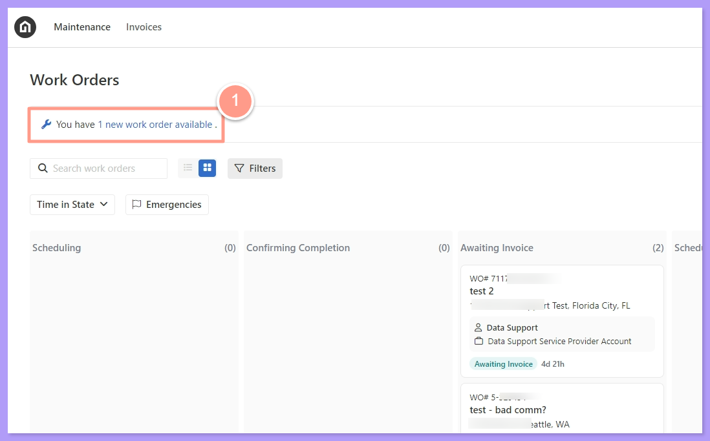
</Frame>

<Steps>
  <Step title="**Click View Work Order**" icon="1" iconType="sharp-solid" stepNumber={1} titleSize="p">
    Clicking the **new jobs available** notification will direct you to the available job page where you can choose which work order you want to accept and schedule by clicking the **View Work Order** icon of the chosen work order.

    <Frame>
      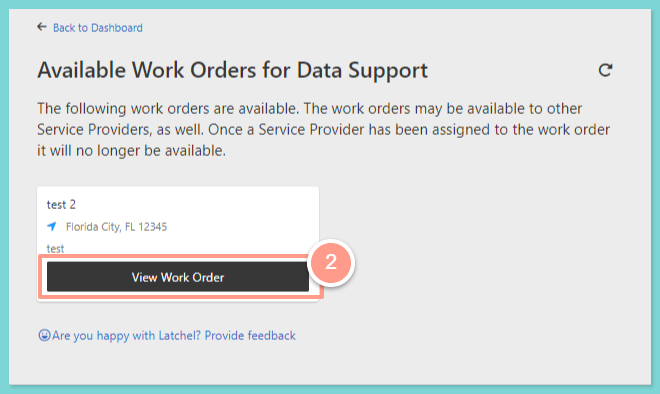
    </Frame>
  </Step>
  <Step title="**Click Accept & Schedule Job**" icon="2" iconType="sharp-solid" stepNumber={2} titleSize="p">
    After analyzing the details of the work order and deciding to accept it, just hit the **Accept & Schedule Job** icon on the upper right side of the page.

    <Frame>
      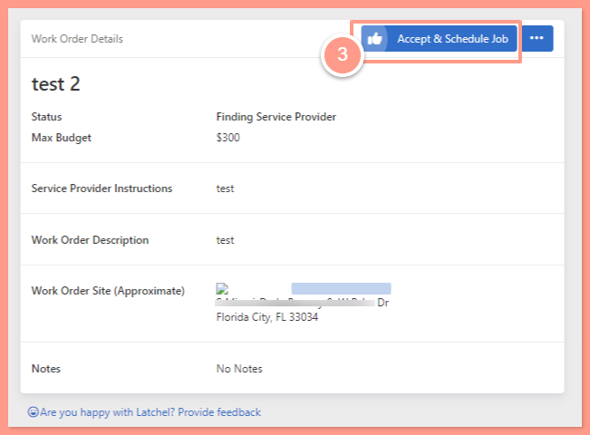
    </Frame>
  </Step>
</Steps>

Now the primary service provider user can choose to which user the work order will be assigned. Either assigning the work order to her/himself or assigning it to another service provider user.

## **Primary Service Provider User**

<Steps>
  <Step title="**Click Myself**" icon="1" iconType="sharp-solid" stepNumber={1} titleSize="p">
    If the primary service provider user would like to assign the work order to her/himself just click the green label that says **Myself** with the corresponding name.

    <Frame>
      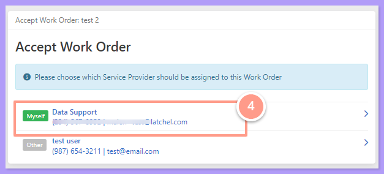
    </Frame>
  </Step>
  <Step title="**Pick a schedule**" icon="2" iconType="sharp-solid" stepNumber={2} titleSize="p">
    Then on the next screen pick a schedule based on the resident's availability.

    <Frame>
      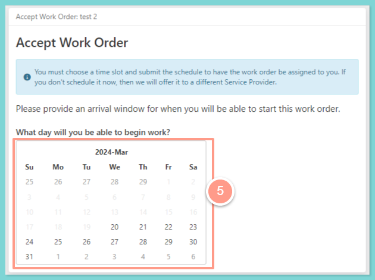
    </Frame>

     

    <Frame>
      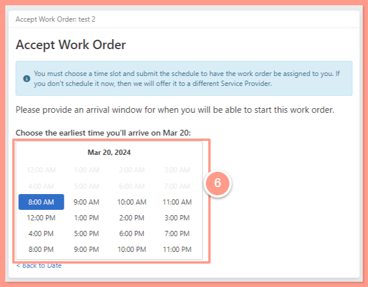
    </Frame>

     

    <Frame>
      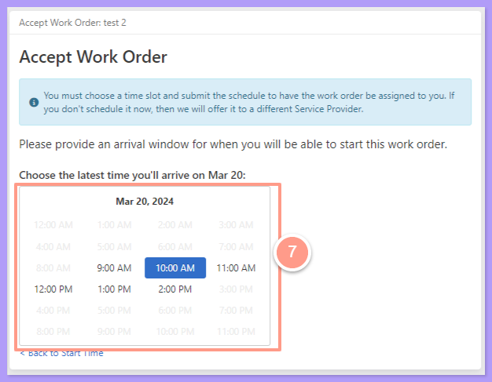
    </Frame>
  </Step>
  <Step title="**Click Submit Schedule**" icon="3" iconType="sharp-solid" stepNumber={3} titleSize="p">
    Now review if you have selected the correct arrival window, and hit **Submit Schedule**.

    <Frame>
      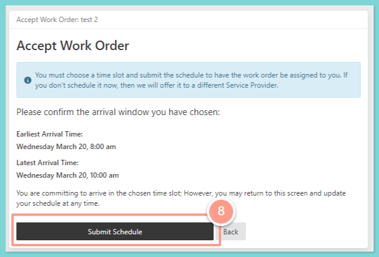
    </Frame>

    <Frame>
      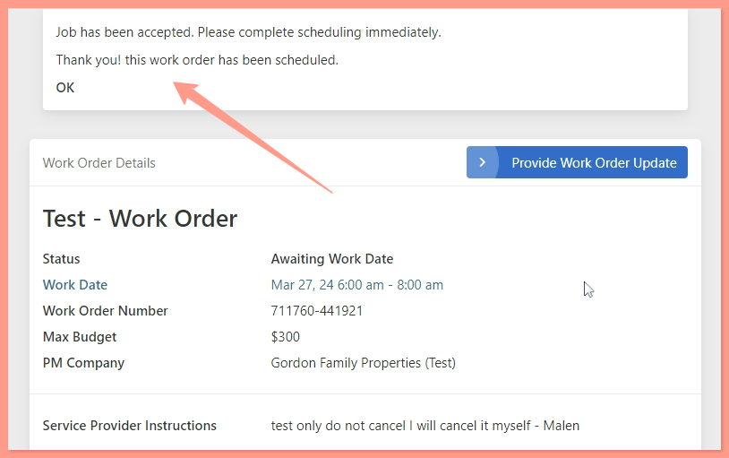
    </Frame>

    Then the work order will be assigned in the **primary service provider user** dashboard under **Scheduled Today** or **Scheduled Later**.

    <Frame>
      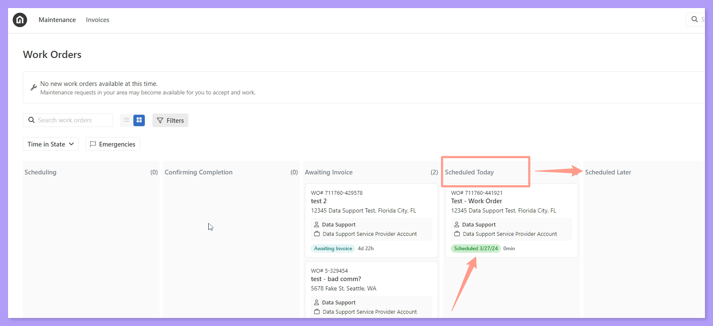
    </Frame>
  </Step>
</Steps>

## **Other Service Provider User**

<Steps>
  <Step title="**Choose the other user**" icon="1" iconType="sharp-solid" stepNumber={1} titleSize="p">
    The primary service provider user can choose **other user** to handle the work order.

    <Frame>
      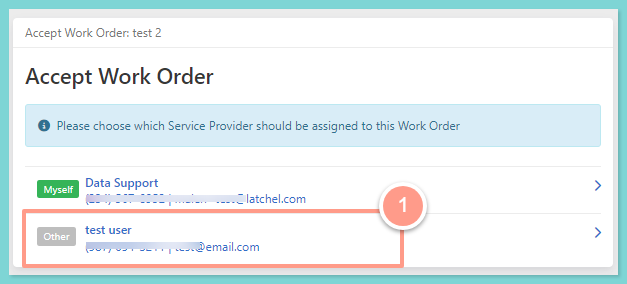
    </Frame>
  </Step>
  <Step title="**Pick a schedule for the user**" icon="2" iconType="sharp-solid" stepNumber={2} titleSize="p">
    On the next screen, the primary service provider user needs to choose a schedule on behalf of the other service provider user based on the resident's availability.

    <Frame>
      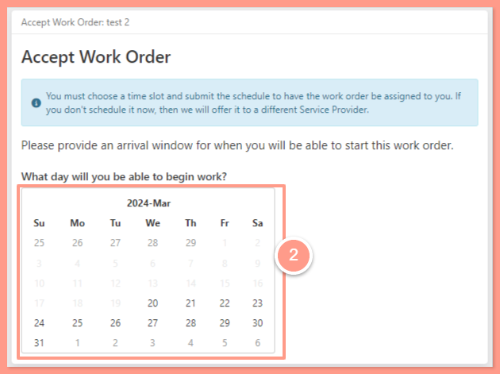
    </Frame>

     

    <Frame>
      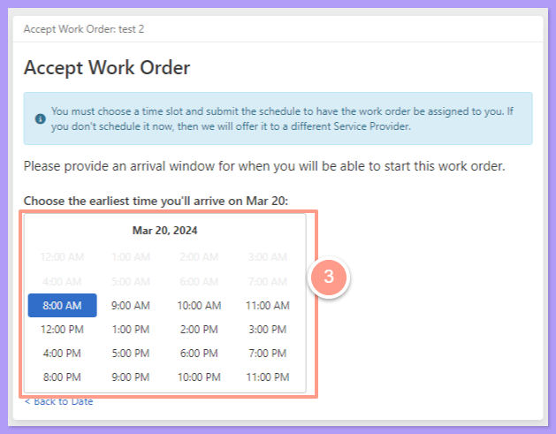
    </Frame>

     

    <Frame>
      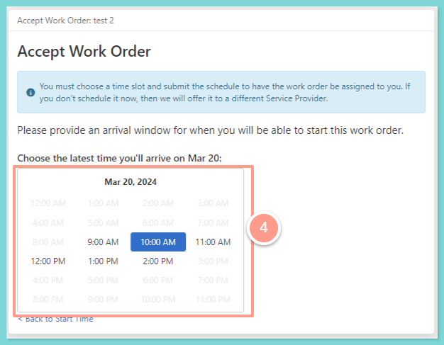
    </Frame>
  </Step>
  <Step title="**Click Submit Schedule**" icon="3" iconType="sharp-solid" stepNumber={3} titleSize="p">
    Then review if the selected schedule is correct and hit **Submit Schedule**.

    <Frame>
      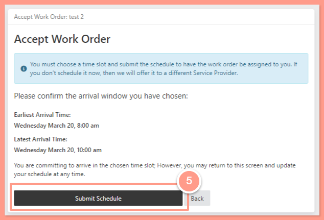
    </Frame>

    Since this work order is scheduled for the **other service provider user**, the work order will be assigned to the dashboard of that other user under **Scheduled Today** or **Scheduled Later** depending on the availability schedule.
  </Step>
</Steps>

And that is how a primary user can accept or schedule a work order for other service providers\!