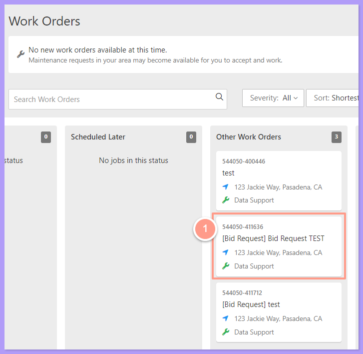
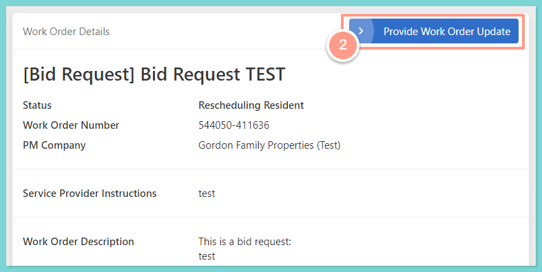
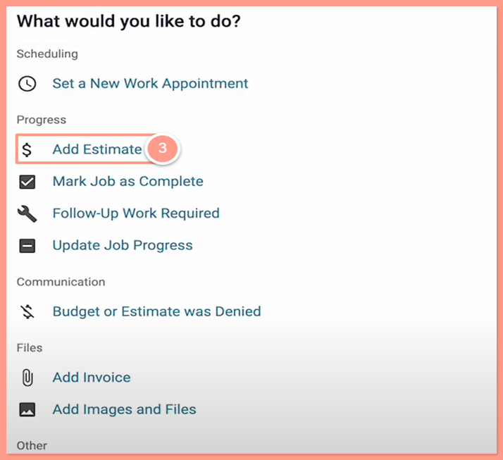
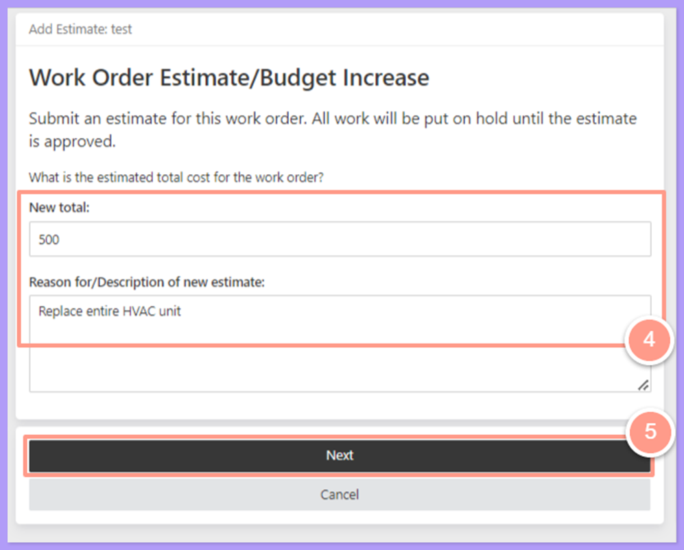
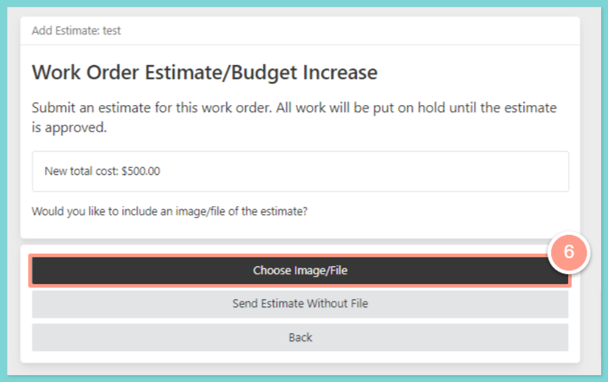
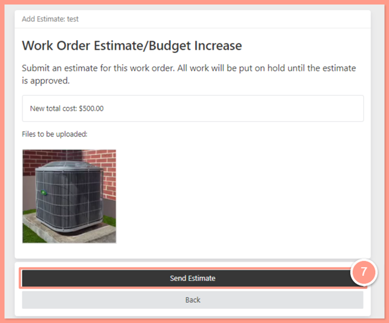
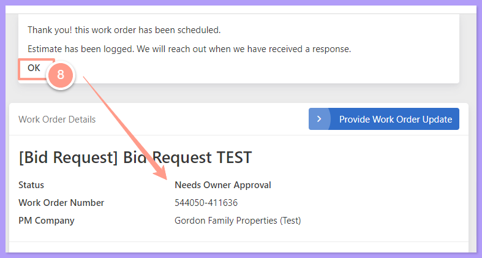

## <Icon icon="camera-movie" iconType="sharp-duotone-solid" color="#ff9b8a" size={25} /> **Quick Video Tutorial: Start here!**

<iframe src="https://www.youtube.com/embed/VBBFZtzyyq0" title="YouTube video player" frameborder="0" className="w-full aspect-video rounded-xl" allow="accelerometer; autoplay; clipboard-write; encrypted-media; gyroscope; picture-in-picture; web-share" allowfullscreen />

## **Steps on Submitting an Estimate or a Bid**

<Steps>
  <Step title="**Click the work order number**" icon="1" iconType="sharp-solid" stepNumber={1} titleSize="p">
    From the Service Provider dashboard, click the **Work Order number** showing under the **Other Work Orders** status.

    <Frame>
      
    </Frame>
  </Step>
  <Step title="**Click Provide Work Order Update**" icon="2" iconType="sharp-solid" stepNumber={2} titleSize="p">
    To submit an estimate, click on **Provide Work Order Update**.

    <Frame>
      
    </Frame>
  </Step>
  <Step title="**Click Add Estimate**" icon="3" iconType="sharp-solid" stepNumber={3} titleSize="p">
    The page will be routed to options available to update the job. Click on **Add Estimate**.

    <Frame>
      
    </Frame>
  </Step>
  <Step title="**Enter the new total and reason**" icon="4" iconType="sharp-solid" stepNumber={4} titleSize="p">
    On this page, you will be asked to provide the estimated total cost for the work order. Type the amount under **New Total** and the reason for the budget increase under **Reason for/Description of new estimate**.

    <Frame>
      
    </Frame>
  </Step>
  <Step title="**Attach images or files**" icon="5" iconType="sharp-solid" stepNumber={5} titleSize="p">
    You can also attach an image or file by clicking on **Choose Image/File**. We highly recommend adding these, as most property managers request this information.

    <Frame>
      
    </Frame>

    **For detailed information on adding an image or a file, check this help guide:**

    <Card title="Adding Images/Files to a Work Order (Service Providers)" icon="image" iconType="duotone" color="#ff9b8a" href="/s/topic/0TO5e000000h9wpGAA/How-to-Add-Images-Files-to-a-Work-Order">
      Upload photos or documents to provide context or proof of completed work.
    </Card>
  </Step>
  <Step title="**Click Send Estimate**" icon="6" iconType="sharp-solid" stepNumber={6} titleSize="p">
    Now that the images and files have been uploaded, you can submit your bid for the Property Manager to review by clicking on **Send Estimate**.

    <Frame>
      
    </Frame>
  </Step>
  <Step title="**Click OK to return**" icon="7" iconType="sharp-solid" stepNumber={7} titleSize="p">
    Notice that the work order status is now **Needs Owner Approval**. To return to the main dashboard page, simply click on **OK**.

    <Frame>
      
    </Frame>

    <Note>
      - If you encounter any difficulties while submitting the estimate through your service provider dashboard, you can send an email to [team@latchel.com](mailto:team@latchel.com).
      - Once the Property Manager approves the job and the resident completes the scheduling, the scheduling functions will be automatically sent to you if you're approved for the job.
    </Note>
  </Step>
</Steps>

## **Send Repair and Replace Options**

If there's more than one way to fix the problem, you can send up to 5 options on one estimate. Each option can be **Repair**, **Replace**, or **Other**, and each has its own price and description. You can mark one option as recommended.

{/* TODO: screenshot of the estimate form with more than one option and one marked as recommended */}

- Options work the same way from the texting link as from your dashboard.
- Photos and files attach to the whole estimate, not to a single option.
- An estimate with one price is reviewed the same way as before. An estimate with more than one option always goes to the property manager, or the owner, to choose from. The price of the option they pick becomes the budget.

## **If You Need Time to Quote**

If you need time to put an estimate together, the work order moves to **Awaiting Estimate** with a due date (3 days by default). Latchel follows up with you automatically.

## **Email Your Estimates and Invoices**

You can also email or forward an estimate to [**estimates@inbox.latchel.com**](mailto:estimates@inbox.latchel.com) or an invoice to [**invoices@inbox.latchel.com**](mailto:invoices@inbox.latchel.com). We find the matching work order and attach it for you.

- Nothing emailed is auto-approved, including invoices.
- If one email covers several work orders, send one email per work order. We won't attach anything from a combined email.
- If we can't place your document, our team reviews it and attaches it by hand.
