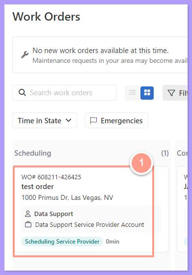
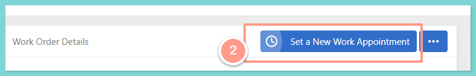
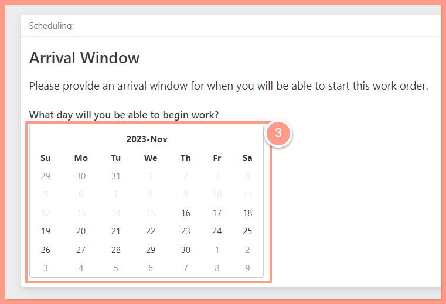
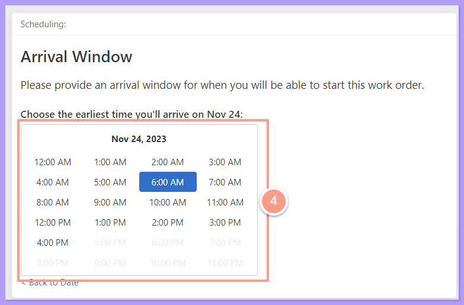
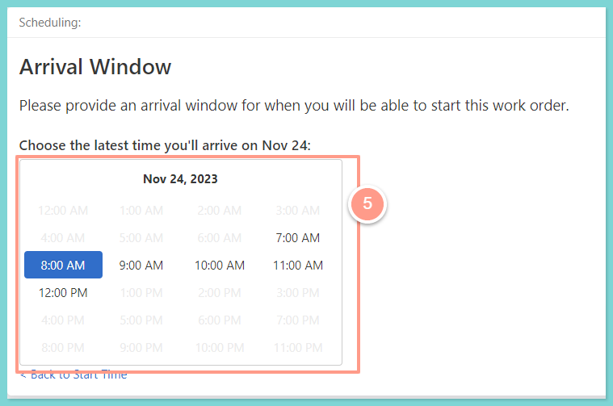
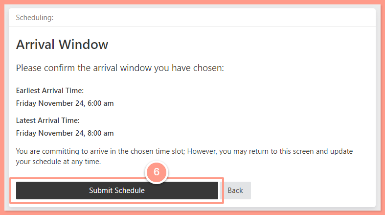
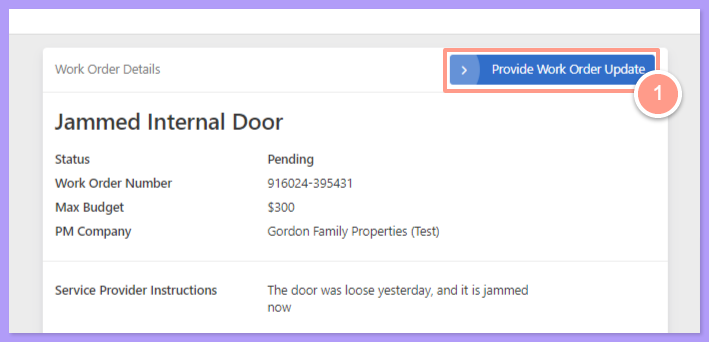
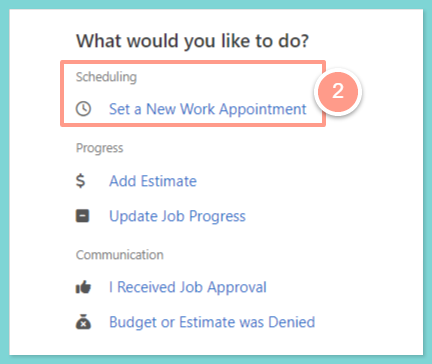
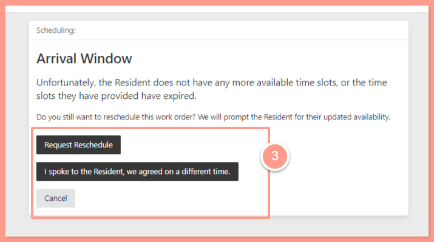

## <Icon icon="camera-movie" iconType="sharp-duotone-solid" color="#ff9b8a" size={25} /> **Quick Video Tutorial: Start here!**

<iframe src="https://www.youtube.com/embed/qEfCaGrBM98" title="YouTube video player" frameborder="0" className="w-full aspect-video rounded-xl" allow="accelerometer; autoplay; clipboard-write; encrypted-media; gyroscope; picture-in-picture; web-share" allowfullscreen />

## **Steps to Reschedule Work Orders**

<Steps>
  <Step title="**Select the work order**" icon="1" iconType="sharp-solid" stepNumber={1} titleSize="p">
    From your dashboard select a work order that needs to be scheduled.

    <Frame>
      
    </Frame>
  </Step>
  <Step title="**Click Set a New Work Appointment**" icon="2" iconType="sharp-solid" stepNumber={2} titleSize="p">
    Then click **Set a New Work Appointment**.

    <Frame>
      
    </Frame>
  </Step>
  <Step title="**Choose an arrival window**" icon="3" iconType="sharp-solid" stepNumber={3} titleSize="p">
    Now from the calendar provide an arrival window (date and time) for when you will be able to start the work order.

    <Frame>
      
    </Frame>

     

    <Frame>
      
    </Frame>

     

    <Frame>
      
    </Frame>
  </Step>
  <Step title="**Click Submit Schedule**" icon="4" iconType="sharp-solid" stepNumber={4} titleSize="p">
    After selecting your desired schedule, review the details and click **Submit Schedule** once confirmed.

    <Frame>
      
    </Frame>
  </Step>
</Steps>

On a more interesting note, another scenario when service providers might need to reschedule arises when the resident is unavailable. Here are the steps to follow in such a case:

<Steps>
  <Step title="**Click Provide Work Order Update**" icon="1" iconType="sharp-solid" stepNumber={1} titleSize="p">
    From the work order status, click on **Provide Work Order Update.**

    <Frame>
      
    </Frame>
  </Step>
  <Step title="**Click Set a New Work Appointment**" icon="2" iconType="sharp-solid" stepNumber={2} titleSize="p">
    From the next window, click on **Set a New Work Appointment.**

    <Frame>
      
    </Frame>
  </Step>
  <Step title="**Click Request Reschedule**" icon="3" iconType="sharp-solid" stepNumber={3} titleSize="p">
    There are three potential scenarios from this point:

    - **Request Reschedule:** The system will advance to request schedule availability.
    - **I spoke to the Resident, we agreed on a different time:** Use this option only when the service provider has been in touch with the resident and has noted their availability. Selecting this option will proceed to the Arrival Window to schedule an appointment.
    - **Cancel:** Choose this to negate the previous action and no changes will be made.

    For this help guide, click on **Request Reschedule.**

    <Frame>
      
    </Frame>

    A prompt will appear indicating that the system has started to collect the resident's availability. Once the resident provides new availability, a notification will be dispatched to the service provider.

    <Frame>
      
    </Frame>
  </Step>
</Steps>

And that's how easy you can reschedule your work order in Latchel!