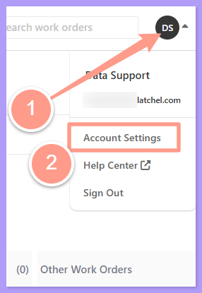
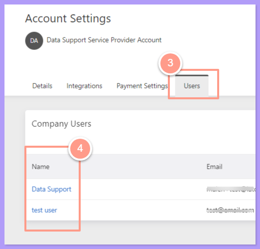
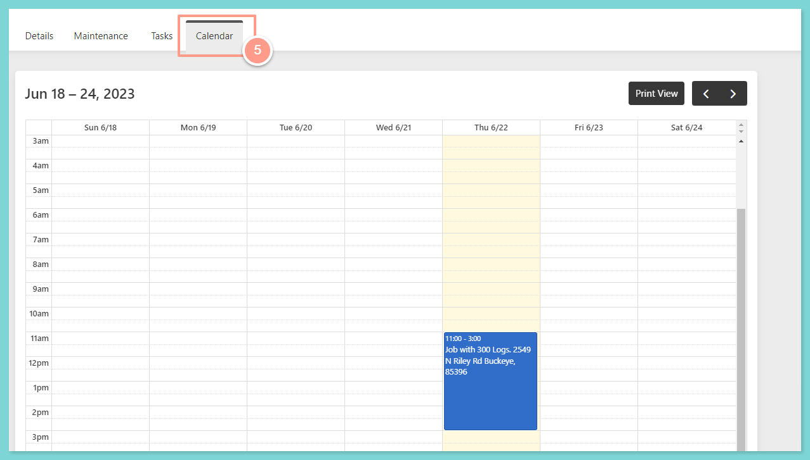
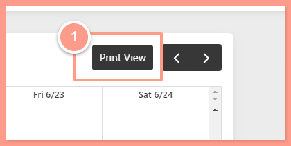
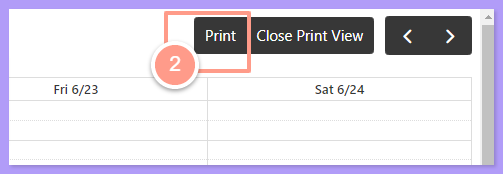

## **Checking your Calendar**

<Steps>
  <Step title="**Open Account Settings**" icon="1" iconType="sharp-solid" stepNumber={1} titleSize="p">
    Sign in to your Latchel service provider email address. From the Service Provider page, click the **initials icon** located at the top right corner, then select **Account Settings** on the dropdown.

    <Frame>
      
    </Frame>
  </Step>
  <Step title="**Select the user**" icon="2" iconType="sharp-solid" stepNumber={2} titleSize="p">
    In the Account Settings page click the **Users** tab. Select which **Service Provider User** you want to view the work order calendar.

    <Frame>
      
    </Frame>
  </Step>
  <Step title="**Click the Calendar tab**" icon="3" iconType="sharp-solid" stepNumber={3} titleSize="p">
    On User's page click the **Calendar** tab, this will display the work order schedule of the specific user.

    <Frame>
      
    </Frame>

    <Note>
      Each work order in the calendar can be clicked and expanded to show the details of the work order and could also direct you to the work order page view.
    </Note>
  </Step>
</Steps>

## **How to Print the Calendar View**

<Steps>
  <Step title="**Click Print View**" icon="1" iconType="sharp-solid" stepNumber={1} titleSize="p">
    On the calendar page, click **Print View** which will give you a larger view of the calendar.

    <Frame>
      
    </Frame>
  </Step>
  <Step title="**Click the Print icon**" icon="2" iconType="sharp-solid" stepNumber={2} titleSize="p">
    Located on the top right corner, click the **Print** icon which enables you to print all of the scheduled work orders for the week.

    <Frame>
      
    </Frame>

    <Check>
      The calendar will always be in the time zone of the person who is viewing the calendar.
    </Check>
  </Step>
</Steps>