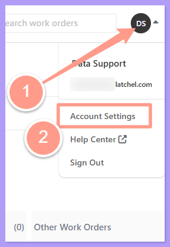
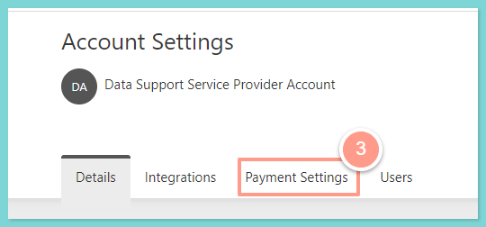
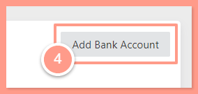
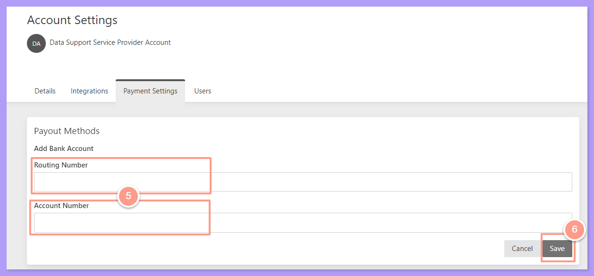

## **How to Add Your Bank Account Information**

<Steps>
  <Step title="**Open Account Settings**" icon="1" iconType="sharp-solid" stepNumber={1} titleSize="p">
    From your dashboard, click the **Dropdown** beside the initial of your account. Then select **Account Settings**.

    <Frame>
      
    </Frame>
  </Step>
  <Step title="**Click the Payment Settings tab**" icon="2" iconType="sharp-solid" stepNumber={2} titleSize="p">
    Now, on the Account Settings page click the **Payment Settings** tab.

    <Frame>
      
    </Frame>
  </Step>
  <Step title="**Click Add Bank Account**" icon="3" iconType="sharp-solid" stepNumber={3} titleSize="p">
    From here, click the **Add Bank Account** icon on the right side of the page.

    <Frame>
      
    </Frame>
  </Step>
  <Step title="**Fill in the details and save**" icon="4" iconType="sharp-solid" stepNumber={4} titleSize="p">
    Then fill in the details needed, and hit **Save**.

    <Frame>
      
    </Frame>
  </Step>
</Steps>

And that's it\! You have successfully added your bank information\!