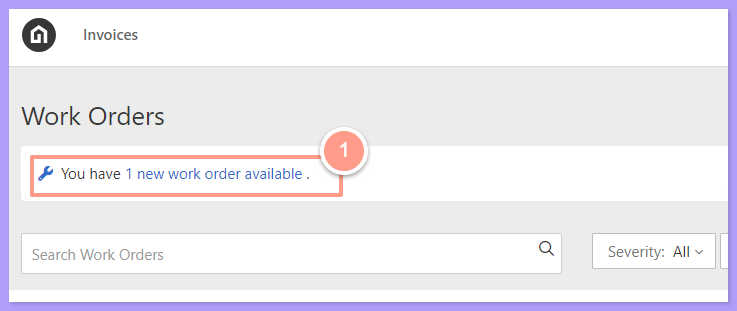
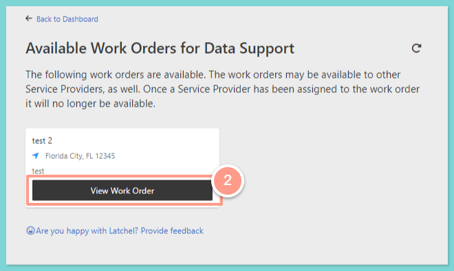
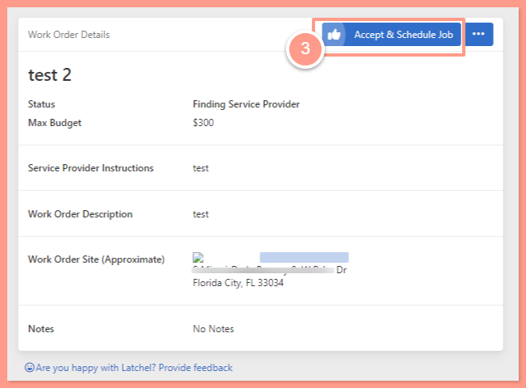
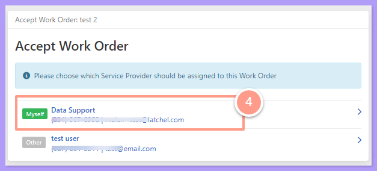
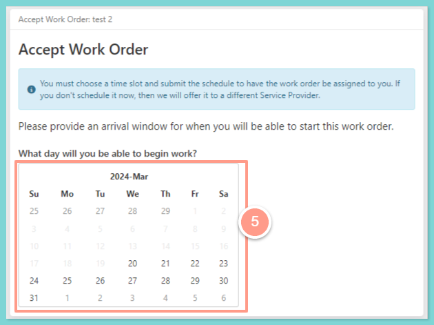
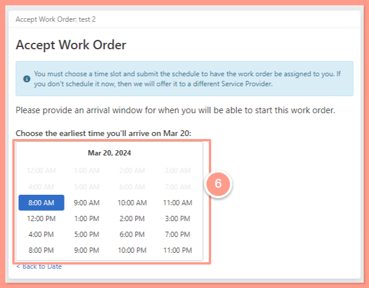
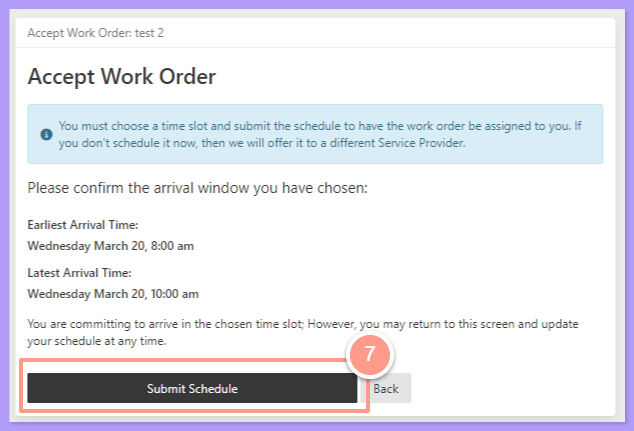

## <Icon icon="camera-movie" iconType="sharp-duotone-solid" color="#ff9b8a" size={25} /> **Quick Video Tutorial: Start here!**

<iframe src="https://www.youtube.com/embed/kDSKEfxrapU" title="YouTube video player" frameborder="0" className="w-full aspect-video rounded-xl" allow="accelerometer; autoplay; clipboard-write; encrypted-media; gyroscope; picture-in-picture; web-share" allowfullscreen />

## **Accepting and Scheduling Work Order**

<Steps>
  <Step title="**Open the new job notification**" icon="1" iconType="sharp-solid" stepNumber={1} titleSize="p">
    If you want to view this work order, in your dashboard you will see a **1 new job available** notification.

    <Frame>
      
    </Frame>

    When you click the notification it will direct you to the page, where all of the available work orders for you to accept and schedule.
  </Step>
  <Step title="**Click View Work Order**" icon="2" iconType="sharp-solid" stepNumber={2} titleSize="p">
    Click **View Work Orde**r, to view the details and other information of the work order.

    <Frame>
      
    </Frame>
  </Step>
  <Step title="**Click Accept & Schedule Job**" icon="3" iconType="sharp-solid" stepNumber={3} titleSize="p">
    Now, after reviewing all the details, hit the **Accept & Schedule Job** button to proceed.

    <Frame>
      
    </Frame>
  </Step>
  <Step title="**Choose the user**" icon="4" iconType="sharp-solid" stepNumber={4} titleSize="p">
    Then choose which **user** will be assigned to the work order. In this instance let's select the **primary user**.

    <Frame>
      
    </Frame>
  </Step>
  <Step title="**Set a schedule**" icon="5" iconType="sharp-solid" stepNumber={5} titleSize="p">
    From here you can accept and set a schedule based on the resident's availability.

    <Frame>
      
    </Frame>

     

    <Frame>
      
    </Frame>

    <Note>
      Aside from the available schedule window you could also select I spoke to the Resident (if you and the resident have another schedule agreement.)
    </Note>
  </Step>
  <Step title="**Click Submit Schedule**" icon="6" iconType="sharp-solid" stepNumber={6} titleSize="p">
    After selecting the schedule, click **Submit Schedule**.

    <Frame>
      
    </Frame>
  </Step>
</Steps>

All set, the work order will move to the Awaiting Work Date status!