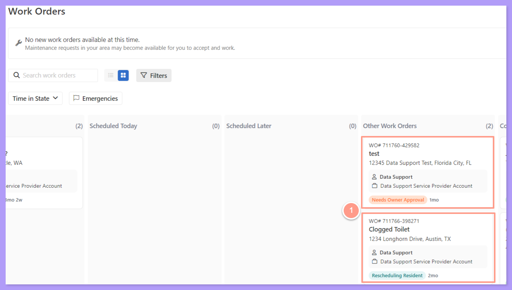
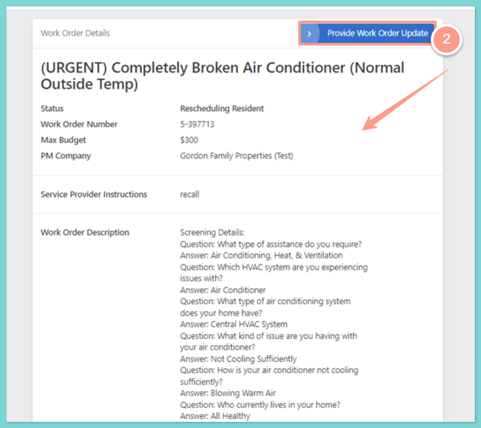
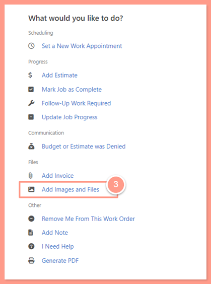
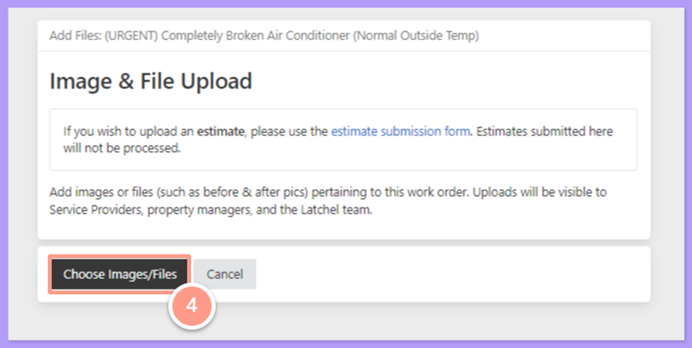
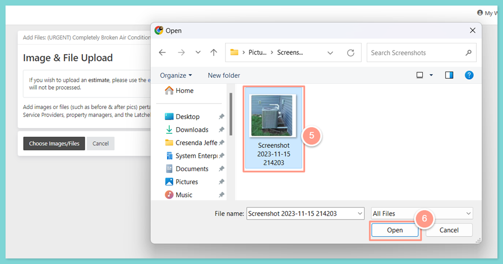
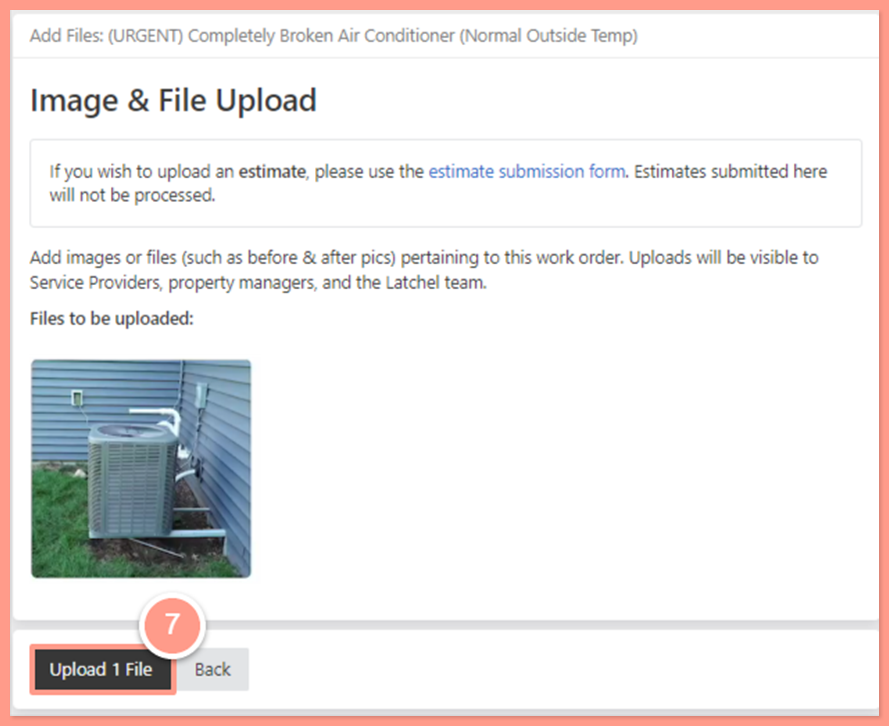
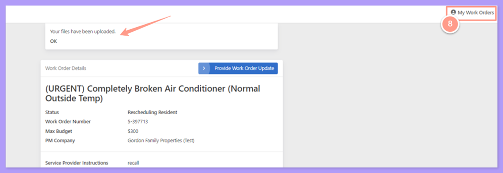

## <Icon icon="camera-movie" iconType="sharp-duotone-solid" color="#ff9b8a" size={25} /> **Quick Video Tutorial: Start here!**

<iframe src="https://www.youtube.com/embed/2x4QlH0tNI4" title="YouTube video player" frameborder="0" className="w-full aspect-video rounded-xl" allow="accelerometer; autoplay; clipboard-write; encrypted-media; gyroscope; picture-in-picture; web-share" allowfullscreen />

## **Steps to Add an Image or File**

<Steps>
  <Step title="**Click the work order number**" icon="1" iconType="sharp-solid" stepNumber={1} titleSize="p">
    From your Service Provider dashboard, click on the Work Order number under **Other Work Orders status.**

    <Frame>
      
    </Frame>
  </Step>
  <Step title="**Click Provide Work Order Update**" icon="2" iconType="sharp-solid" stepNumber={2} titleSize="p">
    The next page will show work order details such as Order number, work order description, etc. Click on **Provide Work Order Update**.

    <Frame>
      
    </Frame>
  </Step>
  <Step title="**Click Add Images and Files**" icon="3" iconType="sharp-solid" stepNumber={3} titleSize="p">
    The page will be routed to options available to update the job. Click on **Add Images and Files**.

    <Frame>
      
    </Frame>
  </Step>
  <Step title="**Click Choose Images/Files**" icon="4" iconType="sharp-solid" stepNumber={4} titleSize="p">
    On the next page, click on **Choose Images/Files** to insert photos or files. This will open your computer folders.

    <Frame>
      
    </Frame>
  </Step>
  <Step title="**Choose the files and click Open**" icon="5" iconType="sharp-solid" stepNumber={5} titleSize="p">
    From the list of your computer folders, choose the appropriate file or photos, then click on **Open**.

    <Frame>
      
    </Frame>
  </Step>
  <Step title="**Click Upload**" icon="6" iconType="sharp-solid" stepNumber={6} titleSize="p">
    Click on **Upload 1** File to continue.

    <Frame>
      
    </Frame>

    <Note>
      Multiple files can be uploaded like the before and after images of the job. An estimate or bid should not be submitted here otherwise, it will not be processed. Use the estimate submission form instead.
    </Note>
  </Step>
  <Step title="**Return with My Work Orders**" icon="7" iconType="sharp-solid" stepNumber={7} titleSize="p">
    A notification will show that **"Your files** **have been uploaded"**. To go back to the main dashboard, click on **My Work Orders.**

    <Frame>
      
    </Frame>
  </Step>
</Steps>

And that's how easy you can add an image or a file on a work order!