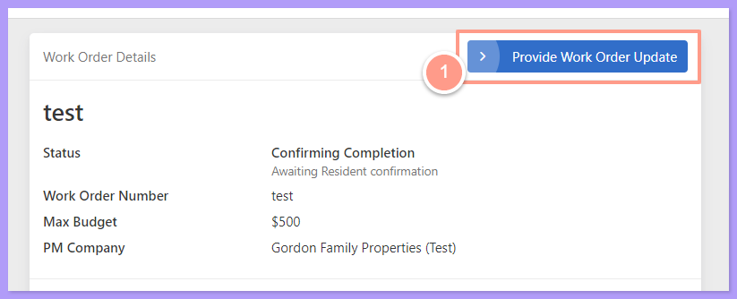
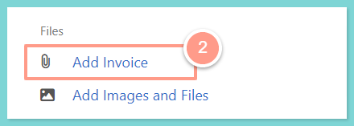
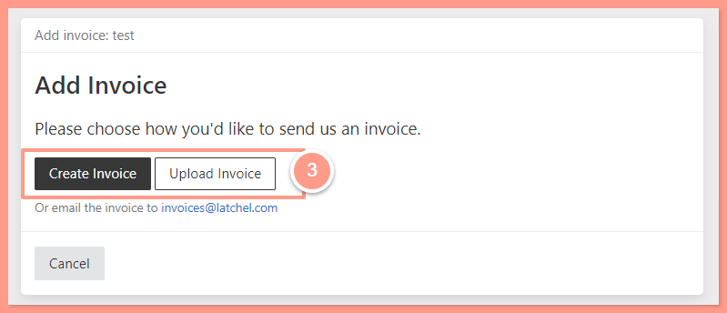
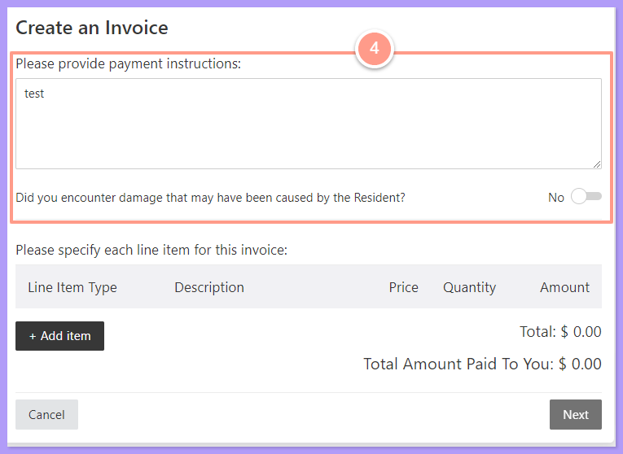
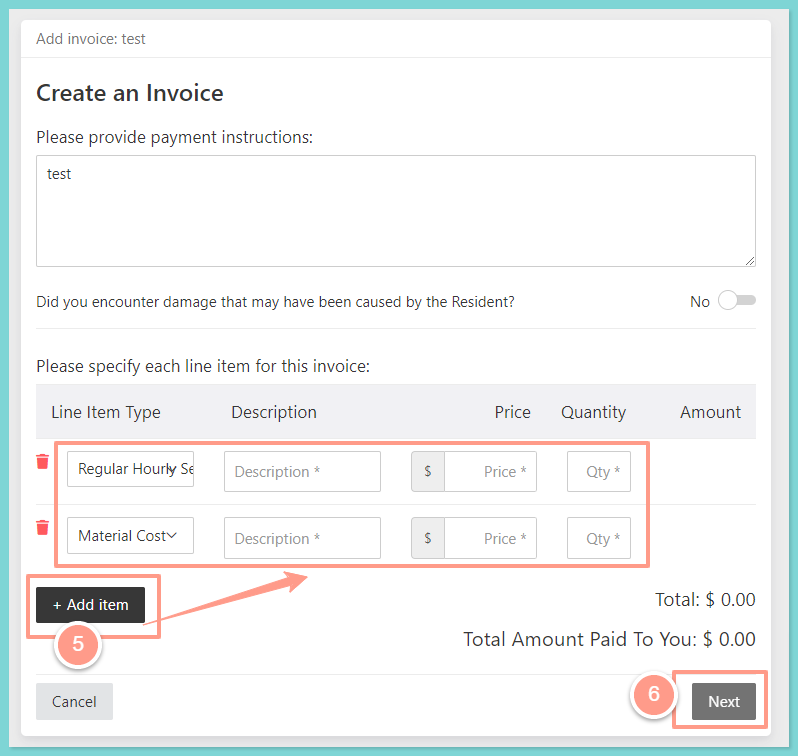
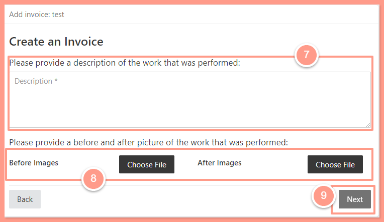
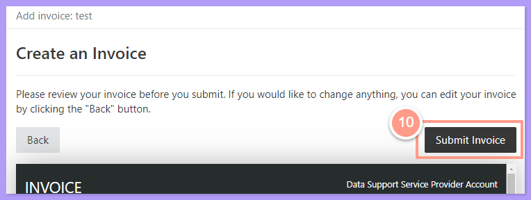
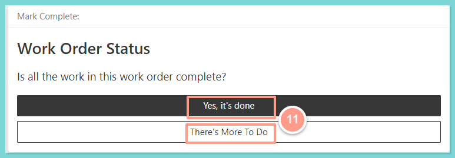

## <Icon icon="camera-movie" iconType="sharp-duotone-solid" color="#ff9b8a" size={25} /> **Quick Video Tutorial: Start Here!**

<iframe src="https://www.youtube.com/embed/bmP1sSpkfdw" title="YouTube video player" frameborder="0" className="w-full aspect-video rounded-xl" allow="accelerometer; autoplay; clipboard-write; encrypted-media; gyroscope; picture-in-picture; web-share" allowfullscreen />

## **Steps to Create an Invoice**

<Steps>
  <Step title="**Click Provider Work Order Update, then Add Invoice**" icon="1" iconType="sharp-solid" stepNumber={1} titleSize="p">
    From your work order page click the **Provider Work Order Update** button located at the top right side of the page. Then select **Add Invoice**.

    <Frame>
      
    </Frame>

    <Frame>
      
    </Frame>
  </Step>
  <Step title="**Choose to upload or create an invoice**" icon="2" iconType="sharp-solid" stepNumber={2} titleSize="p">
    You could either **Upload Invoice** to upload the image of the file or **Create an Invoice**.

    <Frame>
      
    </Frame>
  </Step>
  <Step title="**Add payment instructions**" icon="3" iconType="sharp-solid" stepNumber={3} titleSize="p">
    If you click **Create Invoice**, you can provide payment instructions. In case you encounter damage caused by the resident, you may toggle the switch just across the question about resident-caused damage.

    <Frame>
      
    </Frame>
  </Step>
  <Step title="**Add your line items**" icon="4" iconType="sharp-solid" stepNumber={4} titleSize="p">
    Next, click the **\+Add Item** to specify the line item in your invoice and click **Next**.

    <Frame>
      
    </Frame>
  </Step>
  <Step title="**Describe the work and add photos**" icon="5" iconType="sharp-solid" stepNumber={5} titleSize="p">
    Then describe the work performed. Upload the **Before** and **After** images of the job, and hit **Next**.

    <Frame>
      
    </Frame>
  </Step>
  <Step title="**Review and submit the invoice**" icon="6" iconType="sharp-solid" stepNumber={6} titleSize="p">
    Now you can see the generated invoice overview and check if the details are all correct, then click **Submit Invoice**.

    <Frame>
      
    </Frame>
  </Step>
  <Step title="**Update the work order status**" icon="7" iconType="sharp-solid" stepNumber={7} titleSize="p">
    Provide the work order status if **Yes, it's done** (to mark the work order as complete) or **There's More To Do** (provide information on what is needed to complete). 

    <Frame>
      
    </Frame>
  </Step>
</Steps>

And that's it! You have successfully created an invoice for your completed work order! You may also check the video below for a clearer vision of the steps!