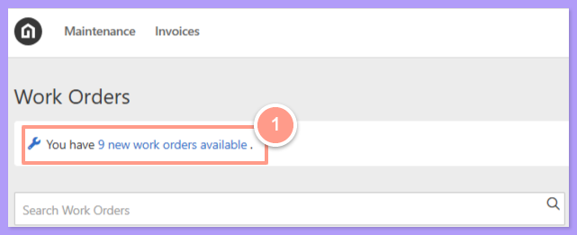
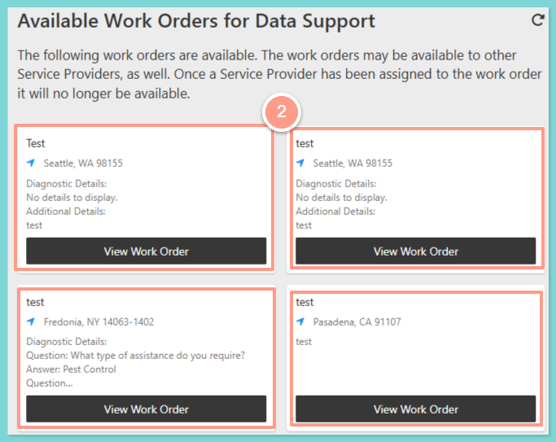
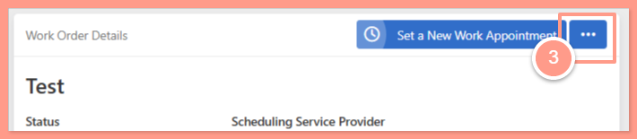
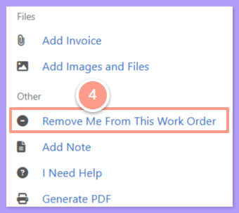
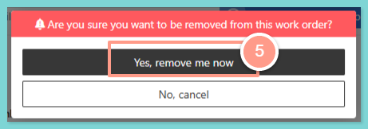
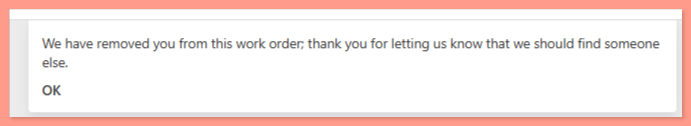

## **How to Reject a Work Order (Service Provider)**

<Steps>
  <Step title="**Log in to your dashboard**" icon="1" iconType="sharp-solid" stepNumber={1} titleSize="p">
    First, **login to your Latchel dashboard** by following the steps in:

    <Card title="Accessing Your Latchel Portal (Service Providers)" icon="chalkboard-user" iconType="duotone" color="#ff9b8a" href="/s/topic/0TO5e000000h9wpGAA/Accessing-your-Latchel-portal">
      Learn how to log into your Latchel portal and access your account.
    </Card>
  </Step>
  <Step title="**Find the new work orders**" icon="2" iconType="sharp-solid" stepNumber={2} titleSize="p">
    If you want to reject a work order, go to your dashboard you will see a **number of new work orders available**.

    <Frame>
      
    </Frame>
  </Step>
  <Step title="**Select the work order**" icon="3" iconType="sharp-solid" stepNumber={3} titleSize="p">
    **Select** the work order you want to reject.

    <Frame>
      
    </Frame>
  </Step>
  <Step title="**Click the ellipsis**" icon="4" iconType="sharp-solid" stepNumber={4} titleSize="p">
    Click the **ellipsis** at the top right of the work order page.

    <Frame>
      
    </Frame>
  </Step>
  <Step title="**Click Remove Me From This Work Order**" icon="5" iconType="sharp-solid" stepNumber={5} titleSize="p">
    From the list of option on the page, click the **Remove Me From This Work Order**.

    <Frame>
      
    </Frame>
  </Step>
  <Step title="**Select Yes, remove me now**" icon="6" iconType="sharp-solid" stepNumber={6} titleSize="p">
    Then select **Yes, remove me now**.

    <Frame>
      
    </Frame>

     

    <Frame>
      
    </Frame>
  </Step>
</Steps>

And that's how you can reject a work order\! 
