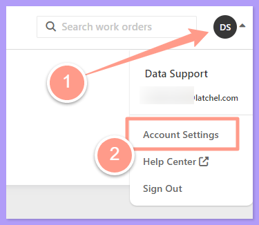
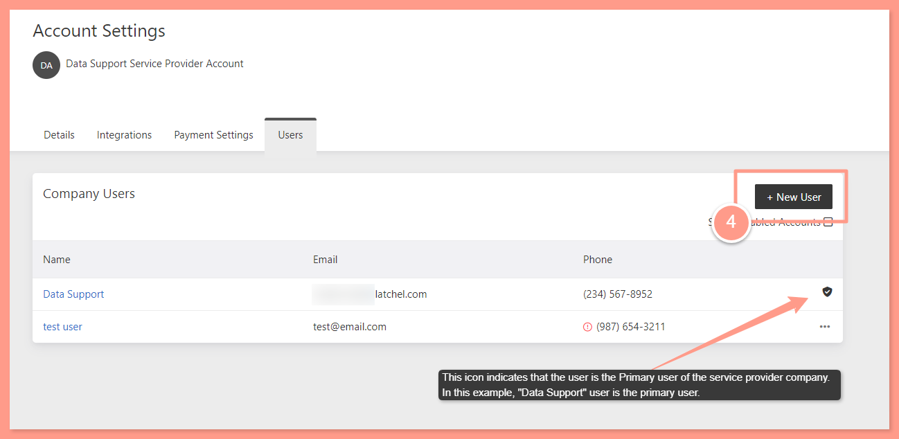
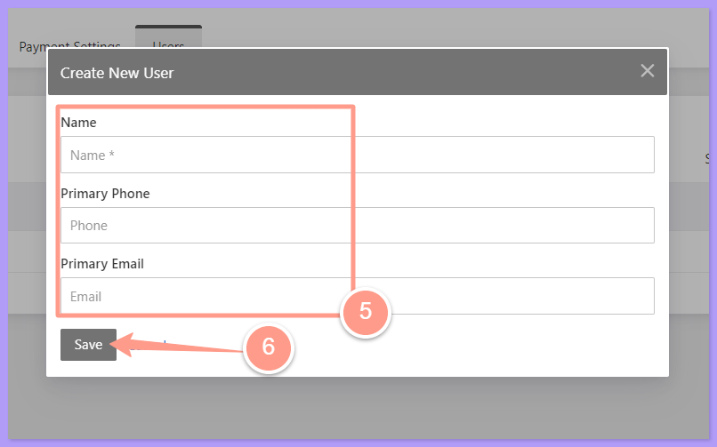
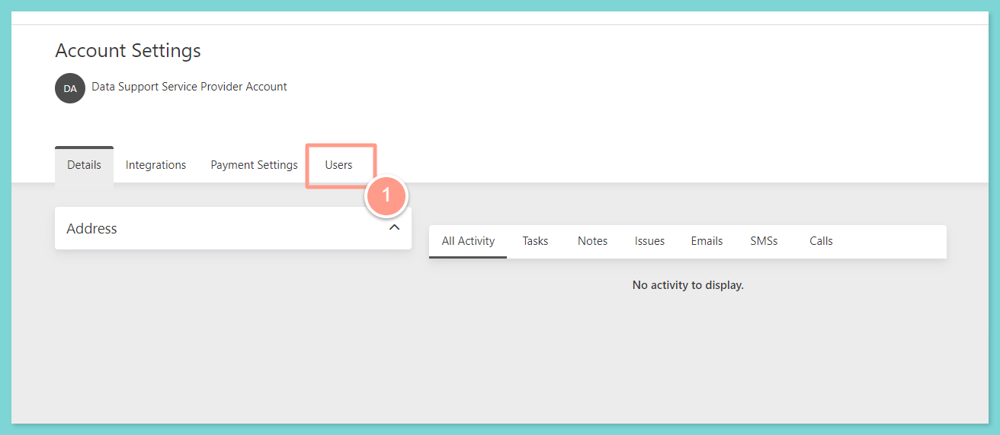
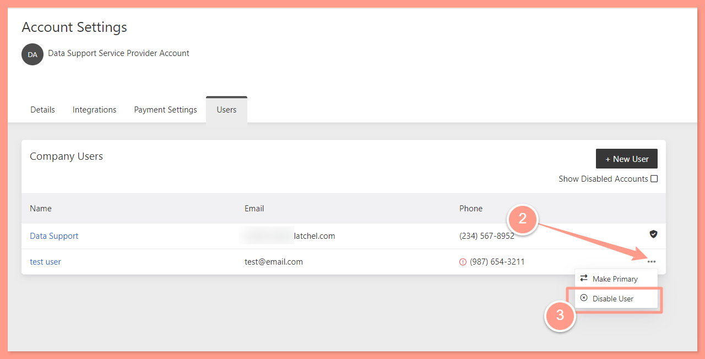
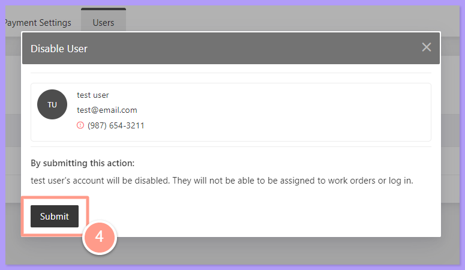
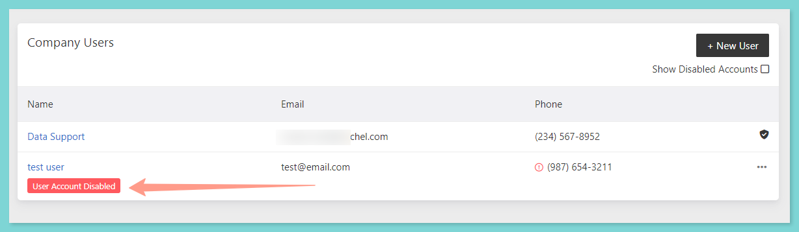
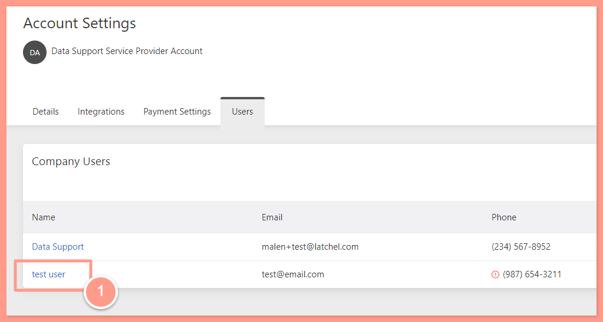
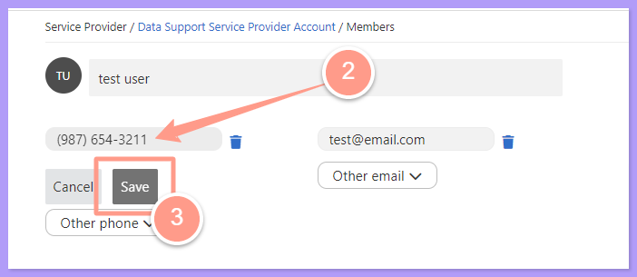
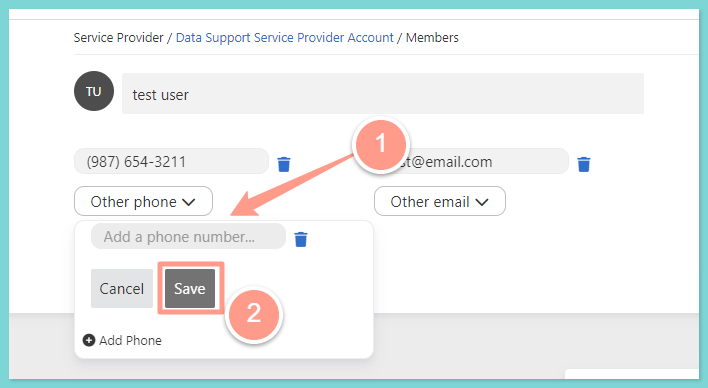

## **Adding New Service Provider User**

<Steps>
  <Step title="**Log in to your dashboard**" icon="1" iconType="sharp-solid" stepNumber={1} titleSize="p">
    First, **login to your Latchel dashboard** by following the steps in:

    <Card title="Accessing Your Latchel Portal (Service Providers)" icon="chalkboard-user" iconType="duotone" color="#ff9b8a" href="/s/topic/0TO5e000000h9wpGAA/Accessing-your-Latchel-portal">
      Learn how to log into your Latchel portal and access your account.
    </Card>
  </Step>
  <Step title="**Open Account Settings**" icon="2" iconType="sharp-solid" stepNumber={2} titleSize="p">
    Once logged in, click your **user icon** at the top right corner of your dashboard, then choose **Account Settings**.

    <Frame>
      
    </Frame>
  </Step>
  <Step title="**Click the User tab**" icon="3" iconType="sharp-solid" stepNumber={3} titleSize="p">
    In the Account Settings page, click the **User** tab.

    <Frame>
      
    </Frame>
  </Step>
  <Step title="**Click +New User**" icon="4" iconType="sharp-solid" stepNumber={4} titleSize="p">
    From there, you will see the list of all your company users if there are multiple. Note that the user with the shield icon is the Primary user of the company. Click **\+New User** to add new service provider user.

    <Frame>
      
    </Frame>

    <Note>
      Primary user acts as the admin of the service provider company. This user has the capability to schedule work orders to other users within the company.
    </Note>
  </Step>
  <Step title="**Add the user details and save**" icon="5" iconType="sharp-solid" stepNumber={5} titleSize="p">
    Finally, add the **name** of the new user, the **primary email**, and primary **contact number**. Click **Save** once done.

    <Frame>
      
    </Frame>
  </Step>
</Steps>

## **Disabling a User**

<Steps>
  <Step title="**Go to Account Settings and select User**" icon="1" iconType="sharp-solid" stepNumber={1} titleSize="p">
    After logging in to your dashboard, go to your **Account Settings** then select **User**.

    <Frame>
      
    </Frame>
  </Step>
  <Step title="**Choose Disable user**" icon="2" iconType="sharp-solid" stepNumber={2} titleSize="p">
    From there, you will see all your users listed. Find the service provider user you need to delete. Click the **3 dots** across the name of the user then choose **Disable user**.

    <Frame>
      
    </Frame>
  </Step>
  <Step title="**Click Submit**" icon="3" iconType="sharp-solid" stepNumber={3} titleSize="p">
    Finally, click **Submit** to make the changes.

    <Frame>
      
    </Frame>

    A **red banner** will appear below the user's name indicating that the user is now disabled. 

    <Frame>
      
    </Frame>

    <Note>
      Once the user is disabled, you may not be able to assign any work orders for the user. In the same manner, the user may not be able to assign himself to any work orders or login to its dashboard.
    </Note>
  </Step>
</Steps>

To **enable a user**, you may follow the same steps above. Choose **Enable user**, then click **Submit**. The red banner on the user's name will disappear after enabling the user.

## **Updating Service Provider User's Contact Information**

<Steps>
  <Step title="**Click the user name**" icon="1" iconType="sharp-solid" stepNumber={1} titleSize="p">
    To update the user's contact information, clicked the **hyperlinked name** of the user.

    <Frame>
      
    </Frame>
  </Step>
  <Step title="**Update the contact details**" icon="2" iconType="sharp-solid" stepNumber={2} titleSize="p">
    Tap in the **box** of either the **phone number** or the **email address** whichever you must need to update. **Add** the new contact information then click **Save**.

    <Frame>
      
    </Frame>
  </Step>
  <Step title="**Add other phones or emails**" icon="3" iconType="sharp-solid" stepNumber={3} titleSize="p">
    You may also add multiple phone numbers or email addresses. To do this, click **Other phone** or **Other email**, **add** **the secondary phone or email address**, then click **Save**.

    <Frame>
      
    </Frame>
  </Step>
</Steps>

As the primary user of your service provider company, you also have the privilege of viewing and managing their calendar for effective scheduling of work orders within your company. **To learn more, check this help guide:**

<Card title="Viewing Work Order Calendar (Service Providers)" icon="calendar-circle-user" iconType="duotone" color="#ff8b8a" href="/s/topic/0TO5e000000h9wpGAA/How-Service-Providers-View-their-Work-Order-Calendar">
  Learn to view or manage your scheduled jobs in calendar view.
</Card>

And that's how easy you can manage your service provider users within your company account settings\! 