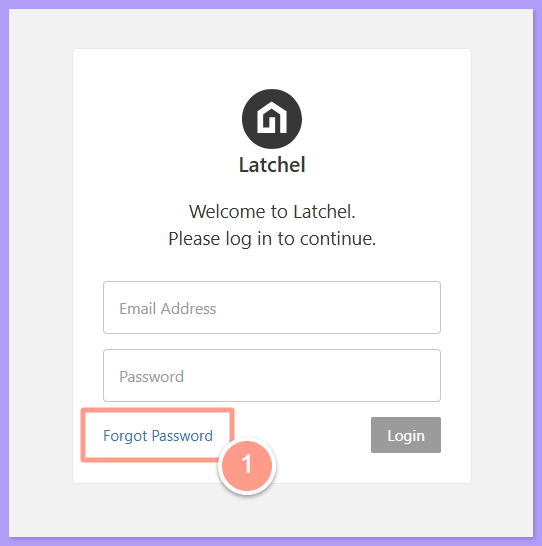
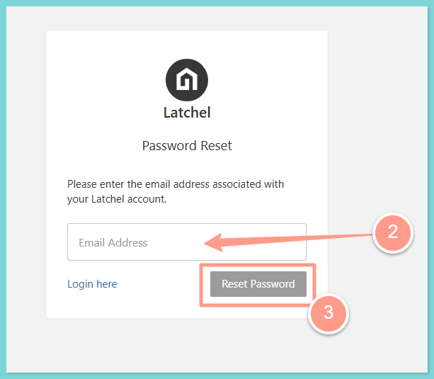
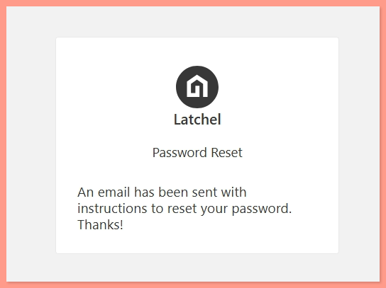
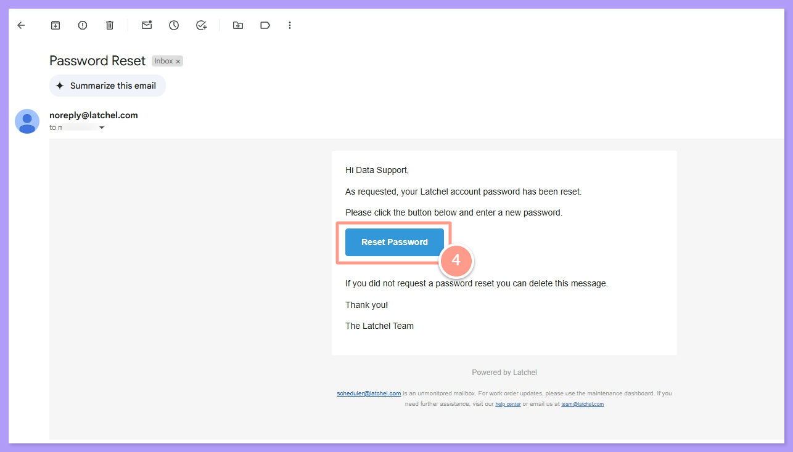
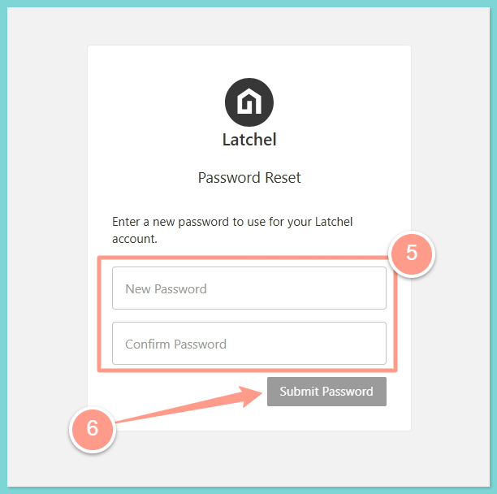
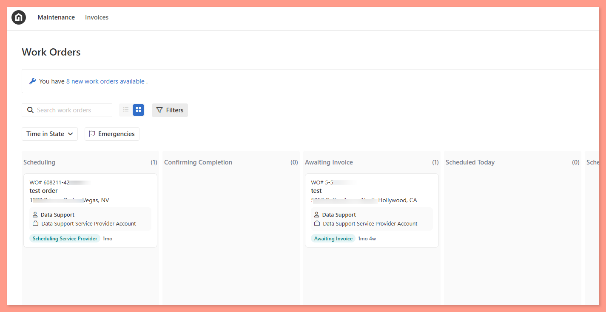

## **Steps to Reset Password**

<CardGroup cols={2}>
  <Card title="Need resetting your password? Click here!" icon="shield-keyhole" color="#ff9b8a" horizontal href="https://app.latchel.com/login">
    
  </Card>
</CardGroup>

<Steps>
  <Step title="**Click Forgot Password**" icon="1" iconType="sharp-solid" stepNumber={1} titleSize="p">
    Click the button above. Then, click **Forgot Password**.

    <Frame>
      
    </Frame>
  </Step>
  <Step title="**Enter your email address**" icon="2" iconType="sharp-solid" stepNumber={2} titleSize="p">
    Enter the **email address** associated with your Latchel account, then click **Reset Password**.

    <Frame>
      
    </Frame>

    A confirmation message will appear, indicating that an email with reset instructions has been sent.

    <Frame>
      
    </Frame>
  </Step>
  <Step title="**Open the reset email**" icon="3" iconType="sharp-solid" stepNumber={3} titleSize="p">
    Check your inbox for an email from Latchel containing a password reset link. Open the email and click Reset Password.

    <Frame>
      
    </Frame>
  </Step>
  <Step title="**Set your new password**" icon="4" iconType="sharp-solid" stepNumber={4} titleSize="p">
    In the new tab that opens, **enter your new password**, then **re-enter it to confirm**. Click **Submit Password** to complete the reset process. You will then be taken to your

    <Frame>
      
    </Frame>

    <Tip>
      Your new password must include at least **one uppercase letter**, **one lowercase letter**, and **a special character**.
    </Tip>

    Once completed, you will be redirected to your **Work Orders** page in Latchel.

    <Frame>
      
    </Frame>
  </Step>
</Steps>

And that's how easy you can reset your password\!