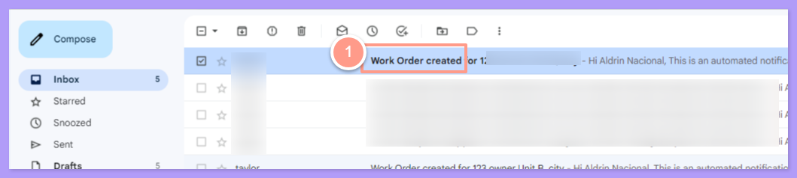
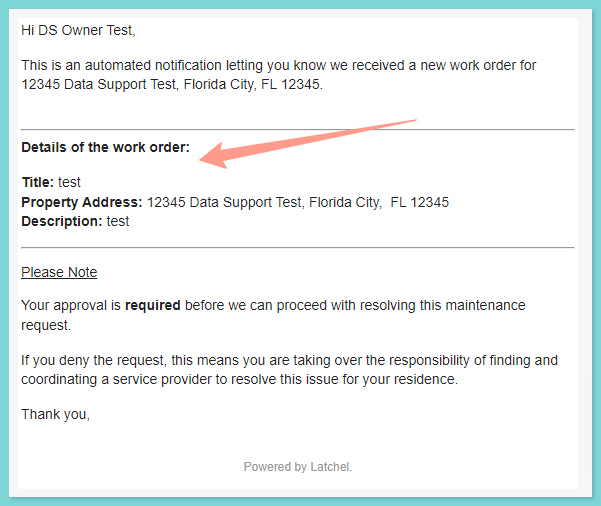
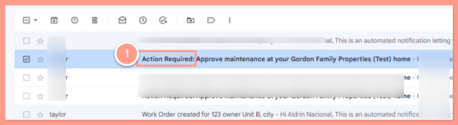
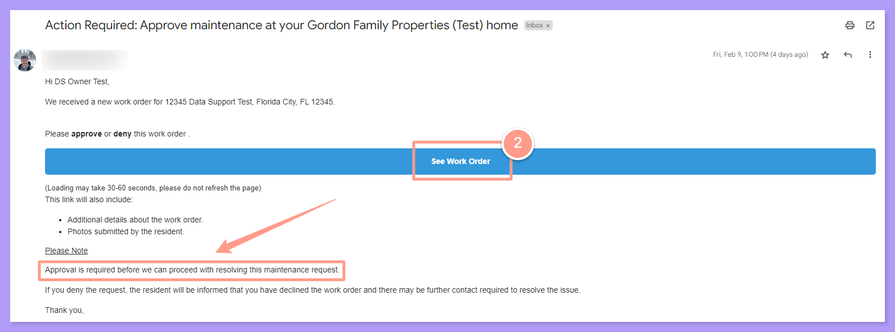
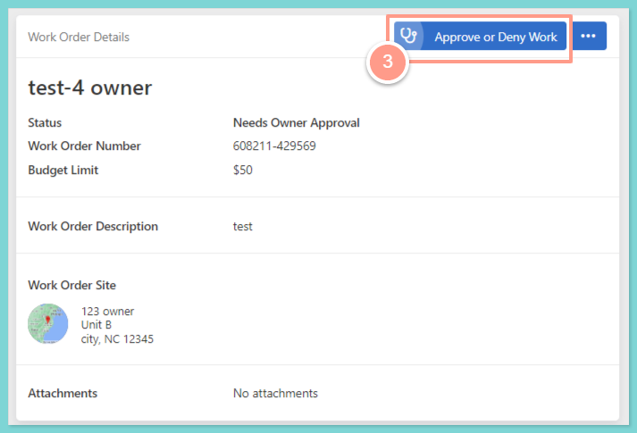
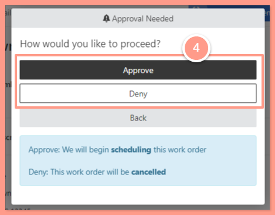
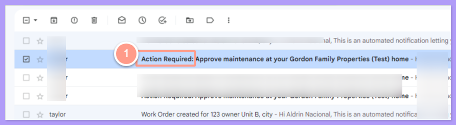
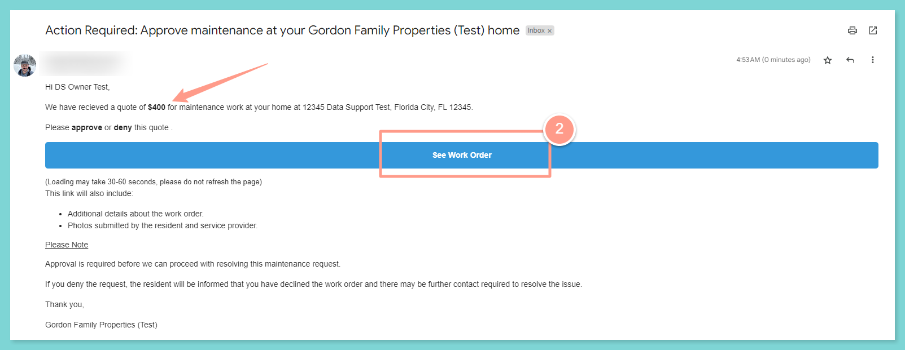
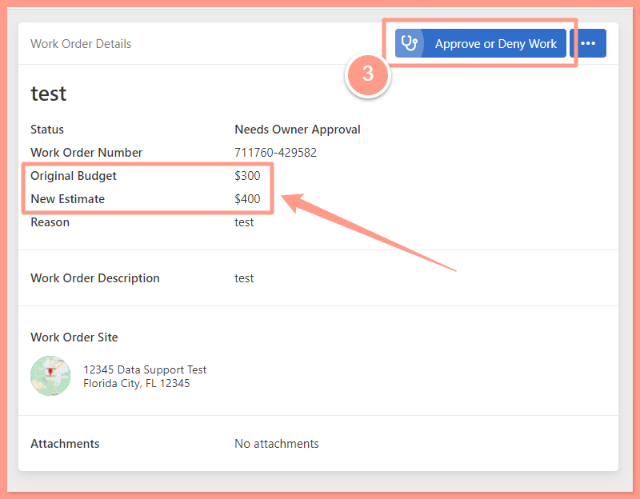
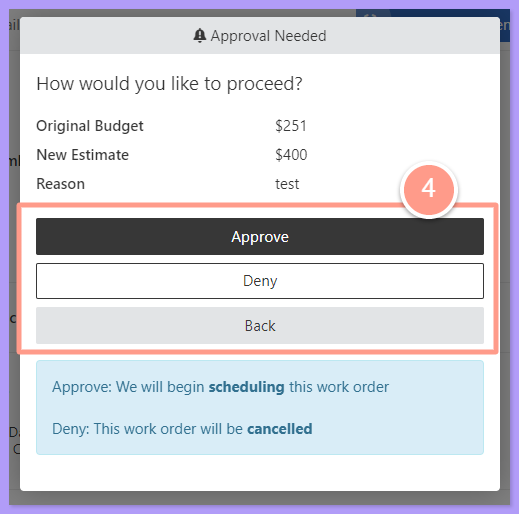

**Owners are notified when:**

* When a work order is created.

* Require pre-approval for new work orders.

* Require approval for budget increases.

## **When a Work Order Created**

If this setting is turned on, you will receive an email notification every time a work order is created.

To view the details, click on the email you received with the subject **Work Order Created**. Please note that you do not need to take any action in this email; it is solely sent to inform you about the details of the work order created for your property.

<Frame>
  
</Frame>

 

<Frame>
  
</Frame>

## **Approving a Work Order**

If this setting is turned on, new work orders for your properties will require approval before proceeding with the maintenance.

<Steps>
  <Step title="**Open the Action Required email**" icon="1" iconType="sharp-solid" stepNumber={1} titleSize="p">
    To view the details, click on the email you received with the subject **Action Required**.

    <Frame>
      
    </Frame>
  </Step>
  <Step title="**Select See Work Order**" icon="2" iconType="sharp-solid" stepNumber={2} titleSize="p">
    Then select **See Work Order** highlighted in blue located in the center of the email.

    <Frame>
      
    </Frame>
  </Step>
  <Step title="**Click Approve or Deny Work**" icon="3" iconType="sharp-solid" stepNumber={3} titleSize="p">
    You will be directed to a new window where you can Approve or Deny the work order. To take action, click the **Approve or Deny Work** button located in the upper right corner.

    <Frame>
      
    </Frame>
  </Step>
  <Step title="**Approve or deny the work order**" icon="4" iconType="sharp-solid" stepNumber={4} titleSize="p">
    Then hit **Approve** and the work order will proceed to scheduling, or **Deny** then the work order will be canceled.

    <Frame>
      
    </Frame>
  </Step>
</Steps>

## **Approving a Budget Increase**

If this is turned on, you will be notified when a new budget is requested that is over the set limit in the property.

<Steps>
  <Step title="**Open the Action Required email**" icon="1" iconType="sharp-solid" stepNumber={1} titleSize="p">
    Click the email that you have received with the subject Action Required to view the details.

    <Frame>
      
    </Frame>
  </Step>
  <Step title="**Select See Work Order**" icon="2" iconType="sharp-solid" stepNumber={2} titleSize="p">
    In the email, the requested budget is indicated. Select **See Work Order** highlighted in blue located in the center of the email to take action.

    <Frame>
      
    </Frame>
  </Step>
  <Step title="**Review the budget and click Approve or Deny Work**" icon="3" iconType="sharp-solid" stepNumber={3} titleSize="p">
    You will be directed to a new window. Review the **Budget Limit** and click the **Approve or Deny Work** button located at the upper right corner to take action.

    <Frame>
      
    </Frame>
  </Step>
  <Step title="**Approve or deny the new budget**" icon="4" iconType="sharp-solid" stepNumber={4} titleSize="p">
    Then, click **Approve** to continue with the new budget requested, or **Deny** then the work order will be canceled.

    <Frame>
      
    </Frame>
  </Step>
</Steps>

And that's how easy to manage the work orders on your owned property!