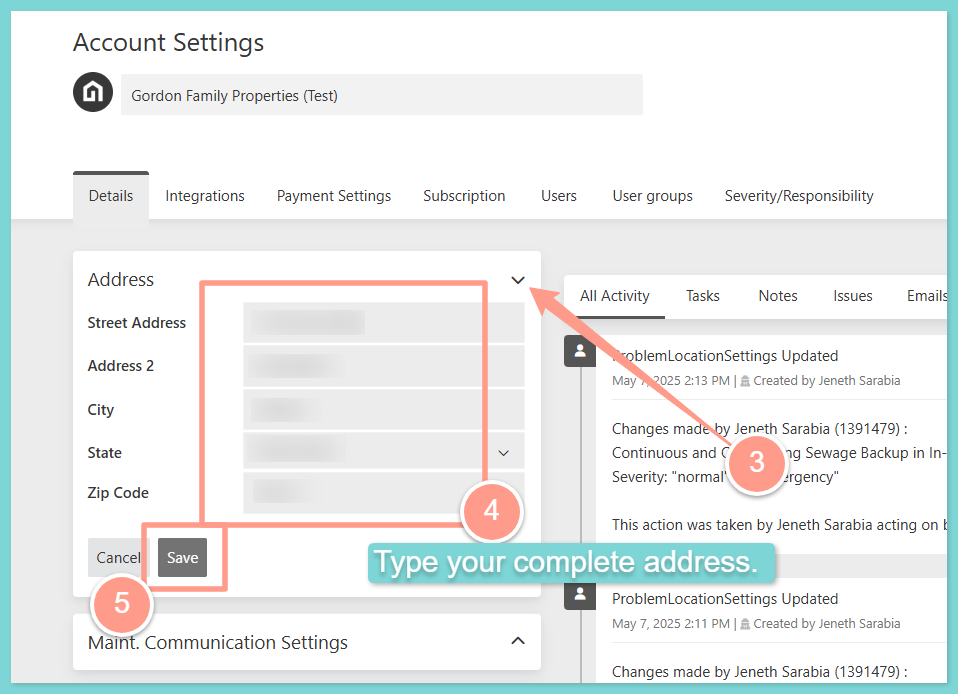

## **How to Add Your Company Address**

<Steps>
  <Step title="**Open Account Settings**" icon="1" iconType="sharp-solid" stepNumber={1} titleSize="p">
    Access your **Account Settings** by clicking your **user icon** at the far right corner of your dashboard.

    <Frame>
      
    </Frame>
  </Step>
  <Step title="**Add your address and click Save**" icon="2" iconType="sharp-solid" stepNumber={2} titleSize="p">
    Expand **Address**, then add or update your company address. Click **Save** once done.

    <Frame>
      
    </Frame>
  </Step>
</Steps>

And that's how easy you can update your company address on file!