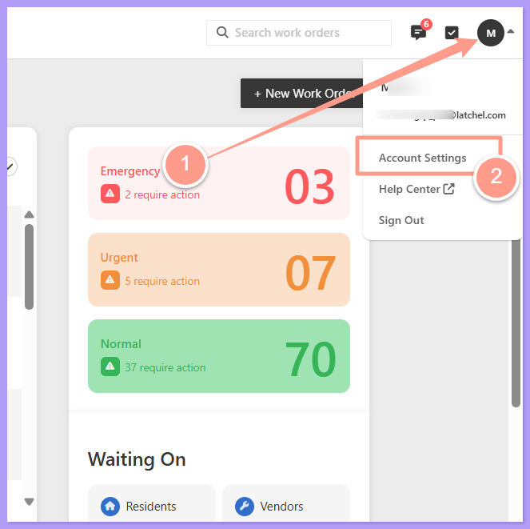
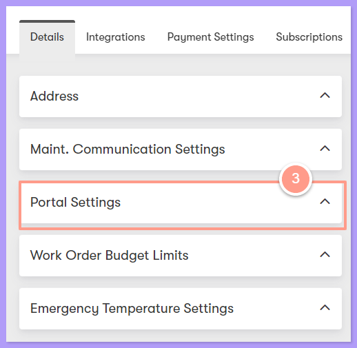
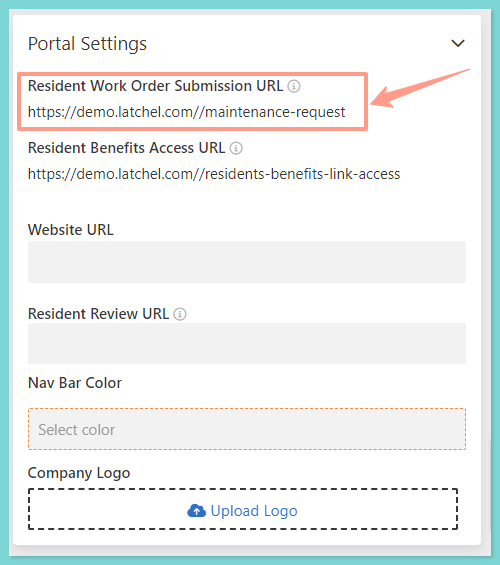
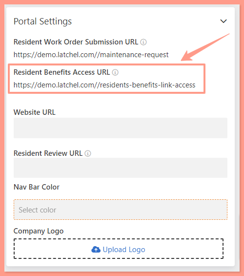
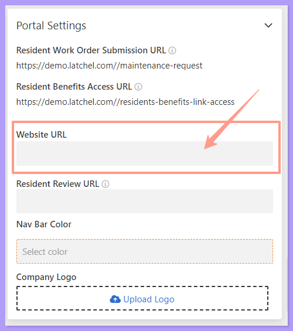
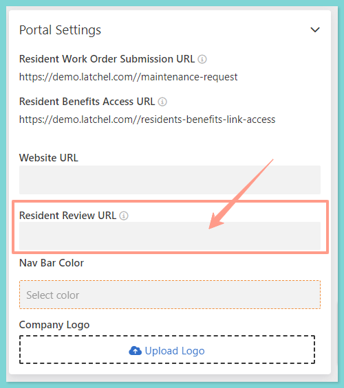
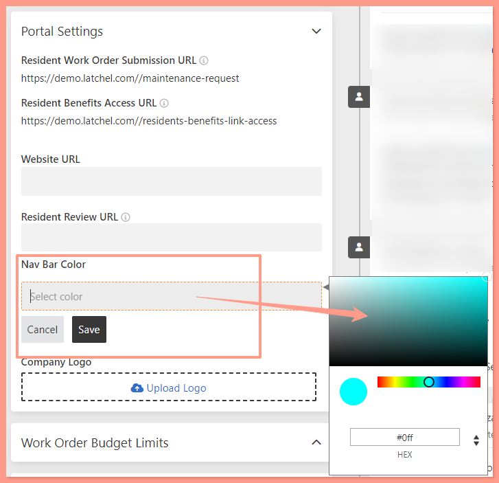
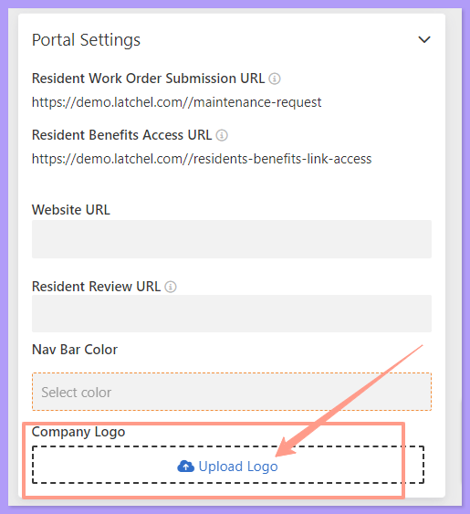

## **Where to Access Portal Settings**

Click on the **Account Icon** on the top right corner of your Dashboard and select **Account Settings**.

<Frame>
  
</Frame>

Once you're on the Account Settings page, look for the **Portal Settings** dropdown menu.

<Frame>
  
</Frame>

Under the Portal Settings section, you will find other options to configure your settings.

## **Residents Work Order Submission URL**

Residents can use this link to submit online maintenance requests.

<Frame>
  
</Frame>

## **Resident Benefits Access URL**

Residents can use this link to access their Resident Benefits.

<Frame>
  
</Frame>

## **Website URL**

You may also add your company's website URL.

<Frame>
  
</Frame>

## **Resident Review URL**

Add your social media URL to your Latchel account page. If your resident leaves a 4 or 5-star review, Latchel sends a prompt asking them to share their positive experience publicly on your social media page. This is where you can customize it.

<Tip>
  To know more about this feature, please visit [Customize Resident Review URL](https://help.latchel.com/s/topic/0TO5e000000h9wqGAA/Customize-Resident-Review-URL).
</Tip>

<Frame>
  
</Frame>

## **Nav Bar Color** (Navigation Bar Color)

Personalize your resident experience by incorporating your company-specific color scheme.

<Frame>
  
</Frame>

## **Company Logo**

Upload your company logo to highlight your brand and create a more cohesive user experience.

<Frame>
  
</Frame>

## **Portfolio White Label for Residents**

White labeling is set at the **Portfolio** level. It only changes what residents see for the properties in that portfolio. Turn on white labeling for a portfolio, and residents there see the community name instead of property manager or Latchel branding.

**Learn more about this by visiting:**

<Card title="How to White Label Your Resident Experience by Portfolio" color="#FF9B8A" icon="tag" iconType="duotone" horizontal href="/s/topic/0TO5e000000h9wqGAA/how-to-white-label-your-resident-experience-by-portfolio">
  Show residents your community's name instead of your company or Latchel branding.
</Card>

<Warning>
  For any Portal settings you've changed, don't forget to save your changes! And that's how you can customize your Portal settings.
</Warning>
