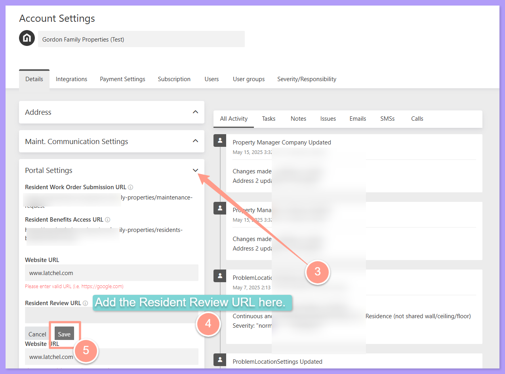
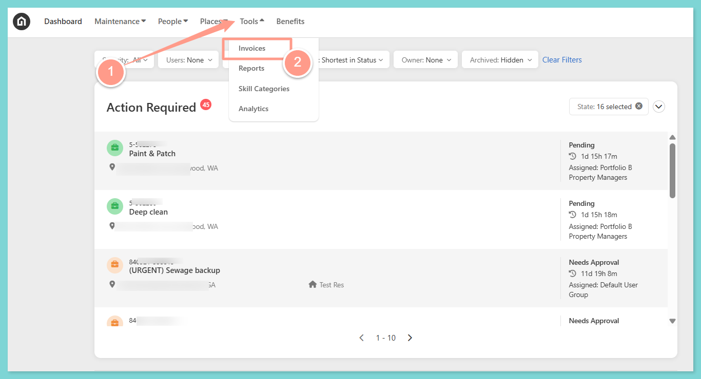
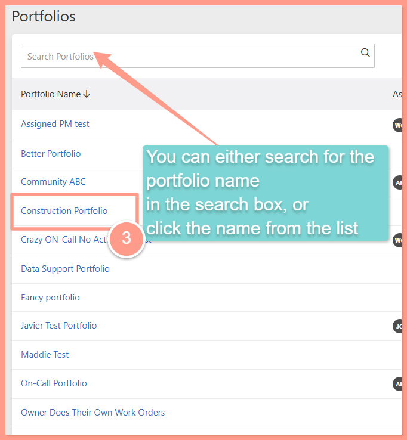
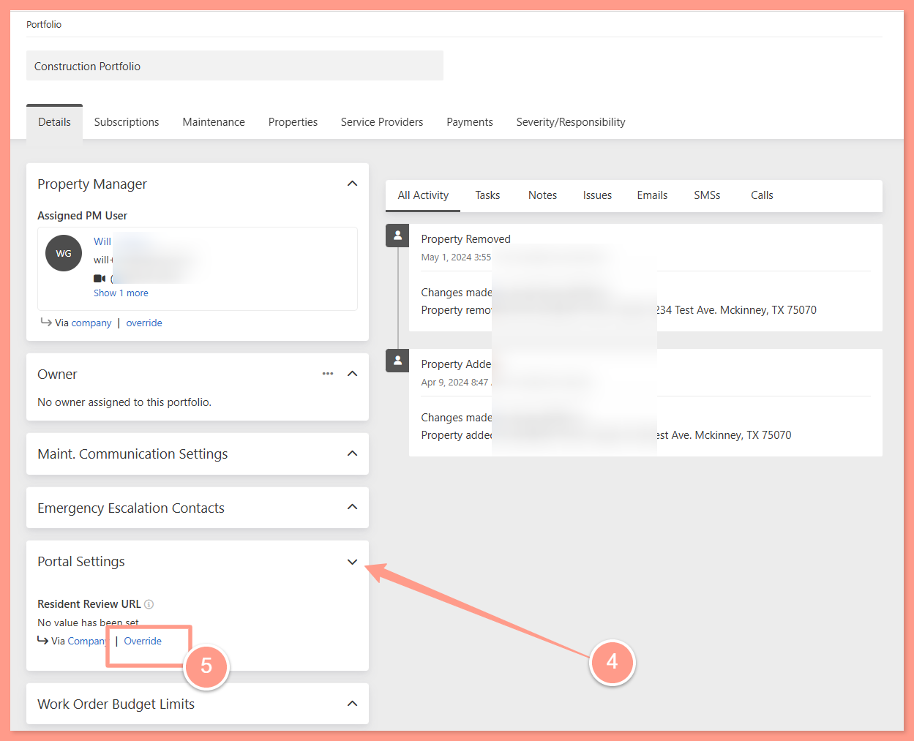
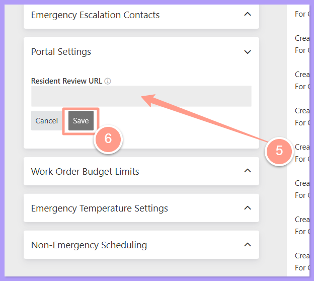
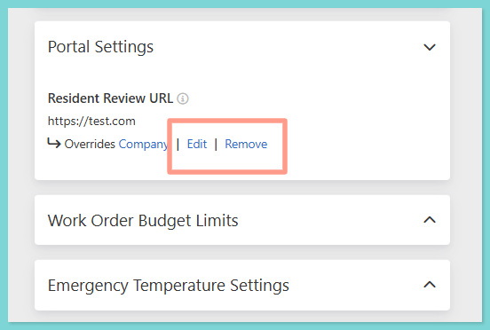

## **Resident Review URL for Global Settings**

Resident Review URL can be customized within your main company Account Settings which will be inherited by all properties. Here's how you can customize it within your Account Settings.

<Steps>
  <Step title="**Open Account Settings**" icon="1" iconType="sharp-solid" stepNumber={1} titleSize="p">
    From your dashboard, click your **Account icon** at the upper right hand corner of the page. Then select **Account Settings**.

    <Frame>
      
    </Frame>
  </Step>
  <Step title="**Add your URL and click Save**" icon="2" iconType="sharp-solid" stepNumber={2} titleSize="p">
    In the **Details tab** of your company **Account Settings**, expand **Portal Settings**, then look for **Resident Review URL**. Add your preferred URL then click **Save**.

    <Frame>
      
    </Frame>
  </Step>
</Steps>

## **Portfolio Resident Review URL**

If your properties are grouped into different portfolios, you can customize the Resident Review URL for each portfolio.

<Warning>
  Changes made at the portfolio level override the company settings. Any updates made at the company level will no longer apply to that portfolio.
</Warning>

<Steps>
  <Step title="**Go to Places then Portfolios**" icon="1" iconType="sharp-solid" stepNumber={1} titleSize="p">
    In your dashboard, click **Places** then choose **Portfolios**.

    <Frame>
      
    </Frame>
  </Step>
  <Step title="**Search for and open the portfolio**" icon="2" iconType="sharp-solid" stepNumber={2} titleSize="p">
    **Search for the portfolio** you need to customize the Resident Review URL for. Click the **hyperlinked portfolio name** to open its **Details** tab.

    <Frame>
      
    </Frame>
  </Step>
  <Step title="**Expand Portal Settings and click Override**" icon="3" iconType="sharp-solid" stepNumber={3} titleSize="p">
    From the **Details** tab, expand **Portal Settings**. Click **Override**, to customize the Resident Review URL.

    <Frame>
      
    </Frame>
  </Step>
  <Step title="**Enter the new URL and click Save**" icon="4" iconType="sharp-solid" stepNumber={4} titleSize="p">
    In the **empty box**, **enter** your new Resident Review URL, then click **Save**.

    <Frame>
      
    </Frame>

    Once done, you'll notice that the settings indicate **"Overrides Company,"** along with options to **Edit** or **Remove**. If you wish to update or delete the custom URL, you can use either of these options.
  </Step>
  <Step title="**Edit or remove the custom URL**" icon="5" iconType="sharp-solid" stepNumber={5} titleSize="p">
    Use **Edit** to update, or **Remove** if you'd like the portfolio to inherit the Resident Review URL from the global account settings.

    <Frame>
      
    </Frame>

    <Tip>
      Only residents who are assigned to and active on properties within the portfolio can access the customized Resident Review URL for that portfolio.
    </Tip>
  </Step>
</Steps>

And that's how easy you can customize your Resident Review URL!