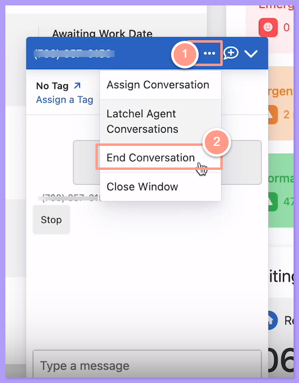
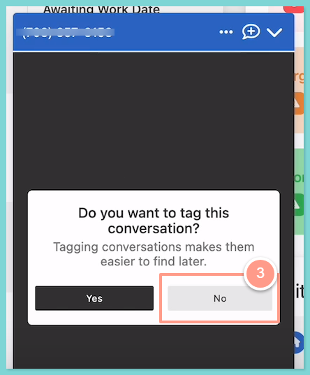
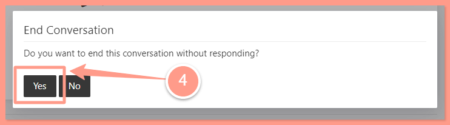

## **How to End an SMS Conversation Without Assigning It**

<Steps>
  <Step title="**Click End Conversation**" icon="1" iconType="sharp-solid" stepNumber={1} titleSize="p">
    From the **SMS box,** select the **Ellipsis icon** on the top right and click **End Conversation** from the Dropdown.

    <Frame>
      
    </Frame>
  </Step>
  <Step title="**Click No and confirm**" icon="2" iconType="sharp-solid" stepNumber={2} titleSize="p">
    A reminder will show and ask if you want to tag the conversation, just click **No.** Once you have clicked No, confirm the action by clicking **Yes**.

    <Frame>
      
    </Frame>

    <Frame>
      
    </Frame>
  </Step>
</Steps>