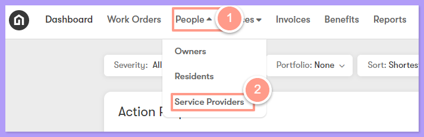
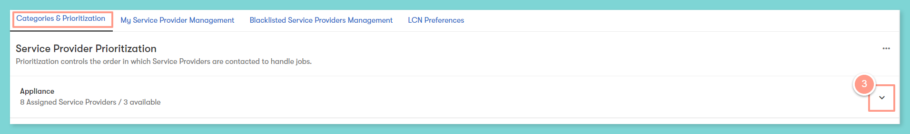
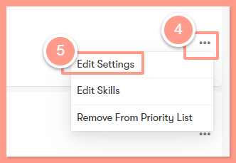
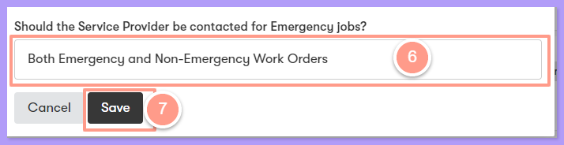

## **How to Specify If Your Service Provider Handles Emergencies, Non-Emergencies, Or Both**

<Steps>
  <Step title="**Go to Service Providers**" icon="1" iconType="sharp-solid" stepNumber={1} titleSize="p">
    Click on **People** from the top navigation menu and select **Service Providers**.

    <Frame>
      
    </Frame>
  </Step>
  <Step title="**Expand the skill category**" icon="2" iconType="sharp-solid" stepNumber={2} titleSize="p">
    From the **Categories & Prioritization** page, you will see a list of skills, and for you to view the list of prioritized service providers just click the **arrow dropdown** of the corresponding skill on the far right side of the page.

    <Frame>
      
    </Frame>
  </Step>
  <Step title="**Click Edit Settings**" icon="3" iconType="sharp-solid" stepNumber={3} titleSize="p">
    Then click on the ellipsis next to the service provider and then on **Edit Settings**.

    <Frame>
      
    </Frame>
  </Step>
  <Step title="**Select your emergency preference**" icon="4" iconType="sharp-solid" stepNumber={4} titleSize="p">
    Select your preference from the list nested under the text, **_“Should the vendor be contacted for Emergency jobs?“_**. From here, you can modify if the service provider should be contacted for Emergency jobs, Non-emergency jobs, or both. Then **Save.**

    <Frame>
      
    </Frame>

    <Warning>
      Please note that this setting is modifiable for the service provider and each trade (skill category) they are assigned. That means if you have a service provider that is prioritized for Appliance jobs and HVAC jobs, you will need to modify the job severity setting for the service provider under the Appliance skill category **_AND_** the HVAC skill category. **_This setting does not carry over to additional skill categories the service provider might be assigned to._**
    </Warning>
  </Step>
</Steps>