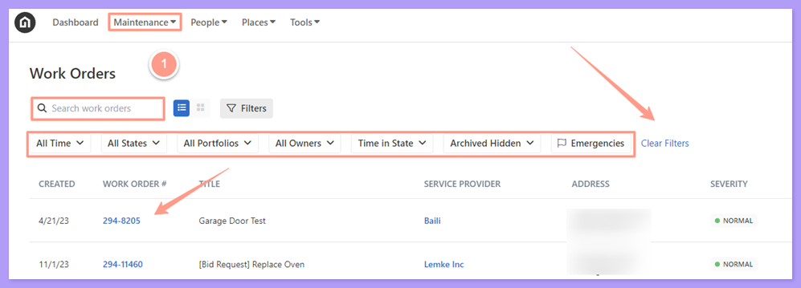
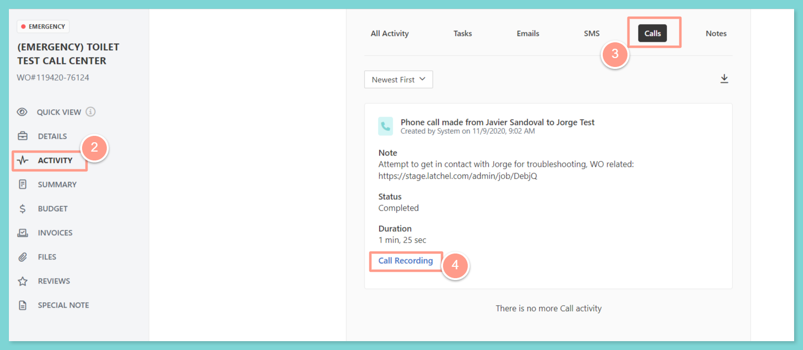

## **How to Access & Read Call Logs**

<Steps>
  <Step title="**Open the work order**" icon="1" iconType="sharp-solid" stepNumber={1} titleSize="p">
    From the dashboard, click on **Maintenance**, and open the work order by either **searching and/or clicking the specific order number**. You can also use the **Filter** and **Clear Filters** option for a more refined search. 

    <Tip>
      To learn more about how to use the **Filter**, check out this help guide:
    </Tip>

    <Card title="How to Use the Filter Options in the Work Order Tab Page" color="#ff9b8a" icon="filter-list" iconType="duotone" href="/s/topic/0TO5e000000h9wqGAA/How-to-Use-the-Filter-Options-in-the-Work-Order-Tab-Page">
      Learn how to use filters in the Work Order tab to quickly sort, find, and manage the requests you care about most.
    </Card>

    <Frame>
      
    </Frame>
  </Step>
  <Step title="**Go to Activity and choose Calls**" icon="2" iconType="sharp-solid" stepNumber={2} titleSize="p">
    Once on the work order page, click on **Activity**, and from **Activity**, choose **Calls**. Below the comment information, the admin user or Property Manager may click on **Call Recording** to listen to the call.

    <Frame>
      
    </Frame>
  </Step>
</Steps>