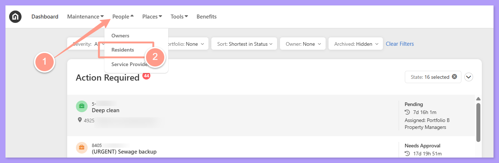
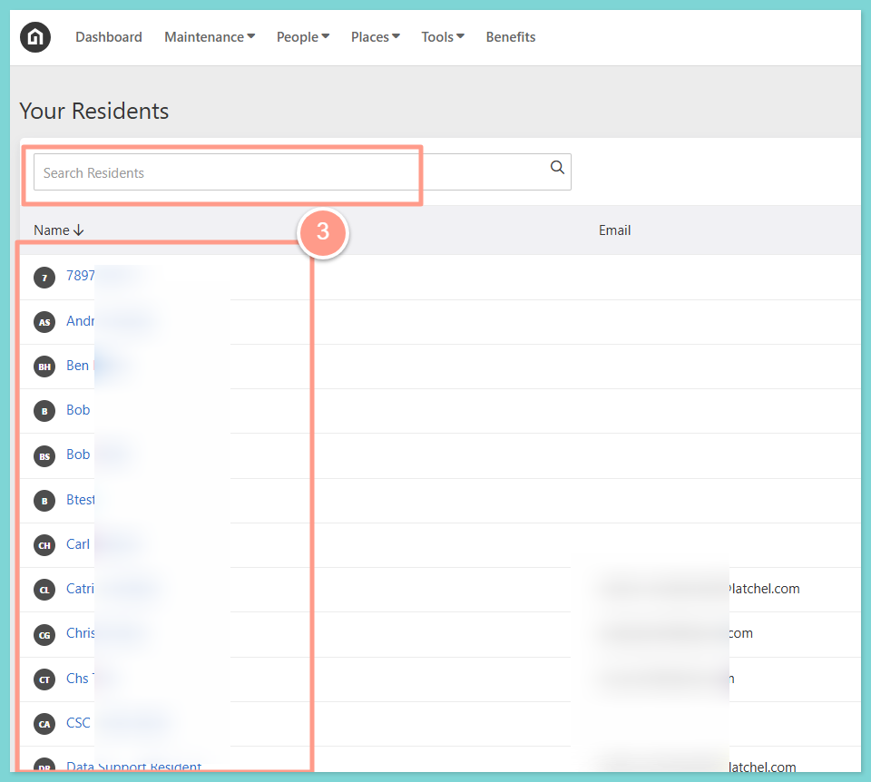
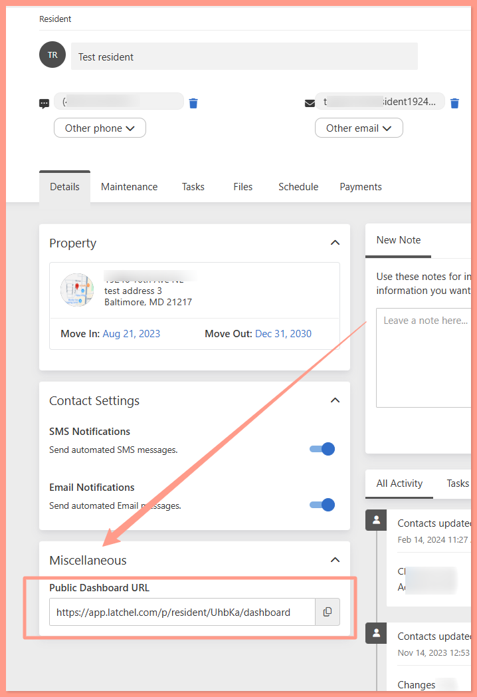
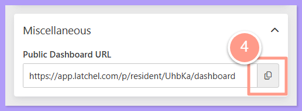

## **How to Access and View a Resident Public Dashboard**

<Steps>
  <Step title="**Go to People then Residents**" icon="1" iconType="sharp-solid" stepNumber={1} titleSize="p">
    From your dashboard click **People**, and select **Residents**.

    <Frame>
      
    </Frame>
  </Step>
  <Step title="**Search for or select the resident**" icon="2" iconType="sharp-solid" stepNumber={2} titleSize="p">
    You can **search** for the resident or just **select** from the list.

    <Frame>
      
    </Frame>
  </Step>
  <Step title="**Go to the Miscellaneous section**" icon="3" iconType="sharp-solid" stepNumber={3} titleSize="p">
    Once you have selected the resident, go to the **Miscellaneous** section at the lower left part of the page.

    <Frame>
      
    </Frame>
  </Step>
  <Step title="**Copy and paste the Public Dashboard URL**" icon="4" iconType="sharp-solid" stepNumber={4} titleSize="p">
    From there you can **grab/copy** the link under the Public Dashboard URL. **Paste** the link to your web browser's address bar and it will lead you to the resident's dashboard.

    <Frame>
      
    </Frame>

    <Tip>
      Every public dashboard URL is unique for each of the residents.
    </Tip>
  </Step>
</Steps>
