## **How to Add New Residents**

<Steps>
  <Step title="**Go to Places then Properties**" icon="1" iconType="sharp-solid" stepNumber={1} titleSize="p">
    Click **Places** and on the dropdown select **Properties** from the top navigation menu.

    <Frame>
      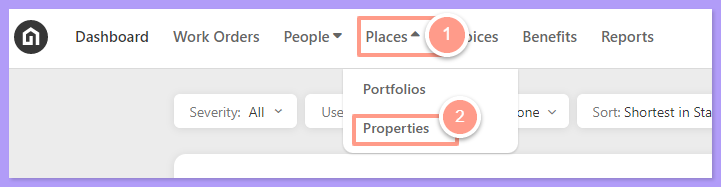
    </Frame>
  </Step>
  <Step title="**Search for or select the property**" icon="2" iconType="sharp-solid" stepNumber={2} titleSize="p">
    **Search** or **select the property address** where the resident is located.

    <Frame>
      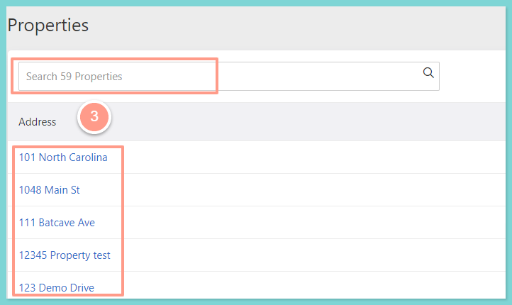
    </Frame>
  </Step>
  <Step title="**Click the Residents tab**" icon="3" iconType="sharp-solid" stepNumber={3} titleSize="p">
    From the property profile page, click on the **Residents** tab.

    <Frame>
      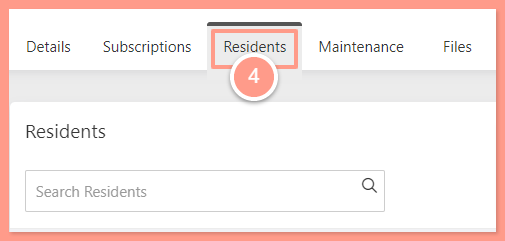
    </Frame>
  </Step>
  <Step title="**Click Add Resident**" icon="4" iconType="sharp-solid" stepNumber={4} titleSize="p">
    To add a new resident, click the **\+ Add Resident** button on the far right.

    <Frame>
      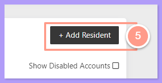
    </Frame>
  </Step>
  <Step title="**Create the resident and click Continue**" icon="5" iconType="sharp-solid" stepNumber={5} titleSize="p">
    Next, click **Create New Resident** then fill out the necessary information, and hit **Continue.**

    <Frame>
      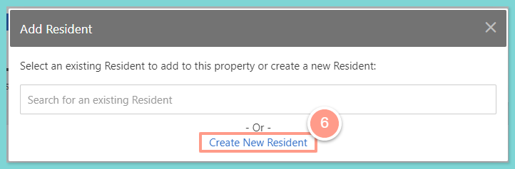
    </Frame>

    <Frame>
      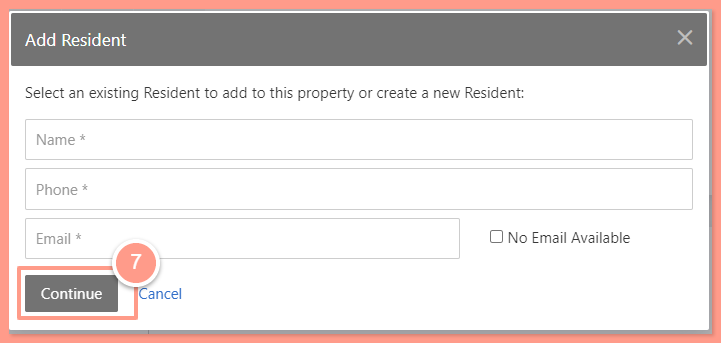
    </Frame>
  </Step>
  <Step title="**Click Submit**" icon="6" iconType="sharp-solid" stepNumber={6} titleSize="p">
    Then click **Submit**. Repeat these steps to add multiple residents to a property profile.

    <Frame>
      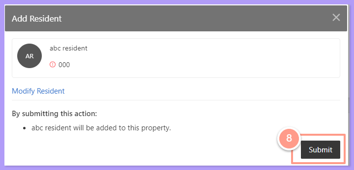
    </Frame>
  </Step>
</Steps>

## **How to Modify Resident Contact Information**

From the resident profile page, you can edit the resident’s primary phone number and email address. You can also add additional phone numbers and email addresses.

<Note>
  Please note that additional numbers and addresses are only used as a reference.
</Note>

<Note>
  **Using a property management software (PMS) integration?** Latchel keeps resident contact info in sync with your PMS for existing residents too, not just on the first sync. On the resident profile, you'll see contact info from two sources: **Latchel** and **PMS**. You can set PMS contact info as **Primary**, but you can't delete it in Latchel. To change or remove it, update it in your PMS.
</Note>

<Steps>
  <Step title="**Go to People then Residents**" icon="1" iconType="sharp-solid" stepNumber={1} titleSize="p">
    Click the **People** tab from the top navigation menu and select **Residents** from the dropdown.

    <Frame>
      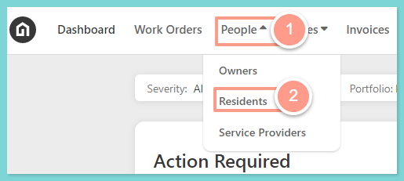
    </Frame>
  </Step>
  <Step title="**Search for and select the resident**" icon="2" iconType="sharp-solid" stepNumber={2} titleSize="p">
    Search and select the resident that you need to modify and you will be directed to the resident profile page.

    <Frame>
      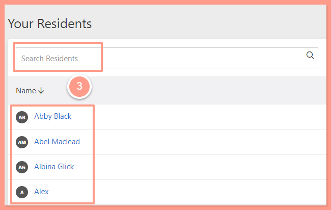
    </Frame>
  </Step>
  <Step title="**Edit the contact information**" icon="3" iconType="sharp-solid" stepNumber={3} titleSize="p">
    From here, you can edit the resident’s contact information.

    <Frame>
      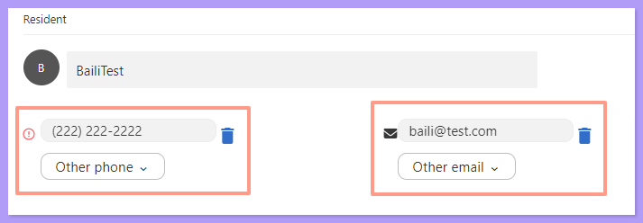
    </Frame>
  </Step>
</Steps>

## **How to Add Resident's Move-in and Move-out Dates**

<Steps>
  <Step title="**Select Edit Resident Move Dates**" icon="1" iconType="sharp-solid" stepNumber={1} titleSize="p">
    In the property page under the **Residents tab**, click the **ellipsis icon** on the right side of the resident and select **Edit Resident Move Dates**.

    <Frame>
      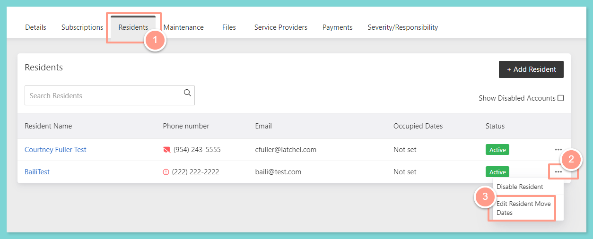
    </Frame>
  </Step>
  <Step title="**Enter the dates and click Submit**" icon="2" iconType="sharp-solid" stepNumber={2} titleSize="p">
    Now input the date either **Move-in** or **Move-out**, then click **Submit**.

    <Frame>
      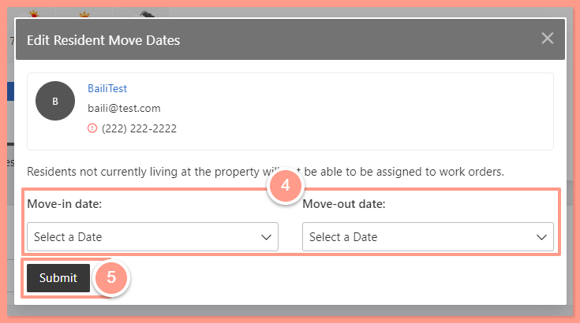
    </Frame>

    <Info>
      Moving out a resident does not mean that the resident's profile will be disabled.
    </Info>
  </Step>
</Steps>

## **How to Disable a Resident Profile**

Property Managers can disable residents from the **Property page** and from the **Resident's page**.

From the property page under the **Residents tab**, click the **ellipsis icon** on the right side of the resident and select **Disable Resident**.

<Frame>
  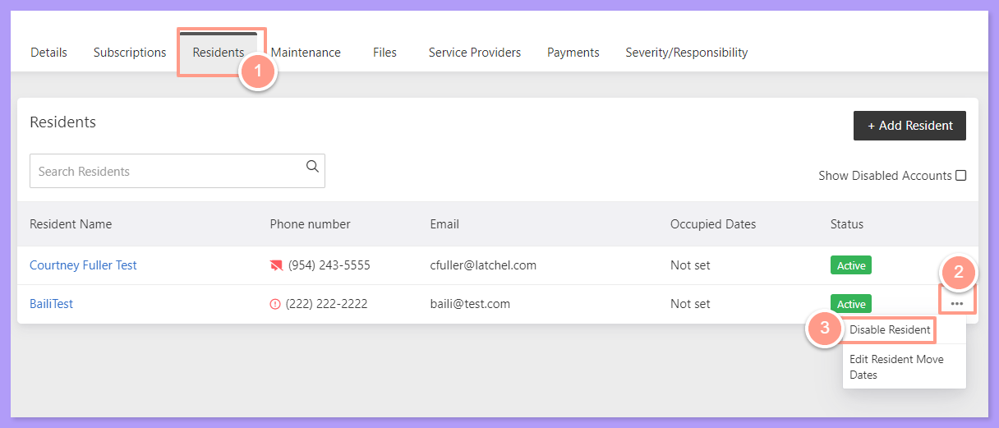
</Frame>

Then select **Submit**.

<Frame>
  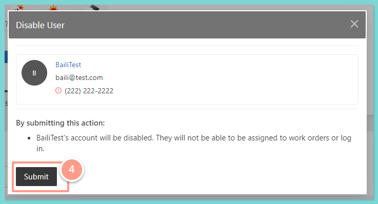
</Frame>

From the **Resident's page** click the **ellipsis icon** on the right side of the page, and select **Disable Account**.

<Frame>
  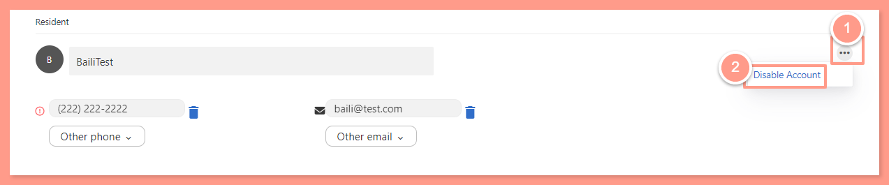
</Frame>

Then select **Submit**.

<Frame>
  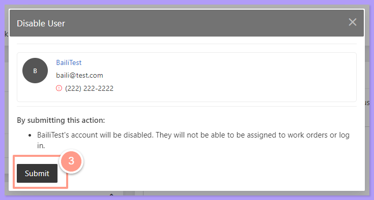
</Frame>