As a Property Manager, you can add your preferred service providers to your Latchel Portal. Once you add your service providers, you will be able to prioritize which preferred service providers that you want to use and the order of priority they should be used for each Skill Category.

## **How to Add a New Preferred Service Provider**

<Steps>
  <Step title="**Go to Service Providers**" icon="1" iconType="sharp-solid" stepNumber={1} titleSize="p">
    From your Latchel Portal, navigate to the **People** menu and select **Service Providers**.

    <Frame>
      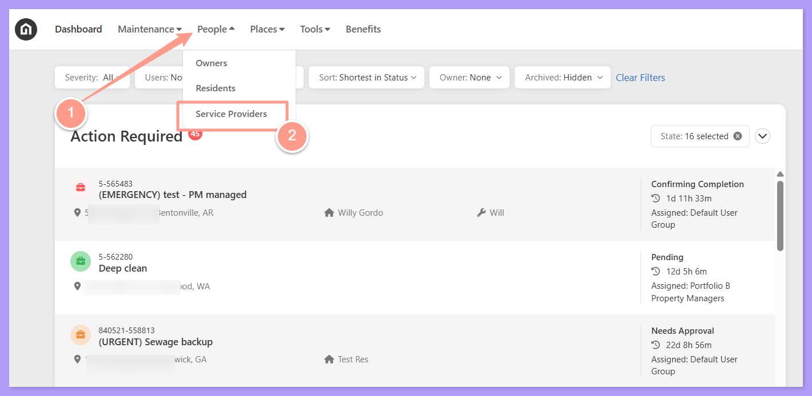
    </Frame>
  </Step>
  <Step title="**Click New Service Provider**" icon="2" iconType="sharp-solid" stepNumber={2} titleSize="p">
    To add a new preferred vendor, click the **\+ New Service Provider**.

    <Frame>
      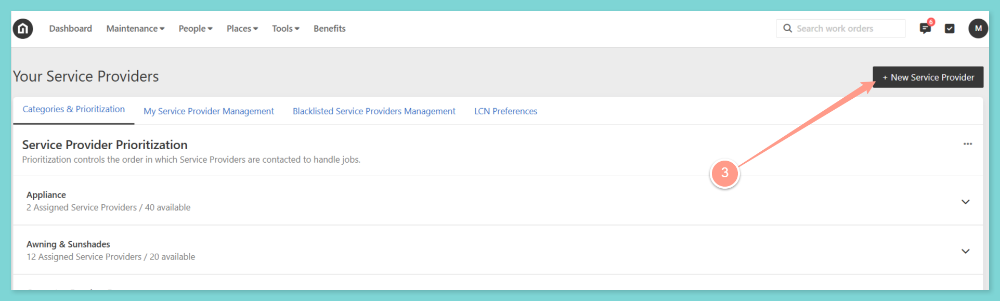
    </Frame>
  </Step>
  <Step title="**Enter the email address**" icon="3" iconType="sharp-solid" stepNumber={3} titleSize="p">
    Type in the **email address** of the service provider. Click **Next**.

    <Frame>
      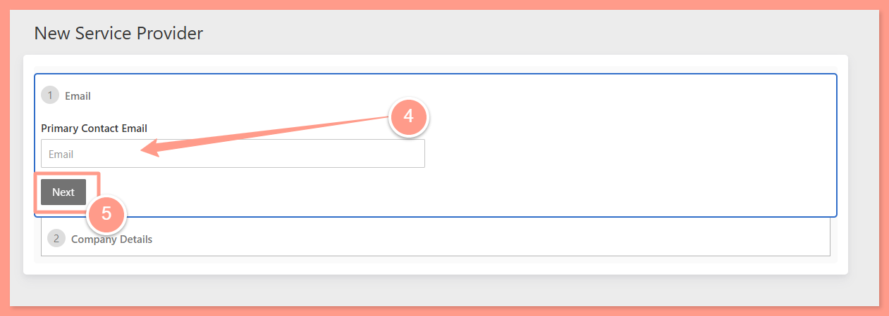
    </Frame>
  </Step>
  <Step title="**Fill out the service provider details**" icon="4" iconType="sharp-solid" stepNumber={4} titleSize="p">
    Fill out the Service Provider Details including the **Service Provider's Company Name**, and **Primary Contact information**. To move on to the next set of information, click **Next.**

    <Frame>
      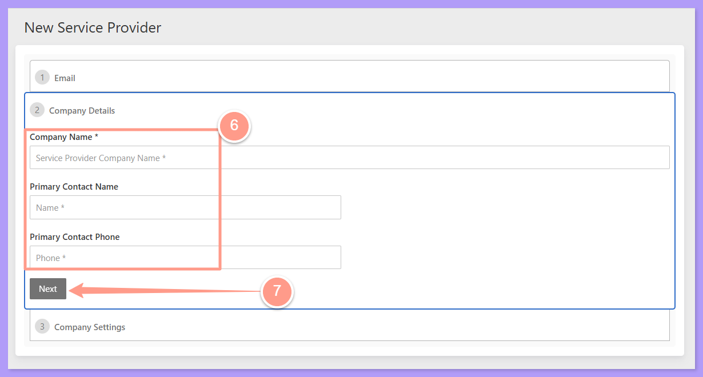
    </Frame>
  </Step>
  <Step title="**Click Add Skills**" icon="5" iconType="sharp-solid" stepNumber={5} titleSize="p">
    Select the service provider's skills. You can choose to add skills one by one. To do this, click **\+ Add Skills.**

    <Frame>
      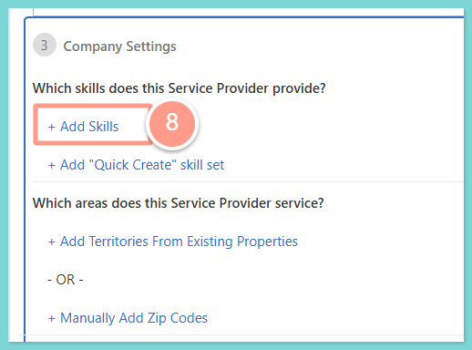
    </Frame>
  </Step>
  <Step title="**Check the applicable skills**" icon="6" iconType="sharp-solid" stepNumber={6} titleSize="p">
    Then, check all the applicable skills of the new service provider. Click **Continue** when done.

    <Frame>
      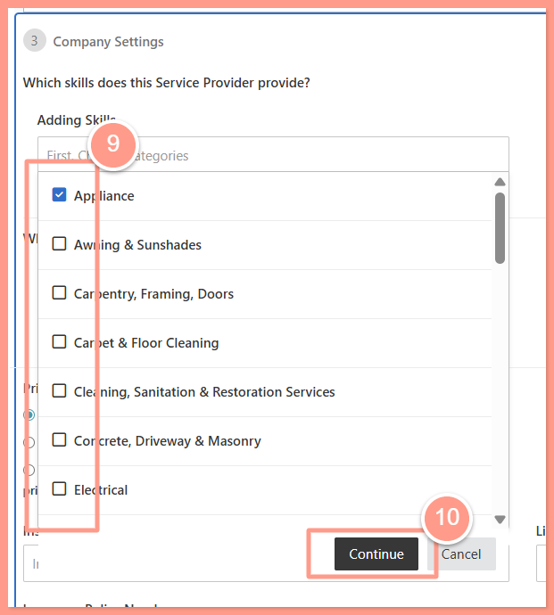
    </Frame>
  </Step>
  <Step title="**Or use a Quick Create skill set**" icon="7" iconType="sharp-solid" stepNumber={7} titleSize="p">
    Alternatively, you can select **\+ Add “Quick Create” Skill Set**. Three options will pop up:

    Handyman Skills,
    General Contractor, and
    All Skills/All Trades.

    <Frame>
      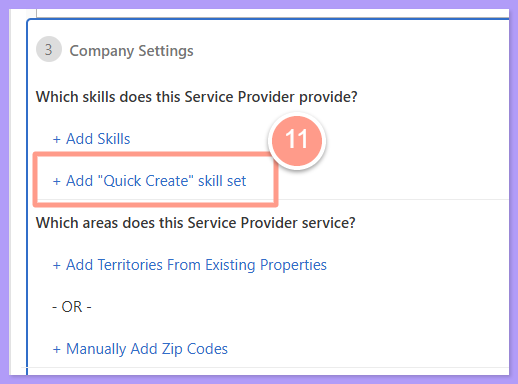
    </Frame>

    <Tip>
      If the service provider will only work on certain properties or territories, you can also add the territories from your existing properties in Latchel, or manually add zip codes. Check [How to Assign Service Provider to a Territory / Zip Code](https://help.latchel.com/s/topic/0TO5e000000h9wqGAA/How-to-Assign-Service-Provider-to-a-Territory-Zip-Code) to learn more\!
    </Tip>

    <Frame>
      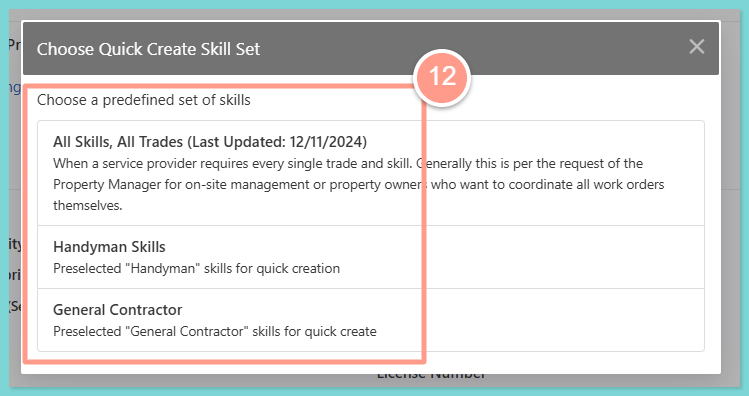
    </Frame>

    We created pre-selected **Handyman skills**, or **General Contractor** skills so you can quickly add skills Latchel has preset for these types of service providers.

    You can choose the third option, **All Skills/All Trades** if you have a service provider who does everything.

    Rest assured, if you select any of the 3 Quick Create Skill Sets, you can easily **edit or add/remove** the skills we have pre-selected. Click **Save** at the bottom of the skill set list so save the changes you made on the pre-selected list.

    <Frame>
      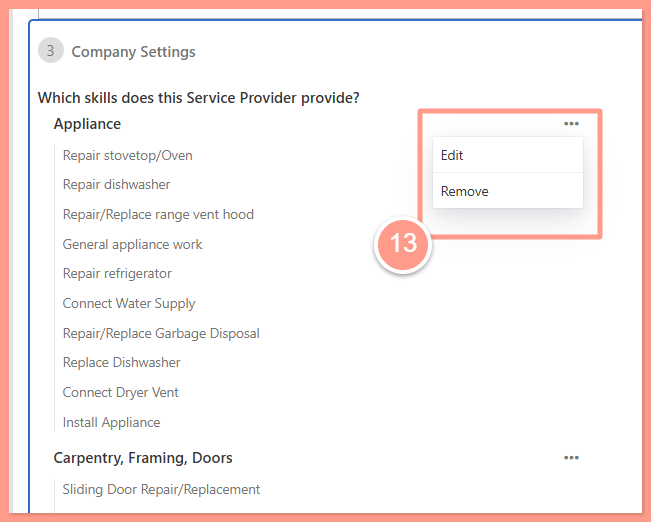
    </Frame>

    <Frame>
      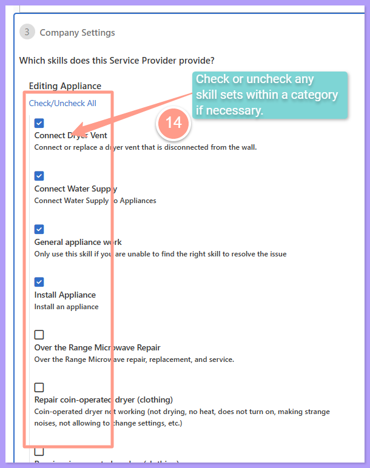
    </Frame>
  </Step>
  <Step title="**Set the prioritization order and save**" icon="8" iconType="sharp-solid" stepNumber={8} titleSize="p">
    Select the **prioritization order** of the service provider for each category. You may also fill out the rest of the company settings including optional insurance information and license number. Lastly, click **Save**.

    <Frame>
      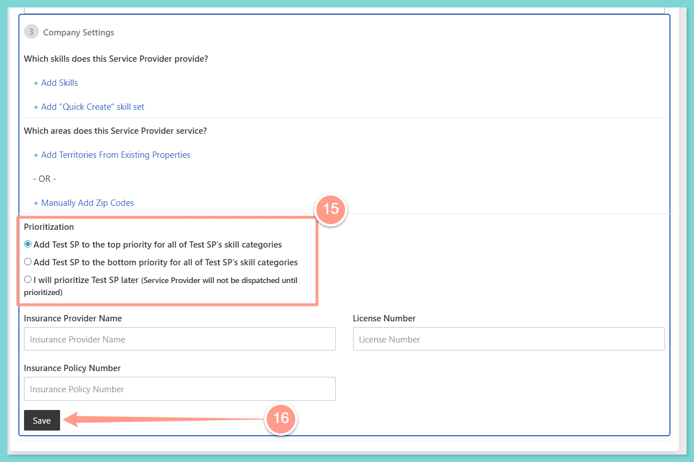
    </Frame>
  </Step>
</Steps>

## **How to Add Existing Service Providers**

By following these steps, you can resolve the message **"Unhandled Error"** when adding an existing service provider as your preferred. 

As soon as the message appears after entering the service provider's email address, click **Add Service Provider.**

<Frame>
  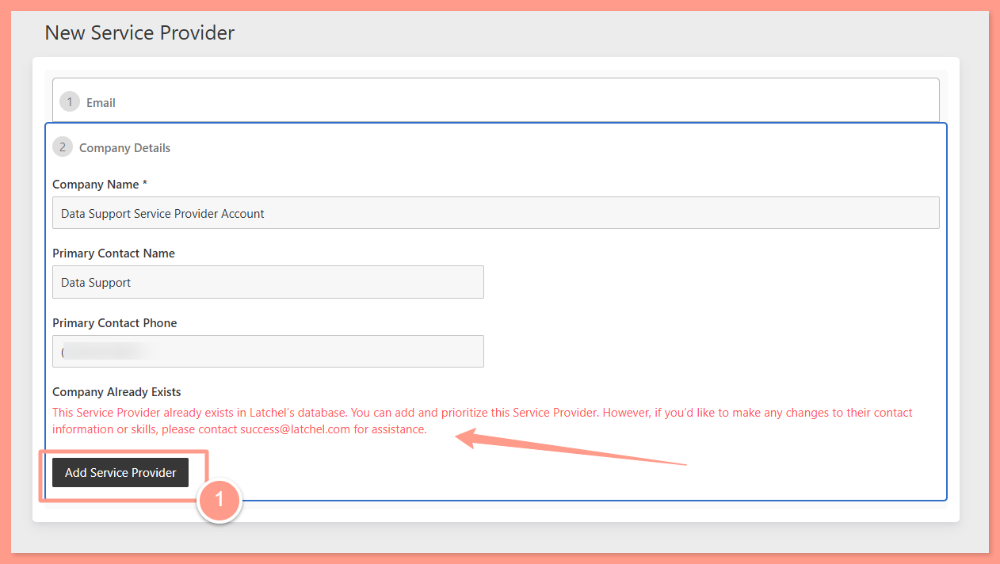
</Frame>

<Danger>
  You may only add and prioritize service providers that already exist in Latchel’s database. However, updates to their skills or contact information cannot be made directly. For any changes, please reach out to [success@latchel.com](mailto:success@latchel.com) for assistance.
</Danger>

## **How to Manage Service Providers and Their Skills**

<Steps>
  <Step title="**Go to Categories & Prioritization**" icon="1" iconType="sharp-solid" stepNumber={1} titleSize="p">
    From your Latchel Portal, navigate to the **People** menu and select **Service Providers** to land on the **Categories & Prioritization** page.

    <Frame>
      
    </Frame>

    <Frame>
      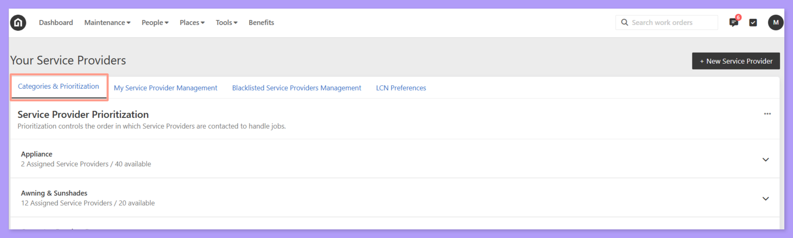
    </Frame>
  </Step>
  <Step title="**Expand a skill category**" icon="2" iconType="sharp-solid" stepNumber={2} titleSize="p">
    On the left-hand side of the page, you will see a list of all Skill Categories. Expand each categories to see the list of your preferred service provider within that category by clicking the . Each service provider will have a number next to it showing their order of priority. 

    <Frame>
      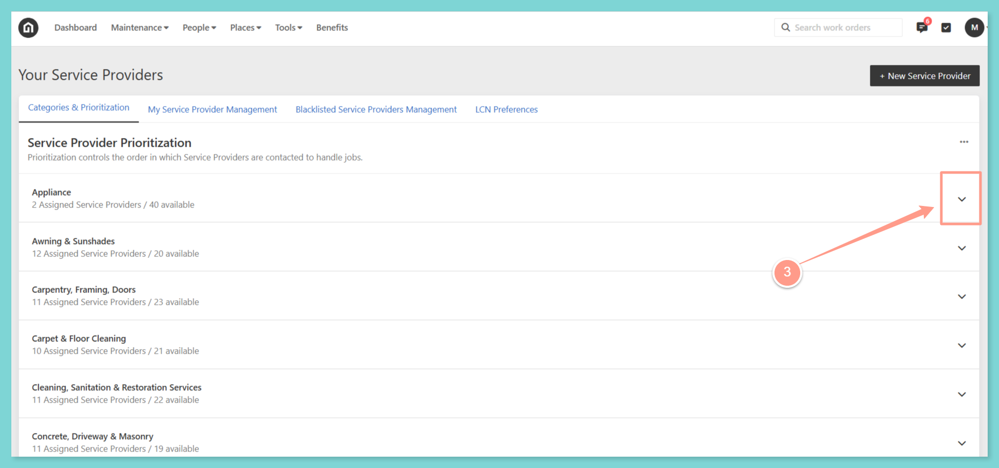
    </Frame>
  </Step>
  <Step title="**Click Edit Priority**" icon="3" iconType="sharp-solid" stepNumber={3} titleSize="p">
    A Property Manager or Admin can arrange the service provider prioritization by clicking **Edit Priority.** 

    <Frame>
      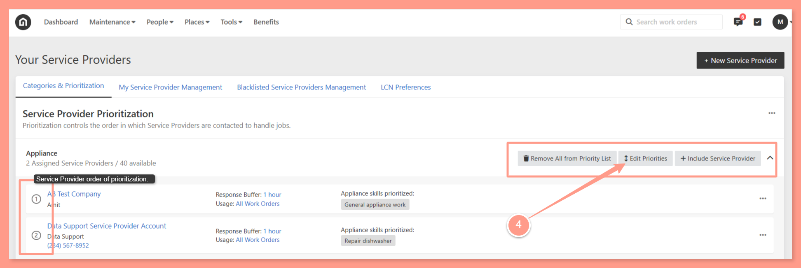
    </Frame>

    <Tip>
      In addition to editing priorities, you can also **Remove ALL Service Providers from the priority list**, or **Include more service providers** if needed.
    </Tip>
  </Step>
  <Step title="**Drag and drop to reorder**" icon="4" iconType="sharp-solid" stepNumber={4} titleSize="p">
    **Six dots** will appear next to the service provider’s name. Use these dots to **drag and drop** the service provider into your preferred order. click **Done Updating Priorities**.

    <Frame>
      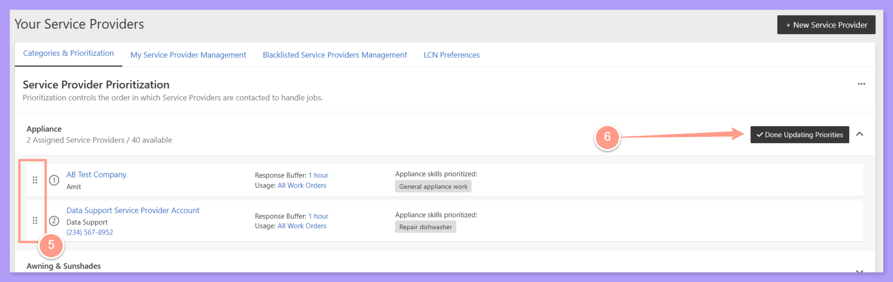
    </Frame>
  </Step>
</Steps>

## **How to Edit or Update a Prioritized Service Provider's Skill Set in a Category**

For each of your preferred service providers, the user can see the contact information and all of the skills that have been prioritized to be used. As the Property Manager, you may choose to not use certain skills from certain service providers. 

<Steps>
  <Step title="**Choose Edit Skills**" icon="1" iconType="sharp-solid" stepNumber={1} titleSize="p">
    To edit the skills, click the three dots assign to the service provider, and choose **Edit Skills**. 

    <Frame>
      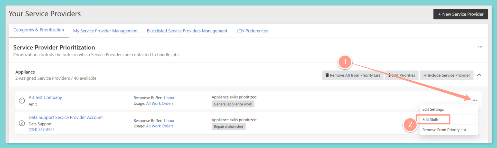
    </Frame>

    <Tip>
      In addition to the Edit Skills option, an option **Remove From Priority List** is also available in case you need to remove a specific service provider from the list. **This option does not remove ALL service providers.**
    </Tip>
  </Step>
  <Step title="**Select the skills and save**" icon="2" iconType="sharp-solid" stepNumber={2} titleSize="p">
    A pop-up box will appear, and the user can either **Check/Uncheck All** or tick specific skills of the service provider and click **Save**. 

    <Frame>
      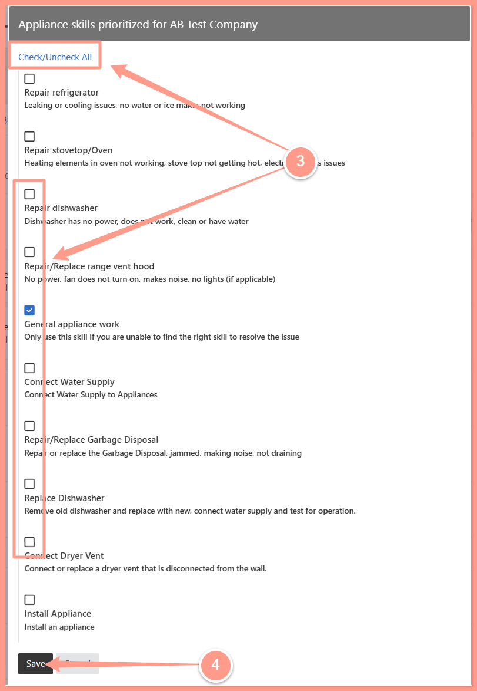
    </Frame>
  </Step>
</Steps>