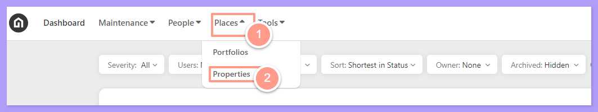
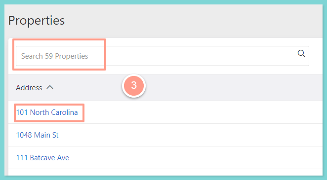
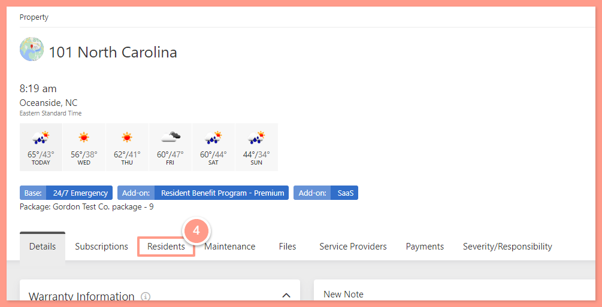
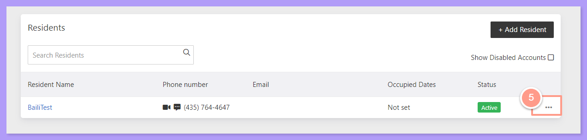
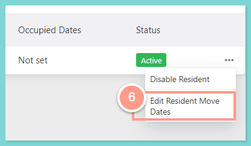
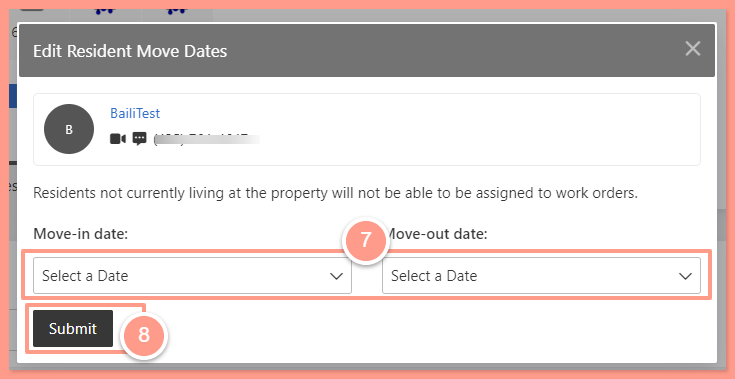
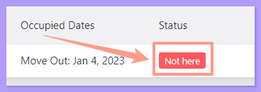

**Before you proceed, make sure that the property address, as well as the residnet is added in Latchel.** **Otherwise, you can follow these help guides:**

<CardGroup cols={2}>
  <Card title="How to Add a Property" icon="location-plus" iconType="duotone" horizontal href="/s/topic/0TO5e000000h9wqGAA/How-to-Add-a-Property">
    
  </Card>
  <Card title="How to Add & Manage Residents" icon="house-chimney-user" iconType="duotone" horizontal href="/s/topic/0TO5e000000h9wqGAA/How-to-Add-Manage-Residents">
    
  </Card>
</CardGroup>

## **How to Add Resident's Move-In/Move-Out Dates**

<Steps>
  <Step title="**Go to Places then Properties**" icon="1" iconType="sharp-solid" stepNumber={1} titleSize="p">
    Log in to the [**Latchel portal.**](https://app.latchel.com/login) Then, On the upper left-hand side of your dashboard click **Places** then **Properties.**

    <Tip>
      You can also go to **People**, then **Residents** to search of the Resident's name as an alternative method of searching for the resident's name.
    </Tip>

    <Frame>
      
    </Frame>
  </Step>
  <Step title="**Search for and open the property**" icon="2" iconType="sharp-solid" stepNumber={2} titleSize="p">
    Then search for the property or select from the list below and click it.

    <Frame>
      
    </Frame>
  </Step>
  <Step title="**Click the Residents tab**" icon="3" iconType="sharp-solid" stepNumber={3} titleSize="p">
    On the property page, click the **Residents** tab.

    <Frame>
      
    </Frame>
  </Step>
  <Step title="**Click the Ellipsis icon**" icon="4" iconType="sharp-solid" stepNumber={4} titleSize="p">
    To modify the dates, click the **Ellipsis** icon next to the resident’s status. 

    <Frame>
      
    </Frame>
  </Step>
  <Step title="**Click Edit Resident Move Dates**" icon="5" iconType="sharp-solid" stepNumber={5} titleSize="p">
    A drop-down will appear, Click on **Edit Resident Move Dates.**

    <Frame>
      
    </Frame>
  </Step>
  <Step title="**Enter the dates and click Submit**" icon="6" iconType="sharp-solid" stepNumber={6} titleSize="p">
    A pop-up will appear where you can specify the move-in date and move-out date for a specific resident. Click **Submit** to save.

    <Frame>
      
    </Frame>

    This will populate occupied dates next to the resident. Once the move-out date has passed for the resident, the status will update to **Not here**.

    <Frame>
      
    </Frame>
  </Step>
</Steps>