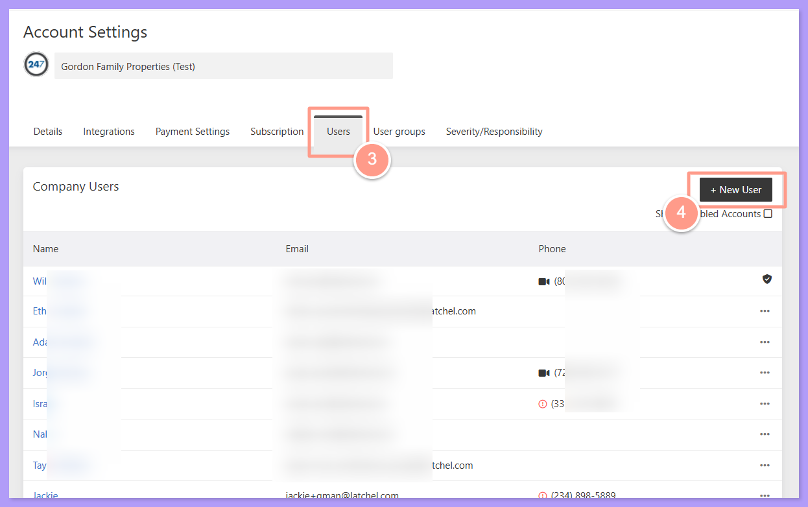
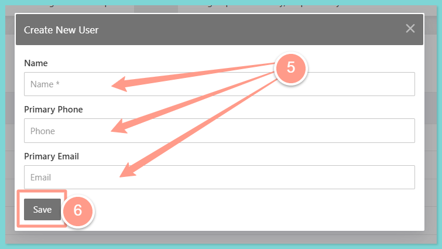
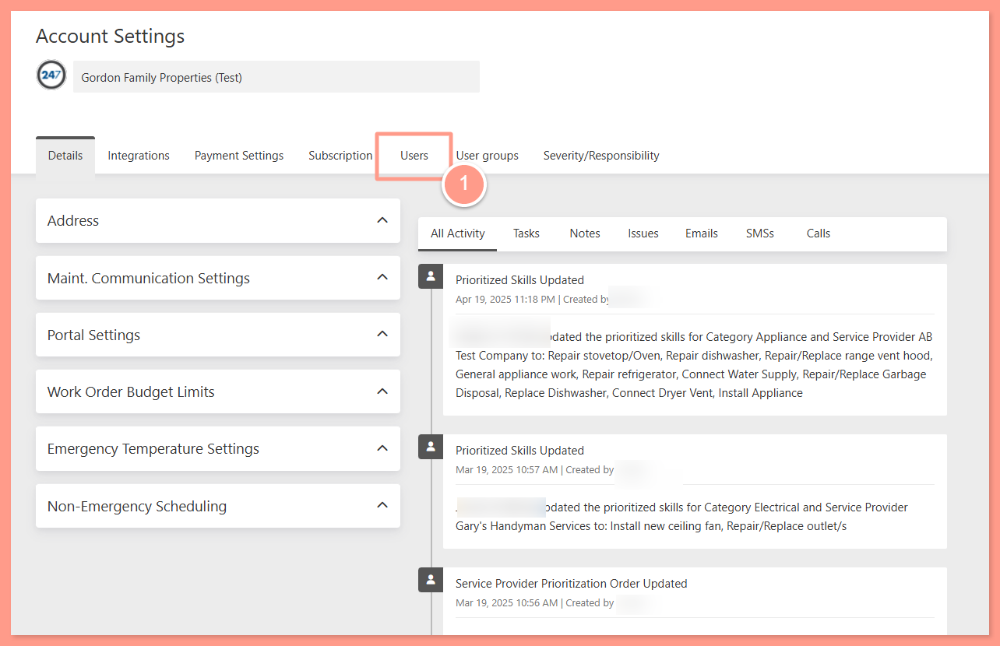
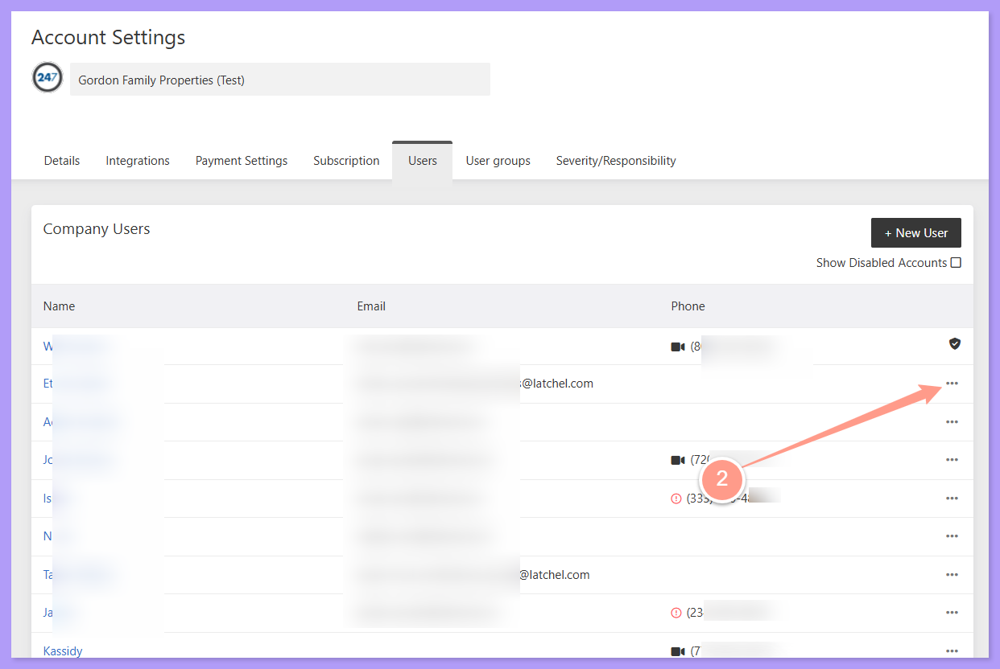
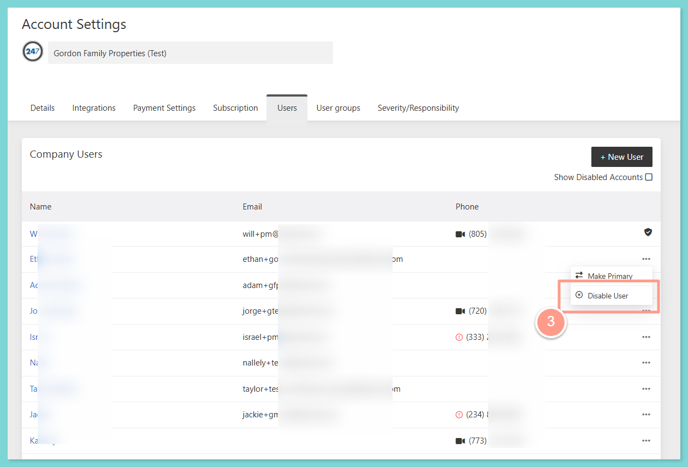
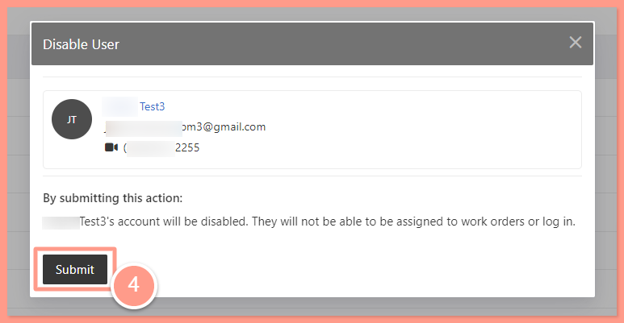

## **Add New Company User**

<Steps>
  <Step title="**Open Account Settings**" icon="1" iconType="sharp-solid" stepNumber={1} titleSize="p">
    After you logged in to Latchel, click the **arrow down** beside your user icon at the top right corner of your dashboard. Then, click **Account Settings.**

    <Frame>
      
    </Frame>
  </Step>
  <Step title="**Click New User**" icon="2" iconType="sharp-solid" stepNumber={2} titleSize="p">
    From the **Account Settings** page, go to the **Users tab.** Then, click the **\+New User** button at the top right.

    <Frame>
      
    </Frame>
  </Step>
  <Step title="**Enter the user's information**" icon="3" iconType="sharp-solid" stepNumber={3} titleSize="p">
    From the small window that shows on the page, **enter the new company user's information**. Click **Save** once done.

    <Frame>
      
    </Frame>

    <Note>
      The name of the new user is required, while the phone number and email address are optional. However, providing the new user's contact information is highly recommended for seamless communication.
    </Note>
  </Step>
</Steps>

## **Remove Existing Company User**

<Steps>
  <Step title="**Go to the Users tab**" icon="1" iconType="sharp-solid" stepNumber={1} titleSize="p">
    From you **Account Settings**, go to **Users** tab.

    <Frame>
      
    </Frame>
  </Step>
  <Step title="**Click the 3 dots by the user**" icon="2" iconType="sharp-solid" stepNumber={2} titleSize="p">
    In the list of the Company Users, **look for the name you need to remove/disable**. Then, click the **3 dots** across the name of the user to be removed/disabled.

    <Frame>
      
    </Frame>
  </Step>
  <Step title="**Choose Disable User**" icon="3" iconType="sharp-solid" stepNumber={3} titleSize="p">
    Next, choose **Disable User**.

    <Frame>
      
    </Frame>
  </Step>
  <Step title="**Click Submit**" icon="4" iconType="sharp-solid" stepNumber={4} titleSize="p">
    Finally, click **Submit** to confirm the action you've taken. You'll notice a note **User Account Disabled** under the user's name upon submission.

    <Frame>
      
    </Frame>
  </Step>
</Steps>

<Tip>
  If you need to update any of your existing company user's contact information, follow steps in [**How to Update a Company User's Contact Information**](/s/topic/0TO5e000000h9wqGAA/How-to-Update-a-Company-User-s-Contact-Information)**.**
</Tip>

And that's how you can add and remove/disable a company user\!