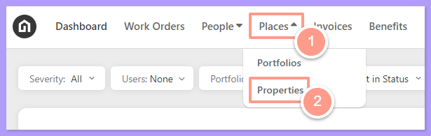
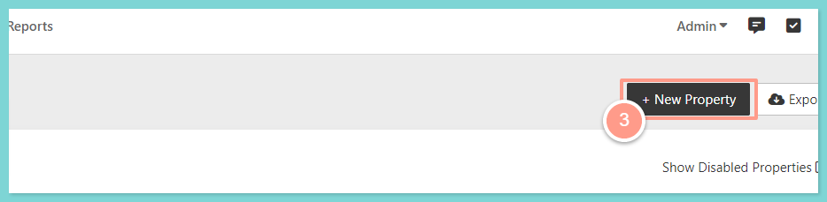
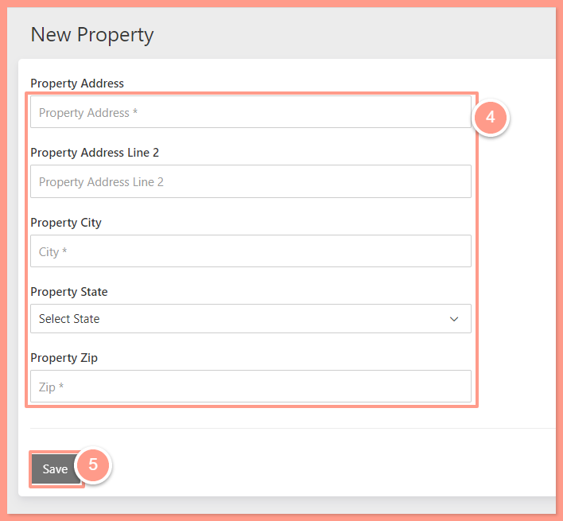

## **How to Add a Property**

<Steps>
  <Step title="**Click Places then Properties**" icon="1" iconType="sharp-solid" stepNumber={1} titleSize="p">
    On the upper left-hand side of your dashboard, click **Places** then **Properties.**

    <Frame>
      
    </Frame>
  </Step>
  <Step title="**Click New Property**" icon="2" iconType="sharp-solid" stepNumber={2} titleSize="p">
    On the upper right-hand side of the screen, click **New Property.**

    <Frame>
      
    </Frame>
  </Step>
  <Step title="**Enter the details and click Save**" icon="3" iconType="sharp-solid" stepNumber={3} titleSize="p">
    Enter the property details & click **Save\!**

    <Frame>
      
    </Frame>
  </Step>
</Steps>