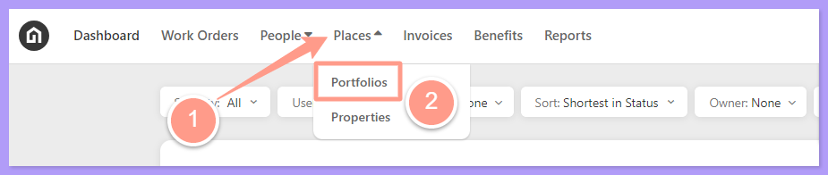
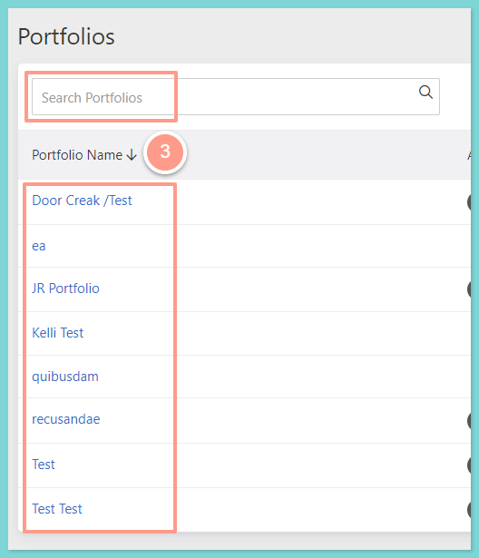
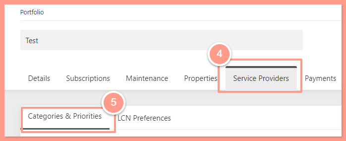
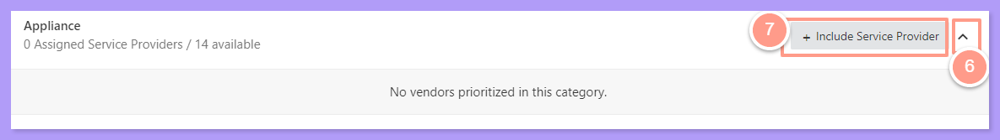
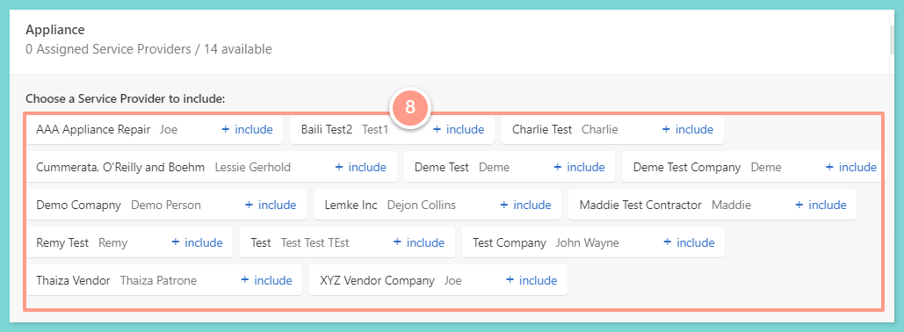
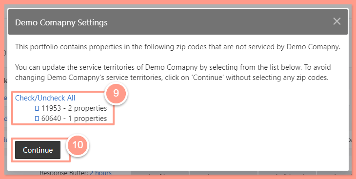

## **How to Add a Service Provider to a Portfolio**

<Steps>
  <Step title="**Click Places then Portfolio**" icon="1" iconType="sharp-solid" stepNumber={1} titleSize="p">
    From your dashboard, click **Places** and then **Portfolio**.

    <Frame>
      
    </Frame>
  </Step>
  <Step title="**Open the portfolio**" icon="2" iconType="sharp-solid" stepNumber={2} titleSize="p">
    From the Portfolio page, you can **click** on the Portfolio you'd like to configure or **search** it on the search bar.

    <Frame>
      
    </Frame>
  </Step>
  <Step title="**Open Categories & Priorities**" icon="3" iconType="sharp-solid" stepNumber={3} titleSize="p">
    On the portfolio page, click on the **Service Providers** tab and select **Categories & Priorities**.

    <Frame>
      
    </Frame>
  </Step>
  <Step title="**Click Include Service Provider**" icon="4" iconType="sharp-solid" stepNumber={4} titleSize="p">
    From the skill/categories, click on the **dropdown icon** and then **\+ Include Service Provider.**

    <Frame>
      
    </Frame>
  </Step>
  <Step title="**Include the service provider**" icon="5" iconType="sharp-solid" stepNumber={5} titleSize="p">
    Then list of Service Providers available will appear and you may add them by clicking **\+ include** beside their names. 

    <Frame>
      
    </Frame>
  </Step>
  <Step title="**Select the properties and continue**" icon="6" iconType="sharp-solid" stepNumber={6} titleSize="p">
    On the pop-up window, **select** the property(s) you want the service provided to be added.

    To finalize the configuration/change, click on **Continue**. 

    <Frame>
      
    </Frame>
  </Step>
</Steps>

Do you also need to update your service provider's skills? Check this help guide: **[How to Prioritize/Edit Service Providers With Their Skills](/s/topic/0TO5e000000h9wqGAA/How-to-Prioritize-Edit-Service-Providers-with-their-skills)**

