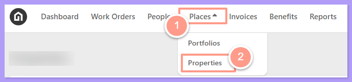
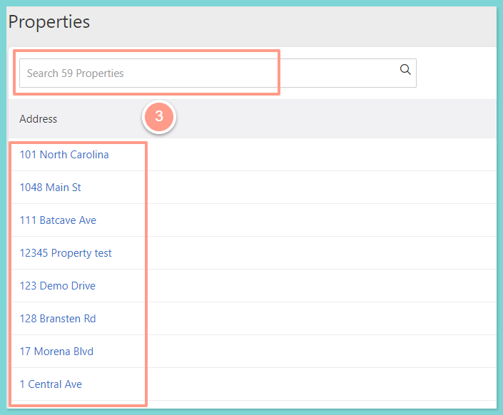
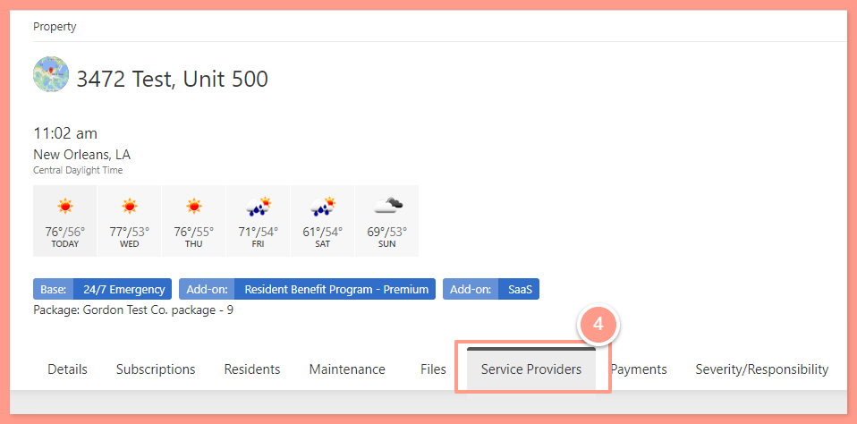
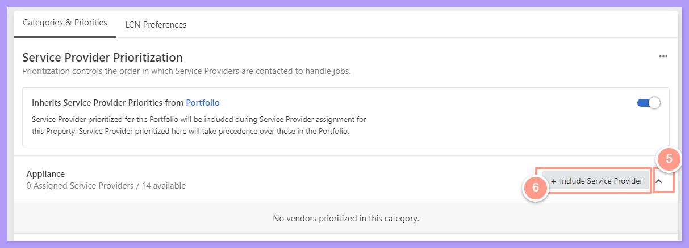
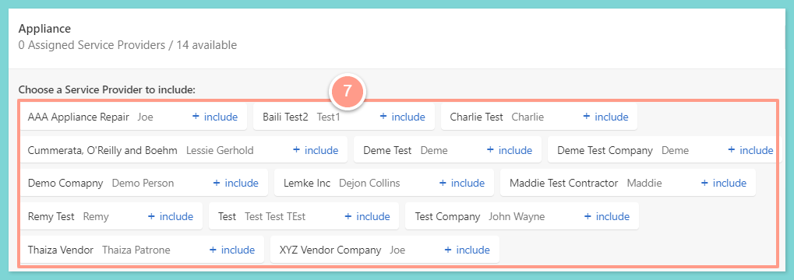
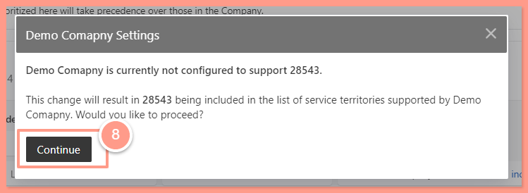
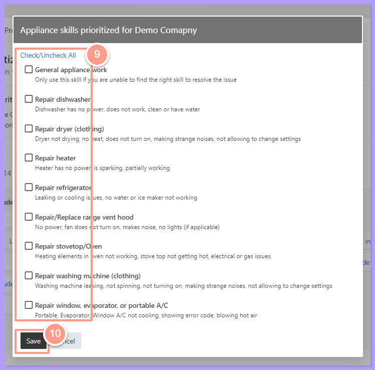

Managing a service provider based on service territories can be actioned from the company, portfolio, or even property level. 

It is encouraged to assign service provider territory/zip code(s) when you do not want a service provider outside the property's territory/zip code to be contacted when a work order comes in. Otherwise, a service provider can be dispatched to all jobs regardless of their location based on service provider prioritization and configuration. 

However on this help guide, if you have a property that is not in a service provider's assigned territory/zip code but wishes to be assigned on a work order moving forward, you can follow this help guide to add them to your service provider's territory on a property level only. This action will not affect the company and portfolio level setup.

## **How to Add a Service Provider to a Property that is Outside of an Assigned Territory / Zip Code**

<Steps>
  <Step title="**Click Places then Properties**" icon="1" iconType="sharp-solid" stepNumber={1} titleSize="p">
    From your dashboard, click on **Places** then **Properties**. 

    <Frame>
      
    </Frame>
  </Step>
  <Step title="**Search or select the property**" icon="2" iconType="sharp-solid" stepNumber={2} titleSize="p">
    From the Property Page, you can **Search** the property or **Select** it from the list.

    <Frame>
      
    </Frame>
  </Step>
  <Step title="**Click the Service Providers tab**" icon="3" iconType="sharp-solid" stepNumber={3} titleSize="p">
    Once you are on the property page, click on the **Service Providers** tab.

    <Frame>
      
    </Frame>
  </Step>
  <Step title="**Click Include Service Provider**" icon="4" iconType="sharp-solid" stepNumber={4} titleSize="p">
    Now under the Categories & Priorities, click the **Dropdown** of the corresponding skill/categories and select **\+ Include Service Provider**.

    <Frame>
      
    </Frame>
  </Step>
  <Step title="**Include the service provider**" icon="5" iconType="sharp-solid" stepNumber={5} titleSize="p">
    You may now choose the service provider you'd like to add to the property by clicking **\+ Include** beside its name.

    <Frame>
      
    </Frame>
  </Step>
  <Step title="**Click Continue**" icon="6" iconType="sharp-solid" stepNumber={6} titleSize="p">
    And since the property is outside the service provider's territory, click **Continue** to allow the changes.

    <Frame>
      
    </Frame>
  </Step>
  <Step title="**Filter skills and save**" icon="7" iconType="sharp-solid" stepNumber={7} titleSize="p">
    Then a new pop-up box will appear that will allow you to filter specific skills of the service provider. 

    To finish the configuration, click on **Save**.

    <Frame>
      
    </Frame>
  </Step>
</Steps>
