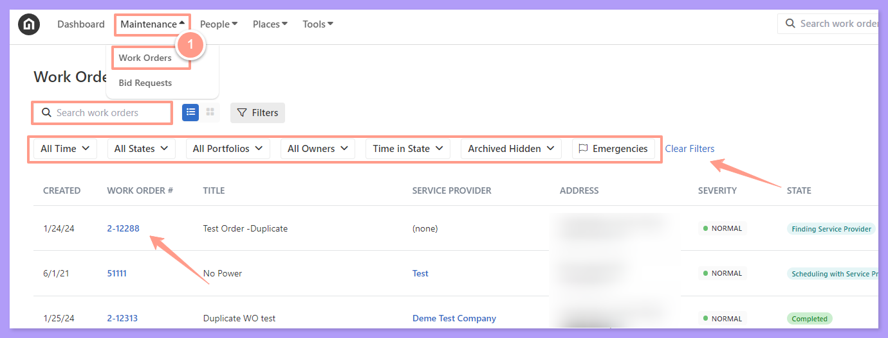
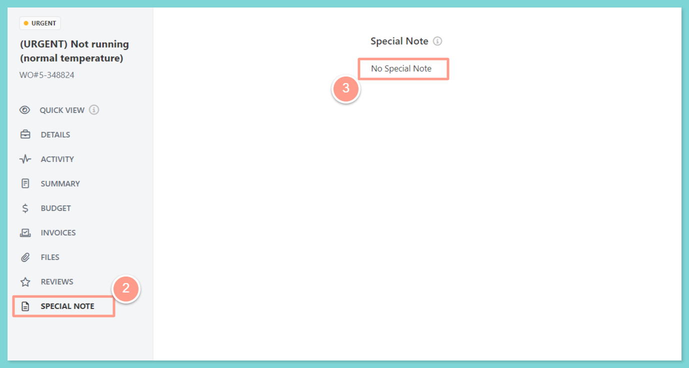
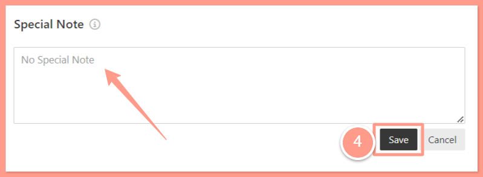

Here's how you can add a special note to any work order:

## **How to Add a Special Note to a Work Order**

<Steps>
  <Step title="**Open the work order**" icon="1" iconType="sharp-solid" stepNumber={1} titleSize="p">
    To select the desired work order, from the dashboard, click on the **Maintenance tab**, and open the work order by either **searching and/or clicking the specific order number.** You can also use the **Filter** and **Clear Filters** option for a more refined search. To learn more about how to use the Filter, check out this help guide:

    <Card title="How to Use the Filter Options in the Work Order Tab Page" color="#ff9b8a" icon="filter-list" iconType="duotone" href="/s/topic/0TO5e000000h9wqGAA/How-to-Use-the-Filter-Options-in-the-Work-Order-Tab-Page">
      Learn how to use filters in the Work Order tab to quickly sort, find, and manage the requests you care about most.
    </Card>

    <Frame>
      
    </Frame>
  </Step>
  <Step title="**Click Special Note and type the note**" icon="2" iconType="sharp-solid" stepNumber={2} titleSize="p">
    From the work order page, click on **Special Note**, and the **Special Note section** will be presented. To type in an additional special note, click the **No Special Note** to activate the box where you can add new notes.

    <Frame>
      
    </Frame>
  </Step>
  <Step title="**Click Save**" icon="3" iconType="sharp-solid" stepNumber={3} titleSize="p">
    Click **Save** once done adding the special note.

    <Frame>
      
    </Frame>
  </Step>
</Steps>

**Are you having difficulty finding the right property you need to work on? Check out the guide below:**

<Card title="Quick Search Box for Work Orders" color="#ff9b8a" icon="box-open" iconType="duotone" href="/s/topic/0TO5e000000h9wqGAA/Quick-Search-Box-for-Work-Orders">
  Use the search bar to instantly locate specific work orders by keyword, number, or address.
</Card>
