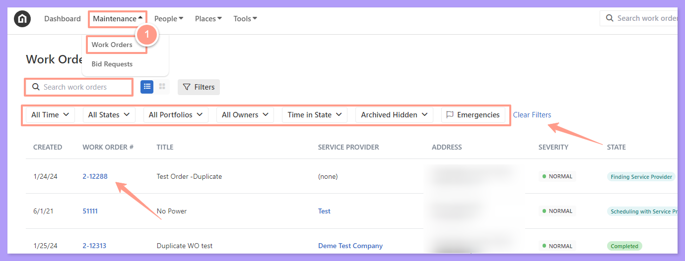
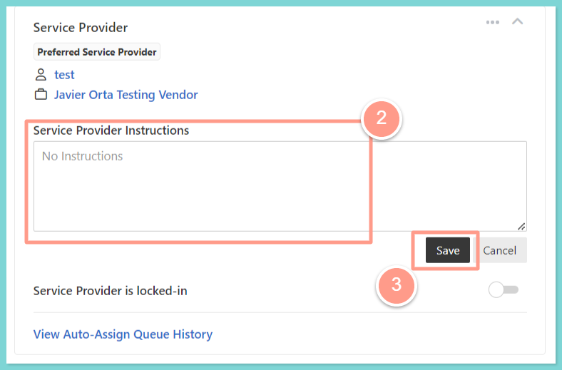

The service provider will **NOT** be notified of any changes made to the scope of a request. Here's how you can add/update service provider instructions on a work order:

## **How to Add or Update Service Provider Instructions on a Work Order**

<Steps>
  <Step title="**Open the work order**" icon="1" iconType="sharp-solid" stepNumber={1} titleSize="p">
    From the dashboard, click on the **Maintenance tab**, and open the work order by either **searching and/or clicking the specific order number**. You can also use the **Filter** and **Clear Filters** option for a more refined search. To learn more about how to use the Filter, check out this help guide:

    <Card title="How to Use the Filter Options in the Work Order Tab Page" color="#ff9b8a" icon="filter-list" iconType="duotone" href="/s/topic/0TO5e000000h9wqGAA/How-to-Use-the-Filter-Options-in-the-Work-Order-Tab-Page">
      Learn how to use filters in the Work Order tab to quickly sort, find, and manage the requests you care about most.
    </Card>

    <Frame>
      
    </Frame>
  </Step>
  <Step title="**Write the new instructions**" icon="2" iconType="sharp-solid" stepNumber={2} titleSize="p">
    Either in the **Quick View** or in the **Details** tab, you will find the Service Provider section where you can find the **Service Provider Instructions** box. Write the new instructions you have for the service provider, then click **Save.**

    <Frame>
      
    </Frame>
  </Step>
</Steps>

And that's how easily you can add Service Provider instructions\!