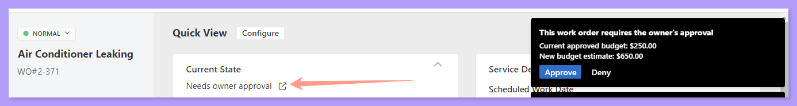
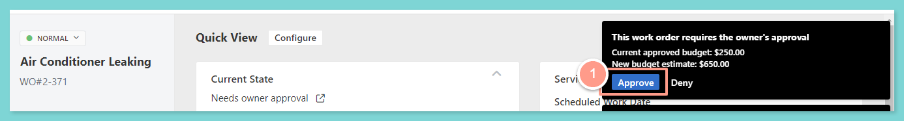
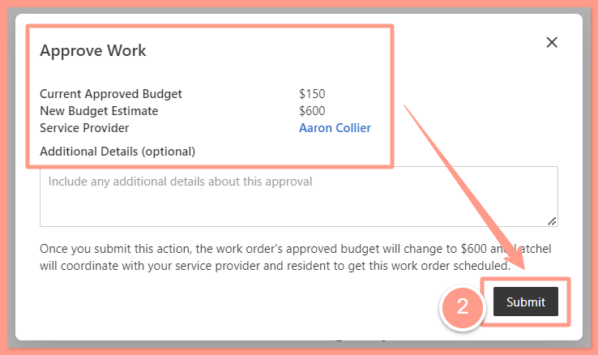
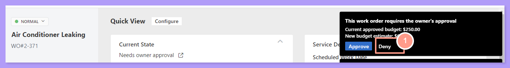
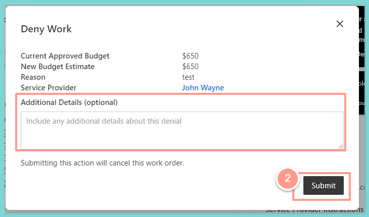

From the work order page, notice that the status of the work is **"Needs Owner Approval"**. To take action, just hit the **Approve** or **Deny** options in the notification box located at the upper right-hand corner of the page.
<Frame>
  
</Frame>

## **When a Vendor Needs Time: Awaiting Estimate**

Some jobs need a closer look before a vendor can give you a price. When that happens, the work order moves to **Awaiting Estimate** and shows a due date for the estimate (3 days by default). Latchel follows up with the vendor for you. If the estimate is 3 days past due, you'll get one **Estimate Overdue** task.

You and Latchel Ops can also set this status yourself. On the work order, click **Take Action** and choose **Waiting on an Estimate**.

{/* TODO: screenshot of the Take Action menu showing Waiting on an Estimate */}

<Note>
  Work orders from a bid request use **Awaiting Bid** instead of **Awaiting Estimate**.
</Note>

## **Estimates With Repair-vs-Replace Options**

Vendors can now send up to 5 options on one estimate. Each option is a **Repair**, a **Replace**, or **Other**, with its own price and description, and the vendor can mark one option as recommended. Vendors can also attach files and photos to the estimate as a whole.

- **One price:** it's approved the same way as before, including auto-approval when it's within the budget.
- **More than one option:** it always comes to you for approval, or to the owner if the owner approves new budgets. You pick one option, and its price becomes the budget.

{/* TODO: screenshot of an estimate with several options and one marked as recommended */}

## **Approve Budget Estimate**

If you choose to Approve the estimate, a new pop-up box will appear showing the following:

* Current Approved Budget
* New Approved Budget
* The reason for the proposed budget
* The name of the Service Provider so the Property Manager will have information who is the Service Provider that may work with the work order.
* Every option the Service Provider sent, if there is more than one
* The Service Provider's notes, files, and photos
* What each decision will do

{/* TODO: replace the screenshots below with the new Approve or Deny screen */}

If you approve the **New Budget Estimate**, you can add a note, and we'll send it to the Service Provider. Then click **Submit** and you're all good

<Frame>
  
</Frame>
 
<Frame>
  
</Frame>

## **Deny Budget Estimate**

On the other hand, if the budget is **Denied**, a pop-up box will also appear. Similarly, you can leave **Additional Details** as to why the estimated budget was denied, then hit **Submit**. We'll send your note to the Service Provider.

<Frame>
  
</Frame>
 
<Frame>
  
</Frame>

<Info>
  **NOTE**: _The work order will be canceled if the budget is denied, and an email notification will be sent to the Service Provider, informing them of the denied bid and the canceled work order. Any other open bids will still be pending until a Property Manager approves or denies them. Additionally, the Service Provider may submit their invoice for the dispatch or initial site visit._
</Info>

## **When the Owner Decides**

If your owner approves new budgets, they can approve or deny from their link and add a note. You can also record the owner's decision yourself on the same Approve or Deny screen.

## **See Everything on the Costs Tab**

The new **Costs** tab on the work order shows the budget, estimates, and invoices together. While an estimate is waiting for approval, it shows on the **Details** tab with an orange highlight, and automations show **Paused** until the estimate is decided.

{/* TODO: screenshot of the Costs tab */}

## **Email Estimates and Invoices to Latchel**

Service Providers and Property Managers can email or forward estimates and invoices to a Latchel inbox:

- Estimates: [**estimates@inbox.latchel.com**](mailto:estimates@inbox.latchel.com)
- Invoices: [**invoices@inbox.latchel.com**](mailto:invoices@inbox.latchel.com)

We find the matching work order and attach the document for you.

<Note>
  - Nothing emailed is ever auto-approved, including invoices.
  - If one email clearly covers several work orders, we'll ask the sender to send one email per work order, and nothing is attached.
  - If we can't place a document, our team reviews it and attaches it by hand.
</Note>
