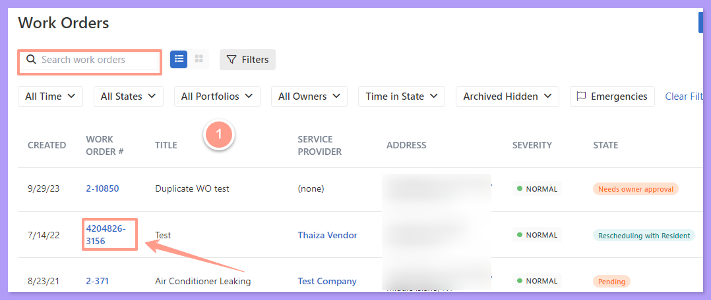
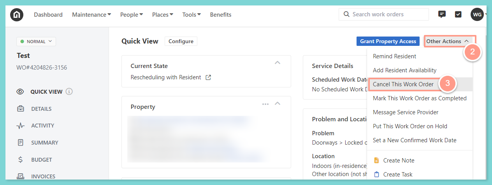
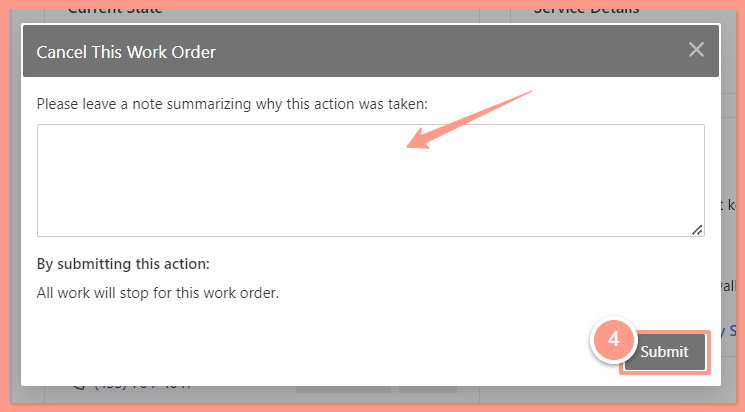

<Info>
  **NOTE:** _All canceled requests will move to the canceled column in the Latchel maintenance page from any active or pending statuses. All tasks and work will cease for this job immediately._
</Info>

## **How to Cancel a Work Order**

<Steps>
  <Step title="**Open the work order**" icon="1" iconType="sharp-solid" stepNumber={1} titleSize="p">
    To get to the desired work order, from the dashboard, click on the Maintenance tab, and open the work order by either searching and/or clicking the specific order number. You can also use the **Filter** and **Clear Filters** option for a more refined search. To learn more about how to use the Filter, check out this help guide:

    <Card title="How to Use the Filter Options in the Work Order Tab Page" color="#ff9b8a" icon="filter-list" iconType="duotone" href="/s/topic/0TO5e000000h9wqGAA/How-to-Use-the-Filter-Options-in-the-Work-Order-Tab-Page">
      Learn how to use filters in the Work Order tab to quickly sort, find, and manage the requests you care about most.
    </Card>

    <Frame>
      
    </Frame>
  </Step>
  <Step title="**Choose Cancel This Work Order**" icon="2" iconType="sharp-solid" stepNumber={2} titleSize="p">
    On the work order page, click **Other Actions** and select **Cancel This Work Order.**

    <Frame>
      
    </Frame>
  </Step>
  <Step title="**Leave a note and submit**" icon="3" iconType="sharp-solid" stepNumber={3} titleSize="p">
    Leave a note on why the work order must be canceled, and click **Submit.**

    <Frame>
      
    </Frame>
  </Step>
</Steps>