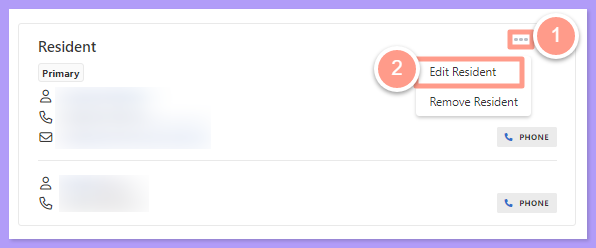
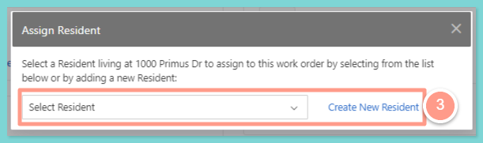
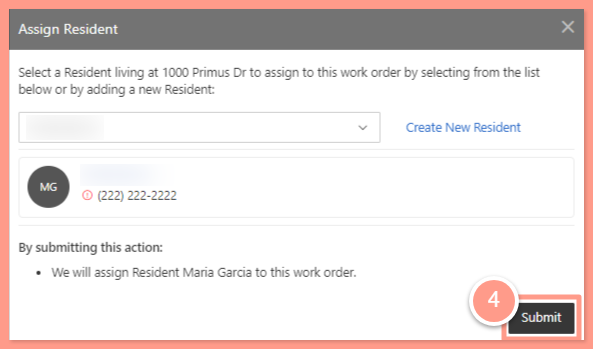

Here's how you can change the primary resident on a work order:

## **How to Change the Primary Resident on a Work Order**

<Steps>
  <Step title="**Select Edit Resident**" icon="1" iconType="sharp-solid" stepNumber={1} titleSize="p">
    In the work order page, click on the 3 dots next to the **Resident** modal and select **Edit Resident.**

    <Frame>
      
    </Frame>

    You will be prompted to **Select** or **Create New Resident.**

    <Frame>
      
    </Frame>
  </Step>
  <Step title="**Select the resident and submit**" icon="2" iconType="sharp-solid" stepNumber={2} titleSize="p">
    Select the appropriate resident from the prompted list, then **Submit.**

    <Frame>
      
    </Frame>
  </Step>
</Steps>

And that's how easy you can change a resident in a work order\!