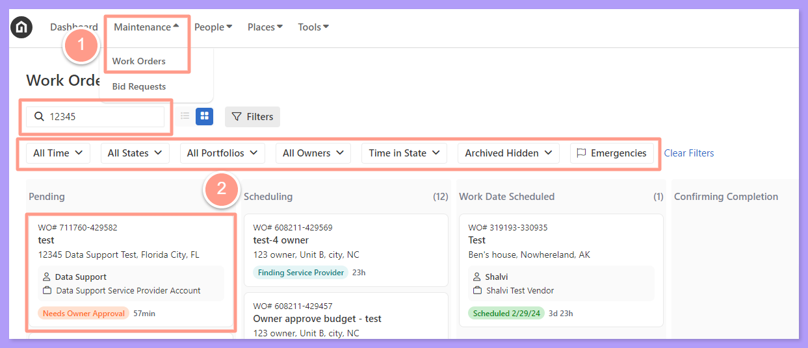
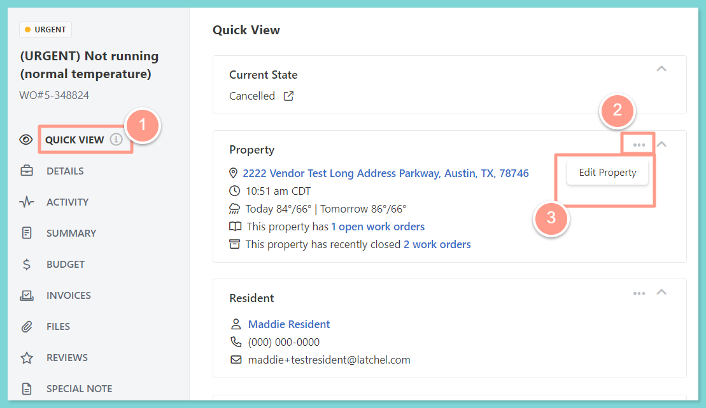
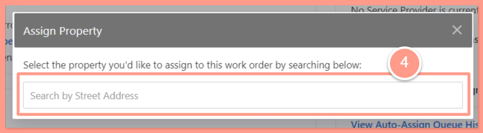
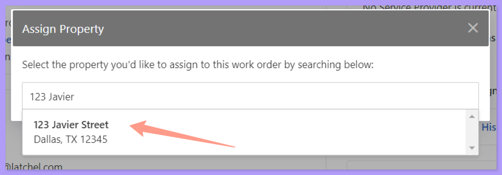
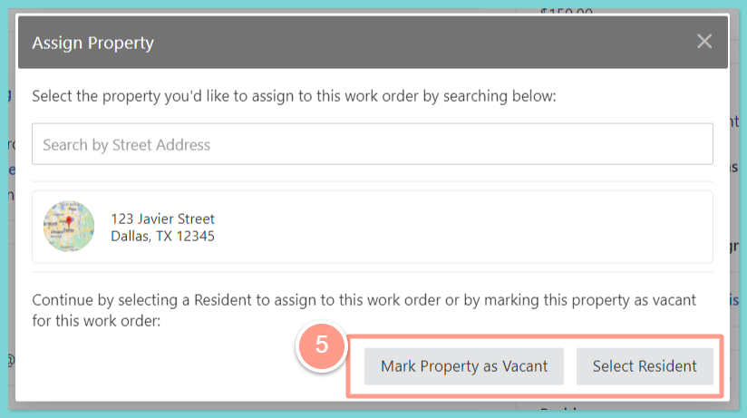
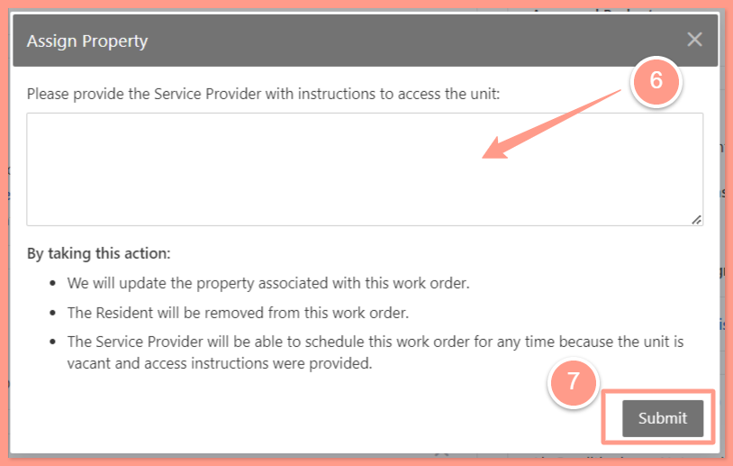

<Info>
  **NOTE:** _Latchel can only have 1 address per Work Order, so if multiple units are affected, multiple requests must be opened for coordination unless resolving the issue in 1 unit solves it for the rest._
</Info>

## **How to Change the Property on a Work Order**

<Steps>
  <Step title="**Open the work order**" icon="1" iconType="sharp-solid" stepNumber={1} titleSize="p">
    To select the desired work order, from the dashboard, click on **the Maintenance tab**, and open the work order by either **searching and/or clicking the specific order number**. You can also use the **Filter** and **Clear Filters** option for a more refined search. To learn more about how to use the Filter, check out this help guide:

    <Card title="How to Use the Filter Options in the Work Order Tab Page" color="#ff9b8a" icon="filter-list" iconType="duotone" href="/s/topic/0TO5e000000h9wqGAA/How-to-Use-the-Filter-Options-in-the-Work-Order-Tab-Page">
      Learn how to use filters in the Work Order tab to quickly sort, find, and manage the requests you care about most.
    </Card>

    <Frame>
      
    </Frame>
  </Step>
  <Step title="**Click Edit Property**" icon="2" iconType="sharp-solid" stepNumber={2} titleSize="p">
    From the Quick View tab click on the **3 dots** located next to the Property modal, and click **Edit Property.**

    <Frame>
      
    </Frame>
  </Step>
  <Step title="**Search for the property**" icon="3" iconType="sharp-solid" stepNumber={3} titleSize="p">
    Search the property you'd like the order to be assigned. The property address will show in the drop-down result. 

    <Frame>
      
    </Frame>

    <Frame>
      
    </Frame>
  </Step>
  <Step title="**Mark as vacant or select a resident**" icon="4" iconType="sharp-solid" stepNumber={4} titleSize="p">
    Next, select **Mark Property as Vacant** or **Select Resident**. For this scenario, let's choose **Mark Property as Vacant.**

    <Frame>
      
    </Frame>
  </Step>
  <Step title="**Add notes and submit**" icon="5" iconType="sharp-solid" stepNumber={5} titleSize="p">
    It is recommended to put in notes and explain the reason for the change of property, then hit **Submit**. 

    <Frame>
      
    </Frame>
  </Step>
</Steps>

And that's how you can change or edit the property address in a work order\!