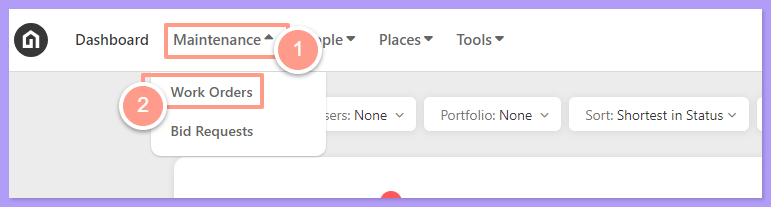
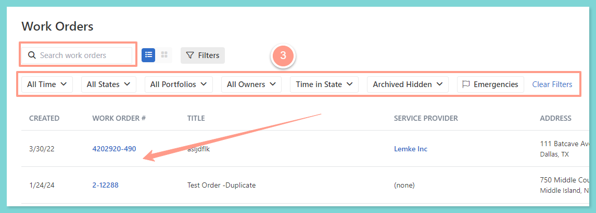
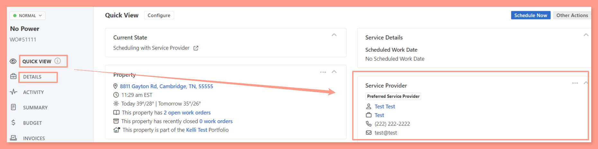
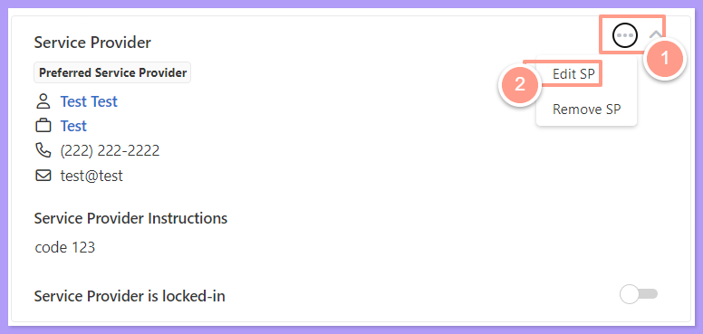
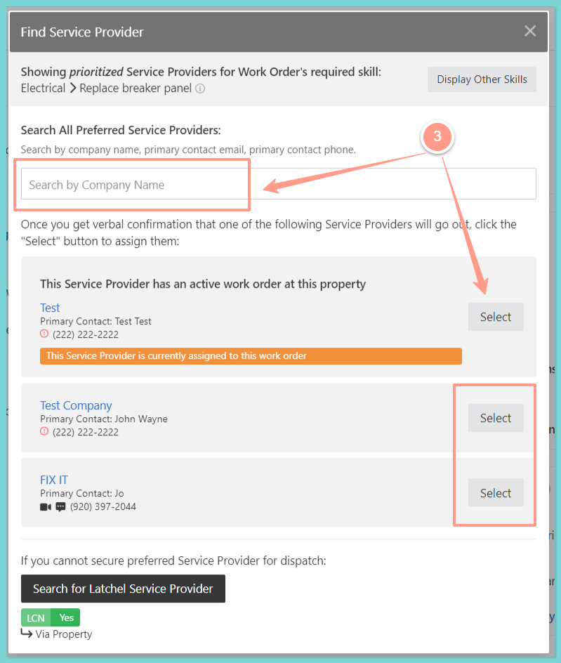
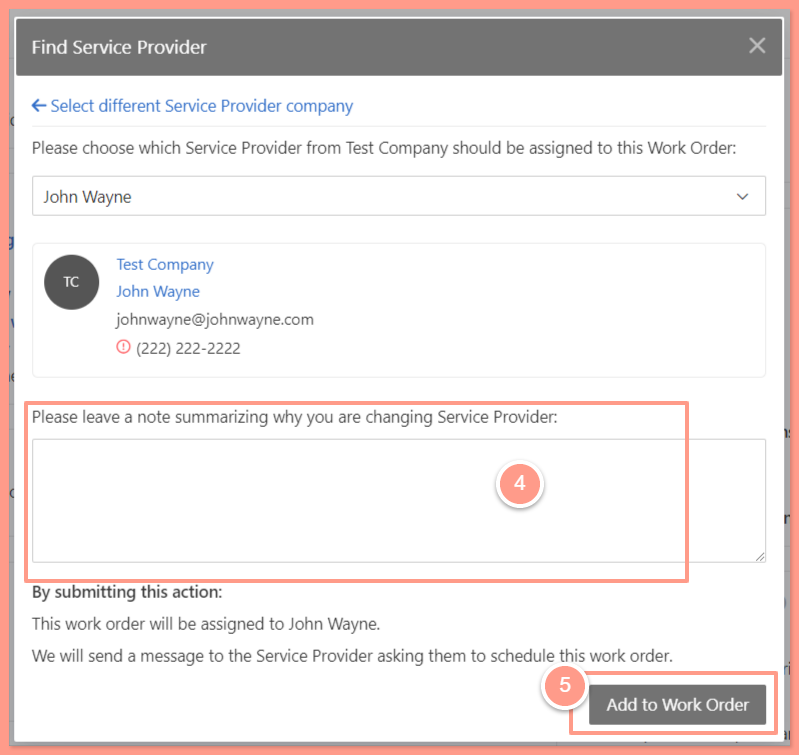
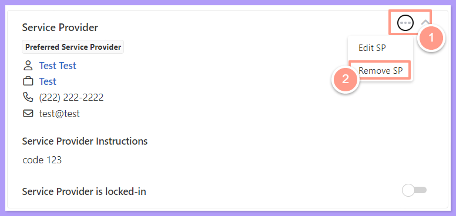
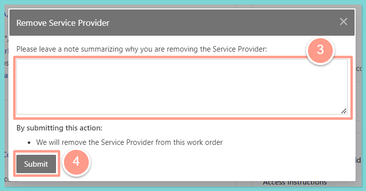

<Steps>
  <Step title="**Go to Work Orders**" icon="1" iconType="sharp-solid" stepNumber={1} titleSize="p">
    First, **search for the work order** you need to update. From your **Dashboard**, click the **Maintenance** dropdown and select **Work Orders**.

    <Frame>
      
    </Frame>
  </Step>
  <Step title="**Search for and open the work order**" icon="2" iconType="sharp-solid" stepNumber={2} titleSize="p">
    Now to select the desired work order, use the **Search Bar** then click on the **Work Order ID** on the Work Order page. You can also use **Filter** for easy search.

    <Frame>
      
    </Frame>
  </Step>
</Steps>

## **How to Edit/Change the Service Provider Assigned on a Work Order**

<Steps>
  <Step title="**Find the Service Provider section**" icon="1" iconType="sharp-solid" stepNumber={1} titleSize="p">
    Once you are in the work order select **Quick View** or **Details** tab, then look for the **Service Provider** section.

    <Frame>
      
    </Frame>
  </Step>
  <Step title="**Choose Edit SP**" icon="2" iconType="sharp-solid" stepNumber={2} titleSize="p">
    From there click the ellipsis <Icon icon="circle-ellipsis" iconType="sharp-regular" size={25} />, then choose **Edit SP**.

    <Frame>
      
    </Frame>
  </Step>
  <Step title="**Select or search for the service provider**" icon="3" iconType="sharp-solid" stepNumber={3} titleSize="p">
    You may select from the list of the **Service Providers** for Work Order's required skill. Or **Search** for the Service Provider company if the service provider is not on the list, then click **Select**.

    <Frame>
      
    </Frame>
  </Step>
  <Step title="**Add the details and confirm**" icon="4" iconType="sharp-solid" stepNumber={4} titleSize="p">
    Once you have chosen the Service Provider, fill out the box providing details of why you are changing the service provider, and click **Add to Work Order.**

    <Frame>
      
    </Frame>

    <Note>
      If there are multiple users in the service provider company, please also select the user to be assigned in the work order.
    </Note>
  </Step>
</Steps>

## **How to Remove the Service Provider Assigned on a Work Order**

<Steps>
  <Step title="**Choose Remove**" icon="1" iconType="sharp-solid" stepNumber={1} titleSize="p">
    From the Service Provider section click the**ellipsis**  <Icon icon="circle-ellipsis" iconType="sharp-regular" size={25} /> and choose **Remove SP** if you need to completely remove or unassign the service provider from the work order.

    <Warning>
      Removing a service provider assigned to the work order will **not** prompt you to assign or choose a different service provider. If you wish to re-assign another service provider, choose **Edit SP** instead.
    </Warning>

    <Frame>
      
    </Frame>
  </Step>
  <Step title="**Leave a note and submit**" icon="2" iconType="sharp-solid" stepNumber={2} titleSize="p">
    Next, leave a note summarizing why you are removing the service provider. Then click **Submit**.

    <Frame>
      
    </Frame>

    <Note>
      When a service provider is unassigned from the work order, the work order will be changed to Finding Service Provider status.
    </Note>
  </Step>
</Steps>