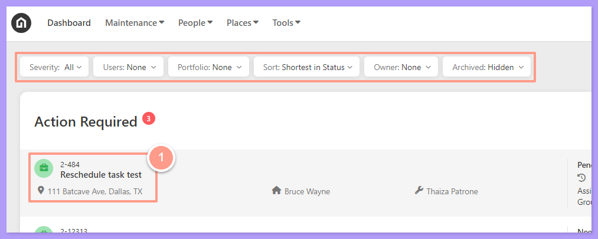
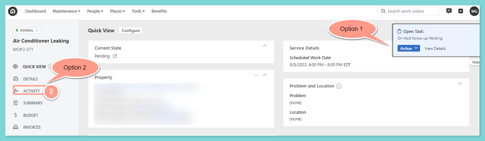
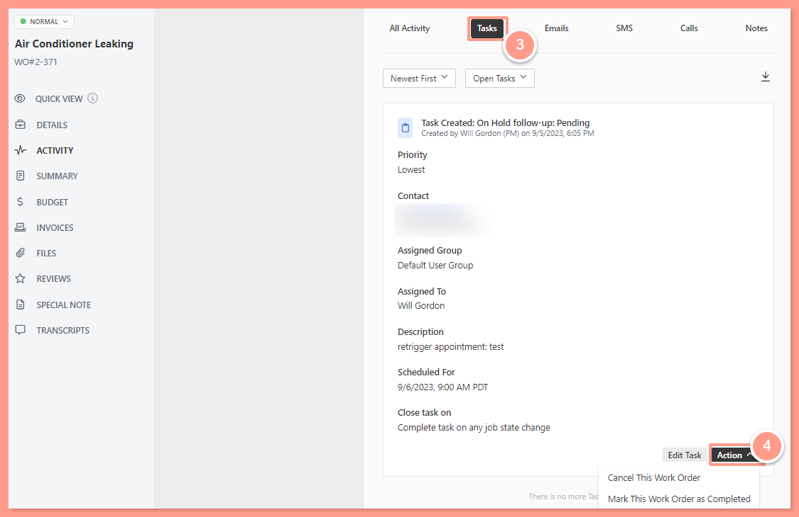
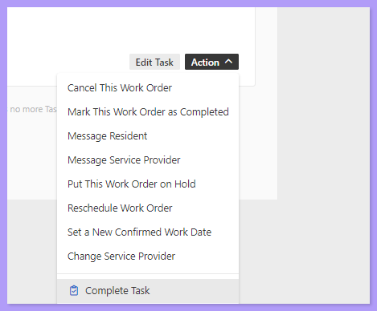

<Info>
  **NOTE:** _If a work order is listed under this bin, it means that the work order has a pending task. Find the work order you need to work on and click it. You can also use the filters just right above the Action Required bin for easy searching._
</Info>

## **How to Complete a Task**

<Frame>
  
</Frame>

Once you are on the Work Order page, there will be **two options** to review and action the open tasks.

<Steps>
  <Step title="**Choose how to open the task**" icon="1" iconType="sharp-solid" stepNumber={1} titleSize="p">
    **Option 1:** Notice the floating **Open Task reminder** in blue at the top right corner of the screen. From this option, you may click **View Details** or **Action**.

    **Option 2:** Click on **Activity,** located on the left side of the page. For this help guide, let's use this option.

    <Frame>
      
    </Frame>
  </Step>
  <Step title="**Click the Tasks tab**" icon="2" iconType="sharp-solid" stepNumber={2} titleSize="p">
    In the Activity section, click on the **Tasks** Tab to review the task assignment and click **Action** to proceed. 

    <Frame>
      
    </Frame>
  </Step>
  <Step title="**Choose an action**" icon="3" iconType="sharp-solid" stepNumber={3} titleSize="p">
    The **Action** button will give you suggested options to take. Choose the necessary option according to the next step you need to take for the work order.

    <Frame>
      
    </Frame>
  </Step>
</Steps>

And that's how easily you can complete a task\!

**To learn about creating new tasks, follow the steps from this help guide:**

<Card title="How to Create a Task" color="#ff9b8a" icon="file-pen" iconType="duotone" href="/s/topic/0TO5e000000h9wqGAA/How-to-Create-a-Task-New-Experience">
  Step-by-step guide on creating new tasks for better workflow coordination.
</Card>