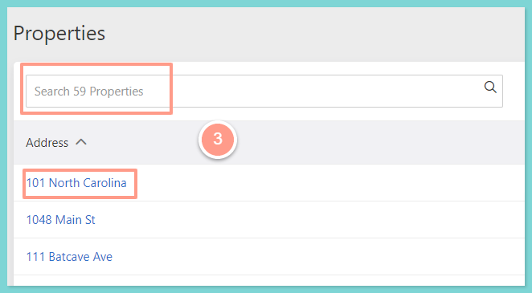
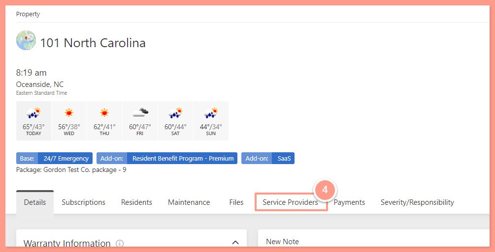
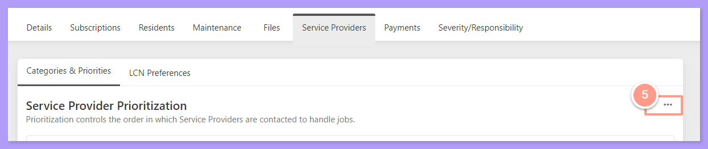
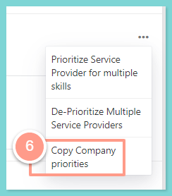
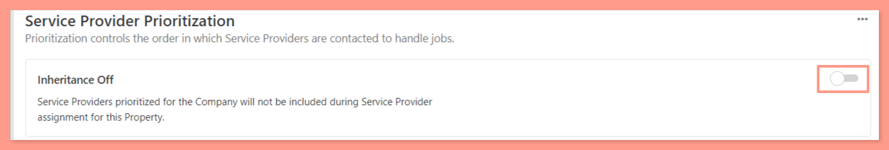

## **How to Copy Company or Portfolio Service Provider Prioritization**

To update a property's Service Provider Prioritization with its parent Company or Portfolio's Service Providers and priorities, follow these steps:

<Steps>
  <Step title="**Go to Places then Properties**" icon="1" iconType="sharp-solid" stepNumber={1} titleSize="p">
    First, navigate to the **Places** tab and select **Properties.**

    <Frame>
      
    </Frame>
  </Step>
  <Step title="**Choose the property**" icon="2" iconType="sharp-solid" stepNumber={2} titleSize="p">
    Then, choose the desired property either by searching or clicking on it.

    <Frame>
      
    </Frame>
  </Step>
  <Step title="**Click the Service Provider tab**" icon="3" iconType="sharp-solid" stepNumber={3} titleSize="p">
    On the property page, click on the **Service Provider** tab.

    <Frame>
      
    </Frame>
  </Step>
  <Step title="**Click the ellipsis icon**" icon="4" iconType="sharp-solid" stepNumber={4} titleSize="p">
    Click the **ellipsis icon** across the **Service Provider Prioritization.**

    <Frame>
      
    </Frame>
  </Step>
  <Step title="**Select Copy Company Priorities**" icon="5" iconType="sharp-solid" stepNumber={5} titleSize="p">
    Select **Copy Company Priorities** to replace all Service Providers and priorities in the property with those in the parent Company. If the property is in the  Portfolio, all Service Providers prioritized will be replaced with those in the parent Portfolio.

    <Frame>
      
    </Frame>

    <Note>
      If this option is **turned OFF**, this will automatically disable the inheritance feature for the selected property, which means that any changes made to the parent Company's Service Providers and priorities will NOT affect this property's Service provider prioritization.
    </Note>

    <Frame>
      
    </Frame>
  </Step>
</Steps>