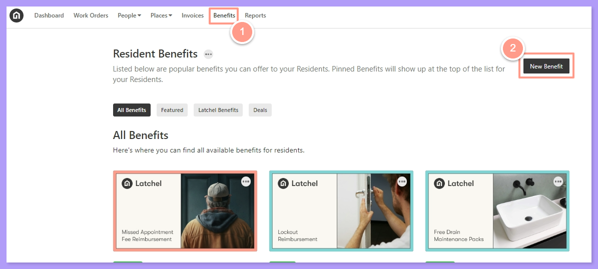
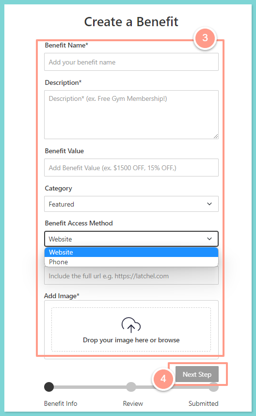
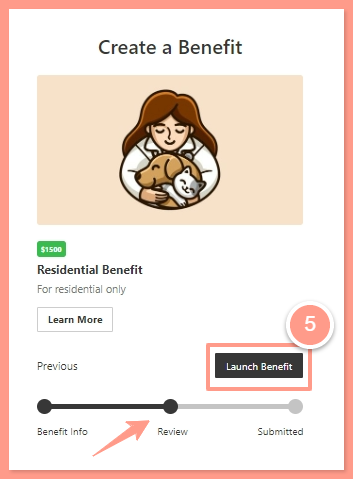
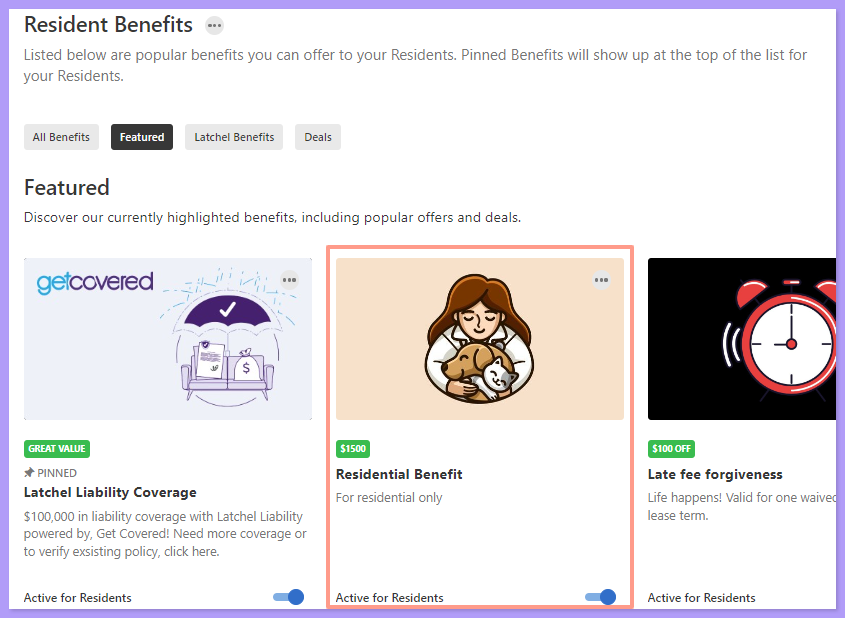

## **How to Create New Resident Benefit**

<Steps>
  <Step title="**Click New Benefits**" icon="1" iconType="sharp-solid" stepNumber={1} titleSize="p">
    Go to the **Benefits** from your dashboard, then click **New Benefits**.

    <Frame>
      
    </Frame>
  </Step>
  <Step title="**Enter the benefit details**" icon="2" iconType="sharp-solid" stepNumber={2} titleSize="p">
    On the **Create a Benefit** page, provide all the necessary information about the new benefit as follows. Click **Next Step** once done.

    - **Benefit Name** - the name of the Resident Benefit
    - **Description** - provide a brief description of the new benefit
    - **Benefit Value** - add a value, for example, \$1500 or 15% OFF
    - **Category** - you may choose between **Featured** or **Deal**
    - **Benefit Access Method** - select an access method either a **website** or **phone number** of the resident benefit information
    - **Add Image** - upload an image. This can be a company logo or the name of the benefit.

    <Frame>
      
    </Frame>
  </Step>
  <Step title="**Review and click Launch Benefit**" icon="3" iconType="sharp-solid" stepNumber={3} titleSize="p">
    Review the new resident benefit, then click **Launch Benefit** if all information is correct.

    <Note>
      You may click **Previous** if you wish to go back to the previous page and edit some information.
    </Note>

    <Frame>
      
    </Frame>

    Once the benefit is launched, it will be part of the active benefit on your Resident Benefit hub.

    <Frame>
      
    </Frame>
  </Step>
</Steps>

And that’s how you create your custom Resident Benefit. Now it’s time to announce it to your residents\!

<Tip>
  Need steps to instruct your residents on how to access their resident benefits? Check [Accessing Your Resident Benefits](/s/topic/0TO5e000000h9wrGAA/Accessing-Your-Resident-Benefits-Hub).
</Tip>