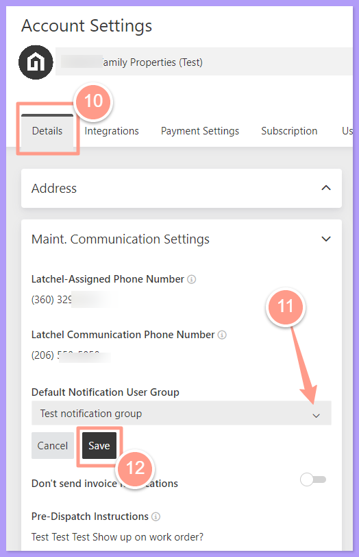
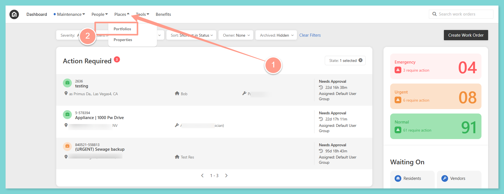
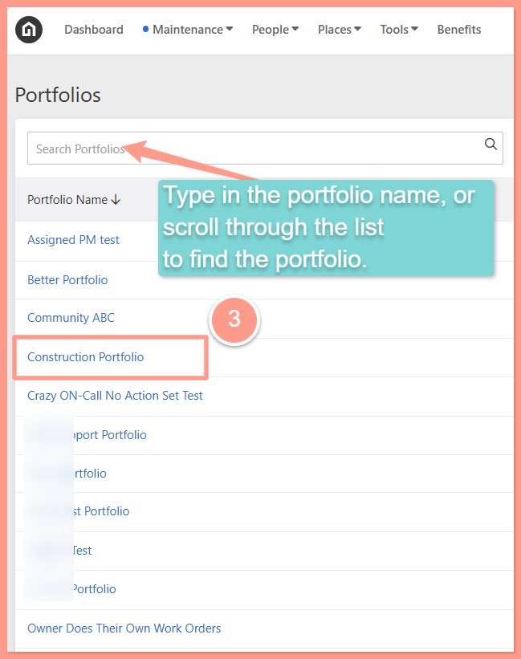
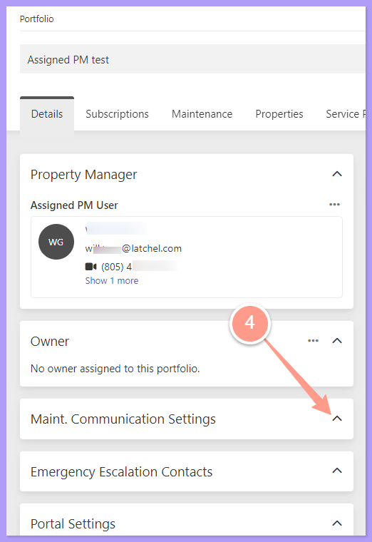
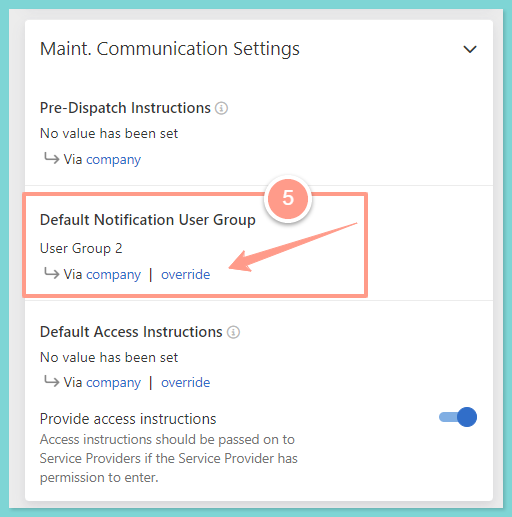
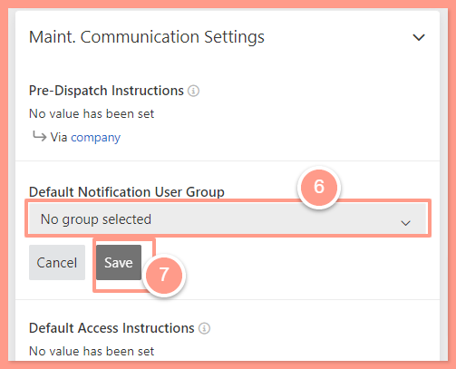
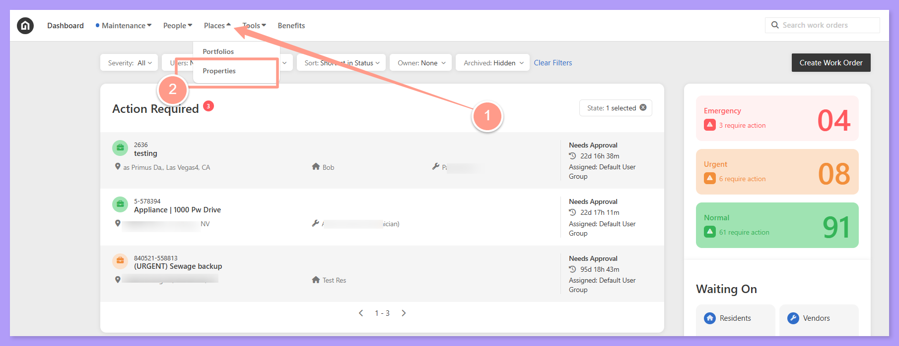
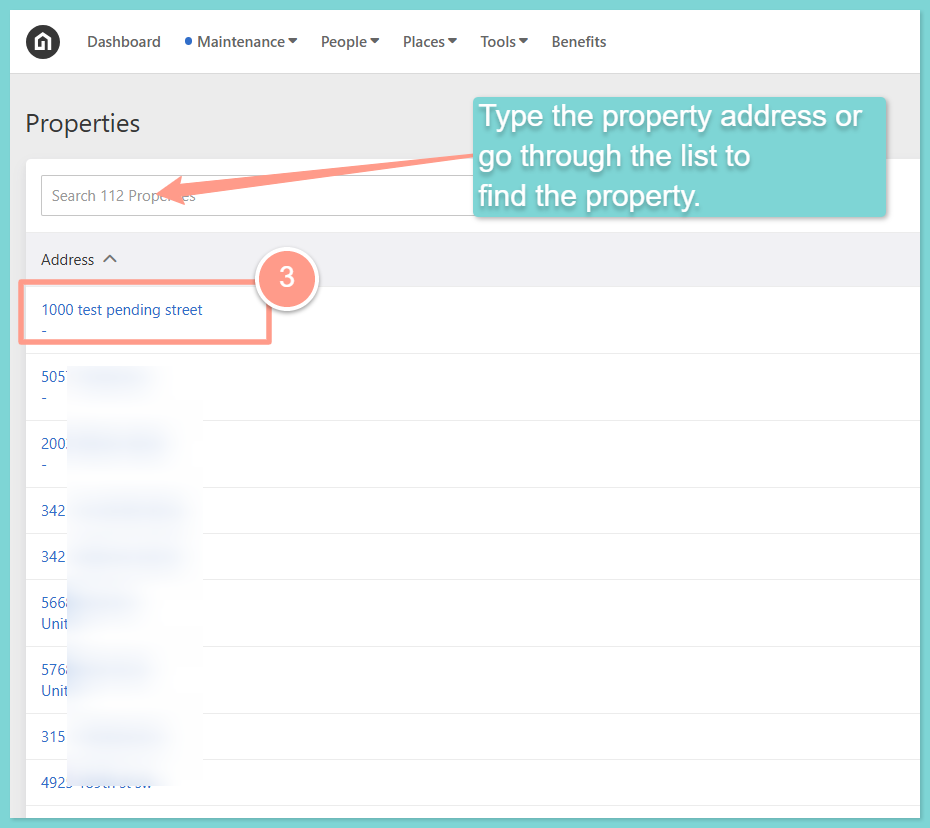
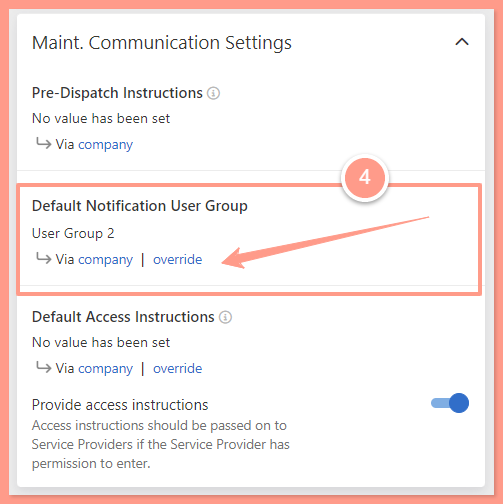
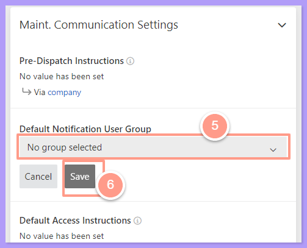

<Note>
  As of the June 2026 release, **"User Groups" have been renamed to "Teams"** throughout the Latchel platform. The steps, button labels, and screenshots below still reflect the previous "User Group" naming — the underlying functionality is unchanged, but you may see "Team" or "Teams" in place of "User Group" in your account.
</Note>

## **Configuring Teams at the Company Level**

<Warning>
  The Teams at the Company Level will automatically apply to all portfolios and properties on the account unless there are individual assignments made at the property or portfolio level.   To learn more about configuration inheritance and how to override company-level configurations, see the guide below.
</Warning>

<Card title="Configuration Inheritance (Property, Portfolio, & Company Level)" color="#ff9b8a" icon="network-wired" iconType="duotone" href="/s/topic/0TO5e000000h9wqGAA/Configuration-Inheritance-Property-Portfolio-Company-Level">
  See how settings at the company, portfolio, and property levels pass down, and how to override them.
</Card>

<Steps>
  <Step title="**Open Account Settings**" icon="1" iconType="sharp-solid" stepNumber={1} titleSize="p">
    Click on the **drop-down** at the top right-hand side of your screen. Select **Account Settings** from the menu.

    <Frame>
      
    </Frame>
  </Step>
  <Step title="**Click the Teams tab**" icon="2" iconType="sharp-solid" stepNumber={2} titleSize="p">
    From the Account Settings page, click the **Teams** tab.

    <Frame>
      
    </Frame>
  </Step>
  <Step title="**Click New Team**" icon="3" iconType="sharp-solid" stepNumber={3} titleSize="p">
    On the right-hand side of your page, click **New Team.**

    <Frame>
      
    </Frame>
  </Step>
  <Step title="**Name the team and save**" icon="4" iconType="sharp-solid" stepNumber={4} titleSize="p">
    Type in a **name** for your Team and click**Save.**

    <Frame>
      
    </Frame>
  </Step>
  <Step title="**Click Add user to team**" icon="5" iconType="sharp-solid" stepNumber={5} titleSize="p">
    On the far right-hand side of your screen, click the **ellipsis (**<Icon icon="ellipsis" color="#000000" />**)** and then **Add user to team.**

    <Frame>
      
    </Frame>
  </Step>
  <Step title="**Add a user and submit**" icon="6" iconType="sharp-solid" stepNumber={6} titleSize="p">
    Search for an existing user on your account or create a new user. Click **Submit** to save.

    <Frame>
      
    </Frame>
  </Step>
  <Step title="**Click the Details tab**" icon="7" iconType="sharp-solid" stepNumber={7} titleSize="p">
    To set the Team to receive all of Latchel’s email notifications on the Company Level, click the **Details** tab.
  </Step>
  <Step title="**Select the default notification group**" icon="8" iconType="sharp-solid" stepNumber={8} titleSize="p">
    Under the **Maint. Communication Settings**, click the dropdown under the **Default Notification User Group** field and select the User Group. Click **Save.**

    If you don’t see the User Groups you need to refresh the page so they get populated.

    <Frame>
      
    </Frame>
  </Step>
</Steps>

## **Configuring a User Group (Portfolio Level)**

<Note>
  The User Group at the Portfolio Level will automatically be applied to all properties within that portfolio.   To learn more about configuration inheritance and how a single property can override Portfolio and company-level configurations, see the guide below.
</Note>

<Card title="Configuration Inheritance (Property, Portfolio, & Company Level)" color="#ff9b8a" icon="network-wired" iconType="duotone" href="/s/topic/0TO5e000000h9wqGAA/Configuration-Inheritance-Property-Portfolio-Company-Level">
  See how settings at the company, portfolio, and property levels pass down, and how to override them.
</Card>

<Steps>
  <Step title="**Open the portfolio**" icon="1" iconType="sharp-solid" stepNumber={1} titleSize="p">
    Click the **Places** tab and then, click **Portfolios**. Then, search or select the portfolio that you want to edit.

    <Frame>
      
    </Frame>

    <Frame>
      
    </Frame>
  </Step>
  <Step title="**Scroll to Maint. Communication Settings**" icon="2" iconType="sharp-solid" stepNumber={2} titleSize="p">
    On the **Details** page, scroll down to the **Maint. Communication Settings** section.

    <Frame>
      
    </Frame>
  </Step>
  <Step title="**Click Override**" icon="3" iconType="sharp-solid" stepNumber={3} titleSize="p">
    Once you expand the **Maint. Communication Settings**, click **Override** under the **Default Notification User Group**.

    <Frame>
      
    </Frame>
  </Step>
  <Step title="**Select the User Group**" icon="4" iconType="sharp-solid" stepNumber={4} titleSize="p">
    From here, you will see the Company Level Notification User Group was automatically applied to the portfolio. To override the settings,  select the User Group from the dropdown under the **Default Notification User Group** field. Click **Save.**

    <Frame>
      
    </Frame>
  </Step>
</Steps>

## **Configuring a User Group (Property Level)**

<Steps>
  <Step title="**Click Places then Properties**" icon="1" iconType="sharp-solid" stepNumber={1} titleSize="p">
    Click the **Places** tab and then, click **Properties**.

    <Frame>
      
    </Frame>
  </Step>
  <Step title="**Select the property**" icon="2" iconType="sharp-solid" stepNumber={2} titleSize="p">
    Search or select the property **address.**

    <Frame>
      
    </Frame>
  </Step>
  <Step title="**Click Override**" icon="3" iconType="sharp-solid" stepNumber={3} titleSize="p">
    On the **Details** page, scroll down to the **Maint. Communication Settings**. From here, you will see the property inherited from the Company Level User Group. To override this, click **Override** under **Default Notification User Group**.

    <Frame>
      
    </Frame>
  </Step>
  <Step title="**Select the User Group and save**" icon="4" iconType="sharp-solid" stepNumber={4} titleSize="p">
    Then select the User Group dropdown under the **Default Notification User Group** field. Click **Save.**

    <Frame>
      
    </Frame>
  </Step>
</Steps>
