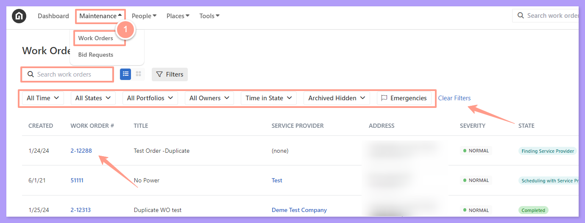
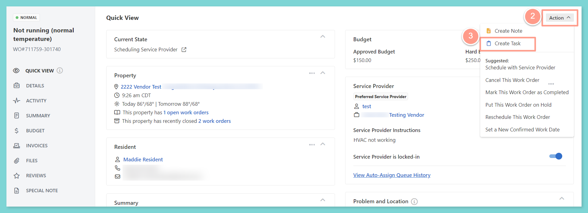
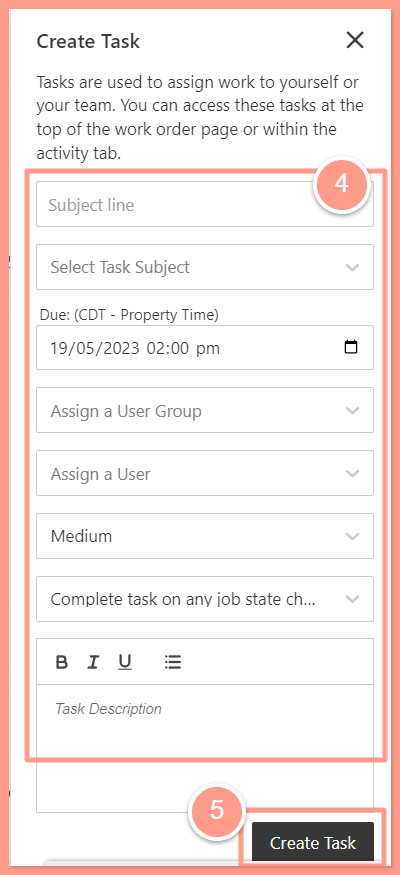
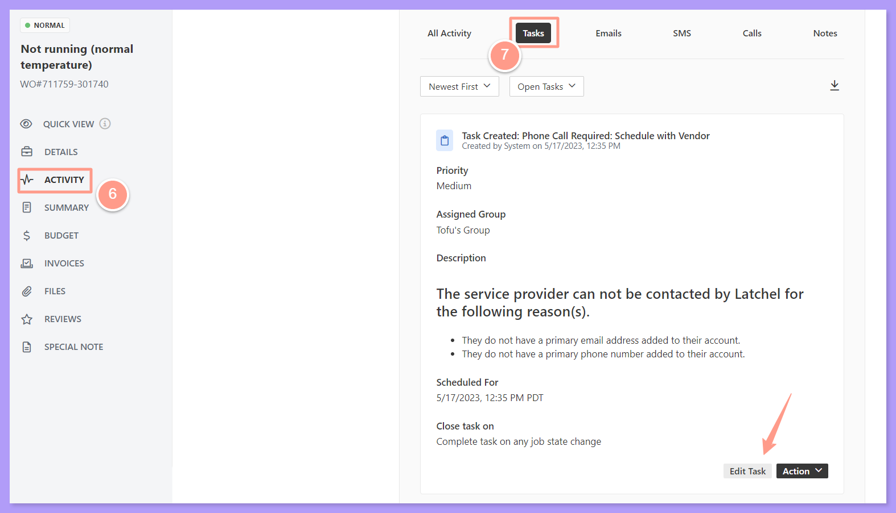

<Info>
  **NOTE:** _Please do not create tasks for the Latchel team. If you need to request something, please message Latchel Support directly._
</Info>

## **How to Create a Task**

<Steps>
  <Step title="**Open the work order**" icon="1" iconType="sharp-solid" stepNumber={1} titleSize="p">
    To create a task, from your Latchel dashboard, go to the **Maintenance tab** and click on **Work Orders**.  Search and select the work order that you want to add it to. Use the Search Bar then click on the Work Order ID.

    You can also use the **Filter** and **Clear Filters** option for a more refined search. To learn more about how to use the **Filter**, check out this help guide:

    <Card title="How to Use the Filter Options in the Work Order Tab Page" color="#ff9b8a" icon="filter-list" iconType="duotone" href="/s/topic/0TO5e000000h9wqGAA/How-to-Use-the-Filter-Options-in-the-Work-Order-Tab-Page">
      Learn how to use filters in the Work Order tab to quickly sort, find, and manage the requests you care about most.
    </Card>

    <Frame>
      
    </Frame>
  </Step>
  <Step title="**Click Action then Create Task**" icon="2" iconType="sharp-solid" stepNumber={2} titleSize="p">
    Now that you can see the work order details, on the **Quick View** tab, click **Action**, then select **Create Task**.

    <Frame>
      
    </Frame>
  </Step>
  <Step title="**Fill out the task details**" icon="3" iconType="sharp-solid" stepNumber={3} titleSize="p">
    Fill out the task details and then click **Create Task**.

    <Frame>
      
    </Frame>
  </Step>
  <Step title="**Confirm the task in Activity**" icon="4" iconType="sharp-solid" stepNumber={4} titleSize="p">
    To confirm if the task is successfully logged, click **Activity** from the work order page, then **Tasks.** The task can be edited when needed too by clicking **Edit Task**.

    <Frame>
      
    </Frame>
  </Step>
</Steps>