## **How to Create and View a Bid Request for a Property**

<Steps>
  <Step title="**Go to Bid Requests**" icon="1" iconType="sharp-solid" stepNumber={1} titleSize="p">
    To create a bid and assign it to a property, navigate from the main dashboard, click on the **Maintenance arrow** then, **Bid Requests.**

    <Frame>
      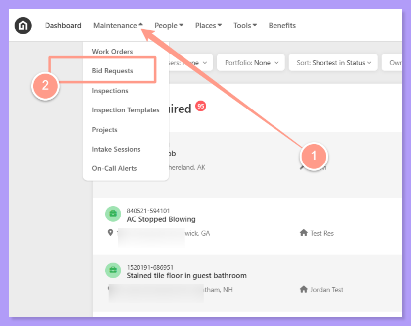
    </Frame>
  </Step>
  <Step title="**Click Create Bid Request**" icon="2" iconType="sharp-solid" stepNumber={2} titleSize="p">
    From the Bid Requests page, click **Create Bid Request.**

    <Frame>
      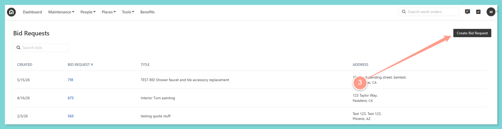
    </Frame>
  </Step>
  <Step title="**Select Search by Property Address**" icon="3" iconType="sharp-solid" stepNumber={3} titleSize="p">
    On assigning a property, you may search either by looking up the resident using the resident's phone number or by searching the property address. For this instance, select **Search by Property Address.**

    <Frame>
      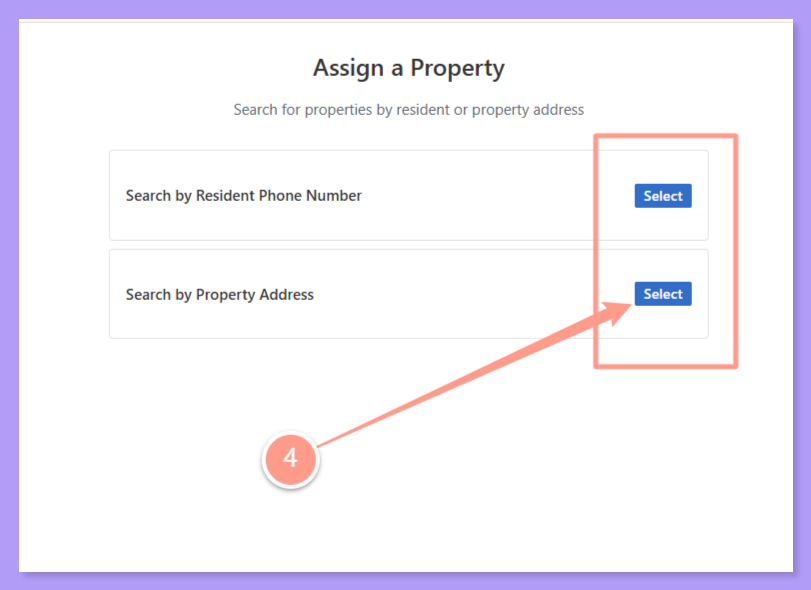
    </Frame>
  </Step>
  <Step title="**Search for and select the address**" icon="4" iconType="sharp-solid" stepNumber={4} titleSize="p">
    Type in the address on the search field, then click on **Select** once the desired property address appears. 

    <Frame>
      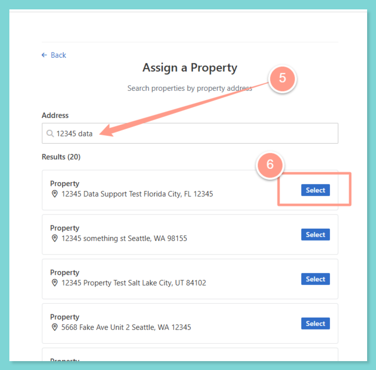
    </Frame>
  </Step>
  <Step title="**Review the information and click Select**" icon="5" iconType="sharp-solid" stepNumber={5} titleSize="p">
    Review property and resident information, then click **Select**.

    <Frame>
      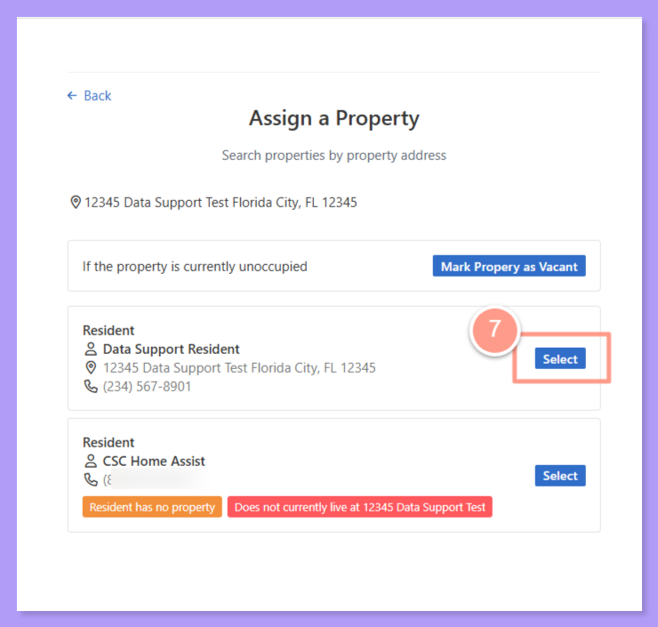
    </Frame>
  </Step>
  <Step title="**Enter the bid details and click Next Step**" icon="6" iconType="sharp-solid" stepNumber={6} titleSize="p">
    Supply the basic details information such as:

    - Bid Request Name
    - Summary
    - Skilled Required
    - Max Budget
    - Property Access Instruction
    - Related Files (when applicable)
    - Instruction for Service Provider

    Then, click **Next Step.**

    <Frame>
      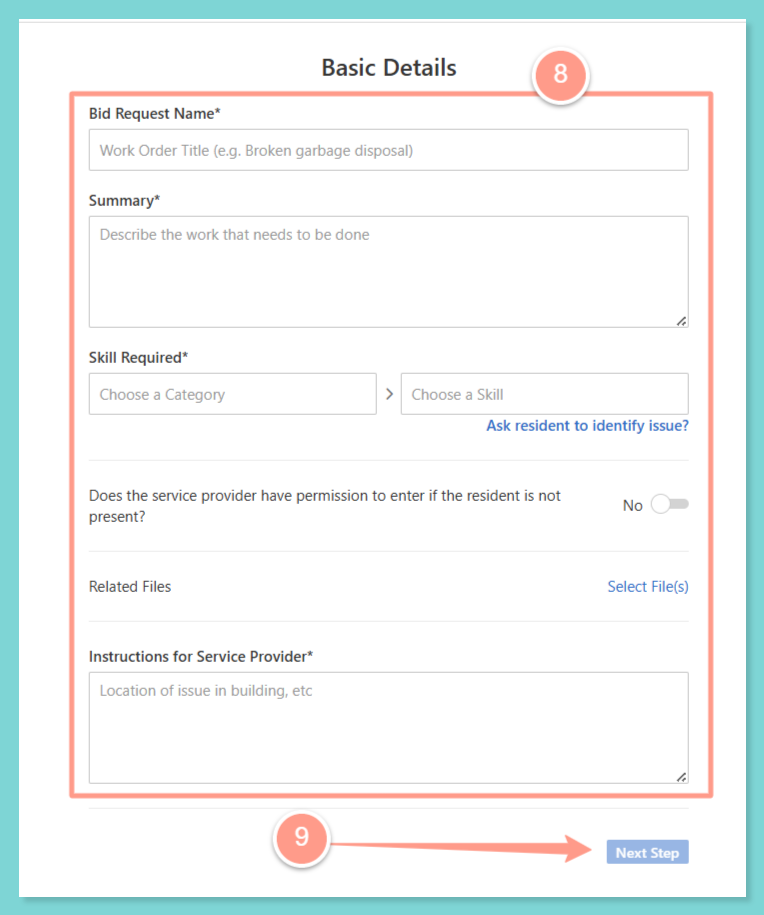
    </Frame>
  </Step>
  <Step title="**Choose service providers and review**" icon="7" iconType="sharp-solid" stepNumber={7} titleSize="p">
    The next screen will now allow you to select two or more Service Providers to whom you want to send the bids. The Service Providers are pre-populated depending on the skills required chosen.

    <Frame>
      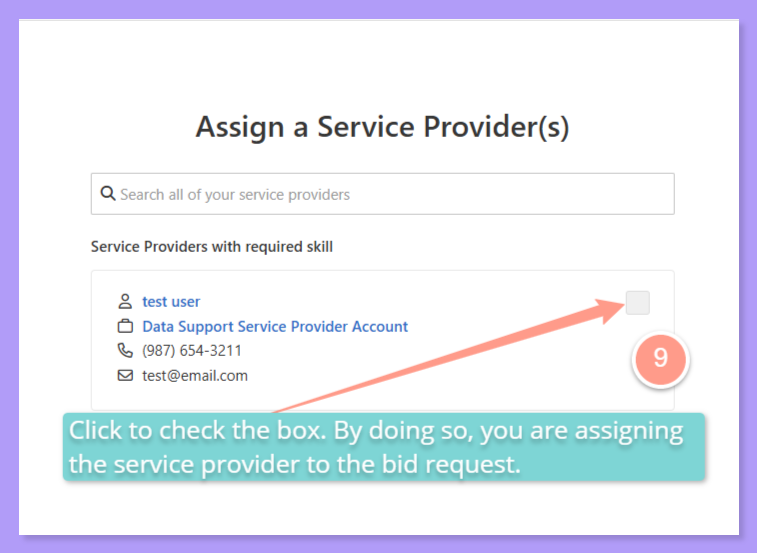
    </Frame>

    You also have an option to search all Service Provider that is not even on the lists. Once all the lists are set, **tick** the box and click **Review Bid Requests.**

    <Frame>
      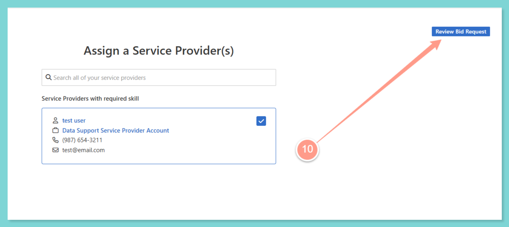
    </Frame>
  </Step>
  <Step title="**Click Submit Bid Request**" icon="8" iconType="sharp-solid" stepNumber={8} titleSize="p">
    If ready to submit, click **Submit Bid Request.**

    <Frame>
      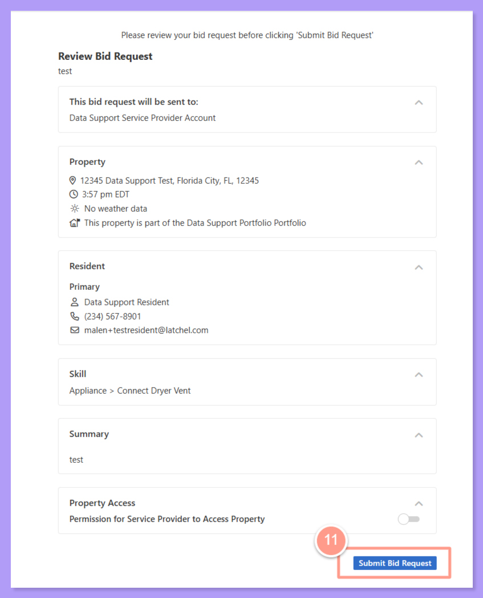
    </Frame>
  </Step>
  <Step title="**View the bid's work orders**" icon="9" iconType="sharp-solid" stepNumber={9} titleSize="p">
    The page will now present the information of the bid information. You may view the work orders that are part of this bid by clicking the **WORK ORDERS.**

    <Frame>
      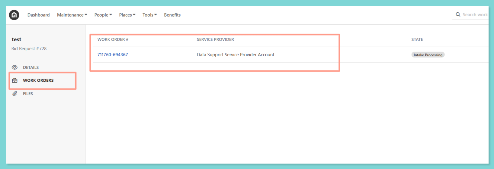
    </Frame>

    <Note>
      The number of work orders listed varies based on the number of service providers you invited for the bid.
    </Note>

    The current state of the work order is **Intake Processing**. The state will change depending on the progress made by the Service Provider to complete the job.

    <Frame>
      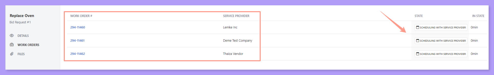
    </Frame>
  </Step>
  <Step title="**Open the Work Order Link**" icon="10" iconType="sharp-solid" stepNumber={10} titleSize="p">
    There is also an option to look at the detailed information of the work order by clicking on the **Work Order Link** and it will show the usual work order view.

    <Frame>
      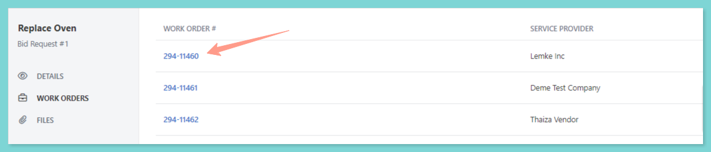
    </Frame>

    <Frame>
      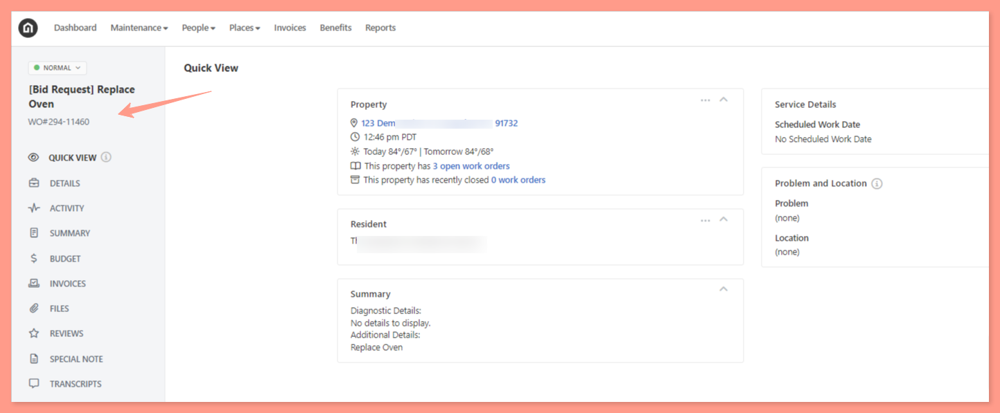
    </Frame>
  </Step>
  <Step title="**View the FILES tab**" icon="11" iconType="sharp-solid" stepNumber={11} titleSize="p">
    Lastly, the **FILES** tab is also available to view files that the Service Provider added to the work order.

    <Frame>
      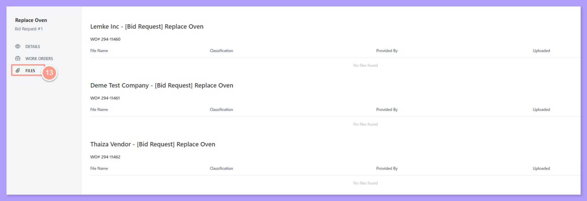
    </Frame>
  </Step>
</Steps>

<Note>
  **Bid Request** can only be accessed through the **Maintenance tab** and is not yet available in the Company or Property view.
</Note>