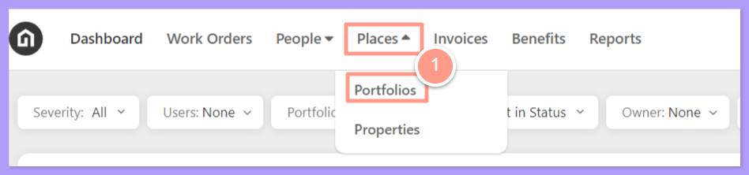
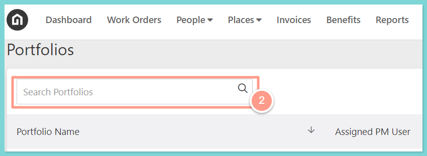
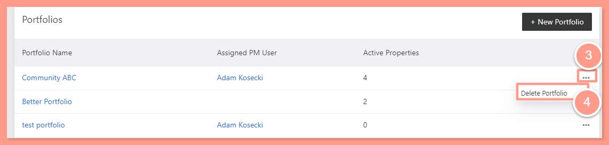
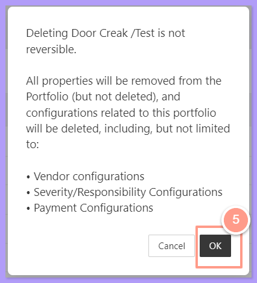

## **How to Delete a Portfolio**

<Steps>
  <Step title="**Go to Places then Portfolios**" icon="1" iconType="sharp-solid" stepNumber={1} titleSize="p">
    On your dashboard click **Places** and then select **Portfolios** on the dropdown.

    <Frame>
      
    </Frame>
  </Step>
  <Step title="**Search for the portfolio**" icon="2" iconType="sharp-solid" stepNumber={2} titleSize="p">
    Then search for the Portfolio name in the **Search bar**.

    <Frame>
      
    </Frame>
  </Step>
  <Step title="**Select Delete Portfolio**" icon="3" iconType="sharp-solid" stepNumber={3} titleSize="p">
    Once you found the portfolio name, navigate to the right side of the page, click the **ellipses icon,** and select **Delete Portfolio**.

    <Frame>
      
    </Frame>
  </Step>
  <Step title="**Click OK to confirm**" icon="4" iconType="sharp-solid" stepNumber={4} titleSize="p">
    A pop-up message will appear, and to confirm action click **OK**.

    <Frame>
      
    </Frame>

    <Note>
      Deleting a portfolio will not affect the status of the properties included in it. The purpose of deleting a portfolio is to ungroup the properties.
    </Note>
  </Step>
</Steps>