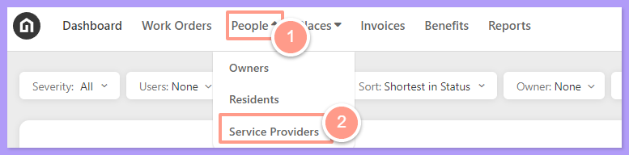
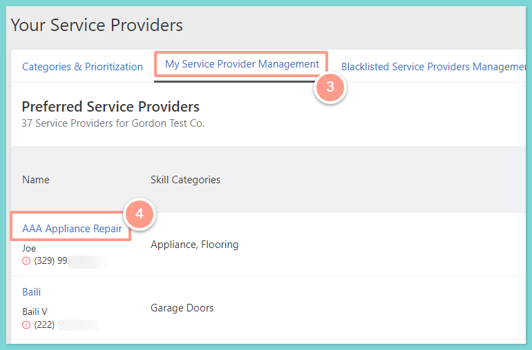
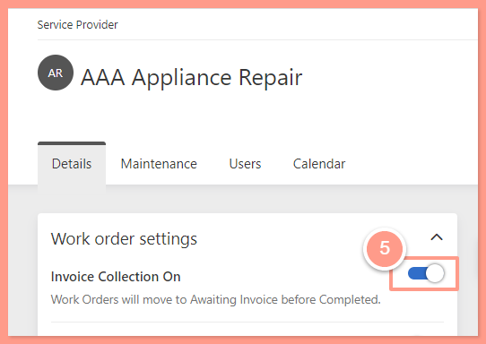

## **How This Works**

- When Invoice Collection is **disabled**, Latchel won’t request invoices from your Service Providers, assuming they’ll send them directly to you.
- When **enabled**, Latchel sends daily automated SMS reminders to collect the invoice.
- When the request for the invoice is sent, Latchel also creates a task for the PM for **Awaiting Invoice**.

## **Invoice Notification Frequency**

Latchel automatically follows up with service providers for outstanding invoices after a work order is complete. Check the help guide below to know more about this!

<Card title="How Latchel Collects Invoices From Your Service Providers" color="#ff9b8a" icon="file-invoice" iconType="duotone" href="/s/topic/0TO5e000000h9wqGAA/How-Latchel-Collects-Invoices-From-Your-Service-Providers">
  Learn how Latchel automatically follows up with service providers for outstanding invoices.
</Card>

## **Managing Invoice Collection Feature**

<Steps>
  <Step title="**Go to People and Service Providers**" icon="1" iconType="sharp-solid" stepNumber={1} titleSize="p">
    On your Latchel Dashboard, select **People** from the top navigation menu and then click on the **Service Providers.** 

    <Frame>
      
    </Frame>
  </Step>
  <Step title="**Open the service provider profile**" icon="2" iconType="sharp-solid" stepNumber={2} titleSize="p">
    Locate the **My Service Provider Management** and click on the hyperlinked name of the Service Provider to be taken to their profile.

    <Frame>
      
    </Frame>
  </Step>
  <Step title="**Toggle Invoice Collection off**" icon="3" iconType="sharp-solid" stepNumber={3} titleSize="p">
    Under **Work Order Settings**, toggle **Invoice Collection** **OFF**. Once the toggle is grayed out (the toggle will be positioned to the left), invoice collection is turned off for the preferred vendor.

    Please feel free to toggle this back **ON** if you want Latchel to ask your preferred Service Providers for an invoice.

    <Frame>
      
    </Frame>
  </Step>
</Steps>