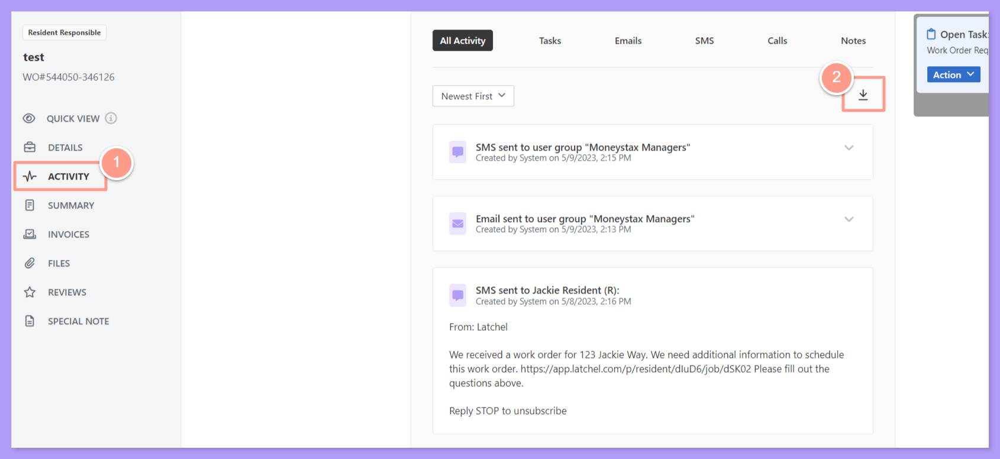
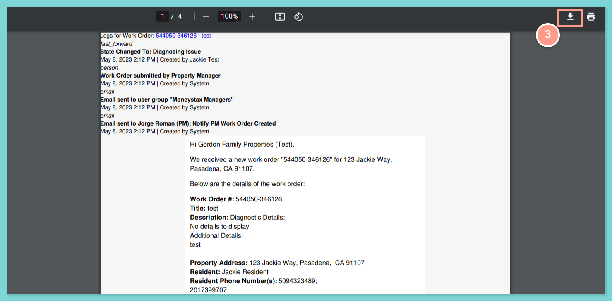
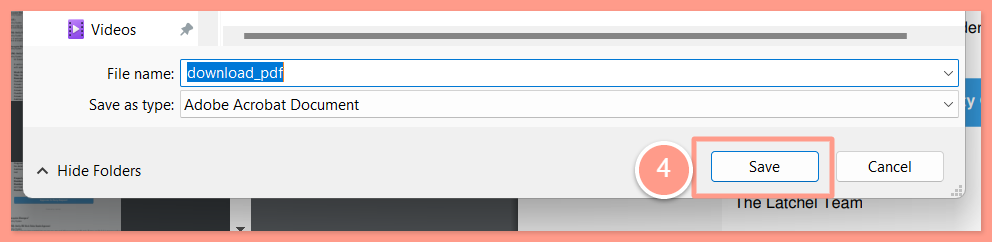

<Tip>
  **Pro Tip:** If you are not using an integration, we recommend exporting the work order history and uploading the PDF file to the corresponding work order in your Property Management system. This will help you keep a log of everything we did in Latchel in your management system\!
</Tip>

## **How to Download a Work Order History**

<Steps>
  <Step title="**Open the Activity tab and click download**" icon="1" iconType="sharp-solid" stepNumber={1} titleSize="p">
    Open the work order then go to the **Activity** tab. Under **All Activity**, a **download icon** can be clicked to download the all details of the work order.

    <Frame>
      
    </Frame>
  </Step>
  <Step title="**Download the PDF**" icon="2" iconType="sharp-solid" stepNumber={2} titleSize="p">
    Once the PDF file preview opens an option to either download the PDF file to your computer or print it out is a the upper right-hand corner of the screen. Click the download icon to download it to your computer.

    <Frame>
      
    </Frame>
  </Step>
  <Step title="**Save the file**" icon="3" iconType="sharp-solid" stepNumber={3} titleSize="p">
    A pop-up window should appear, prompting you to specify the location where you’d like to save the file. If you’d like, you can rename the file at this point. If not, skip this step. Click **Save** or **OK** to save the PDF file to your computer.

    <Frame>
      
    </Frame>
  </Step>
</Steps>