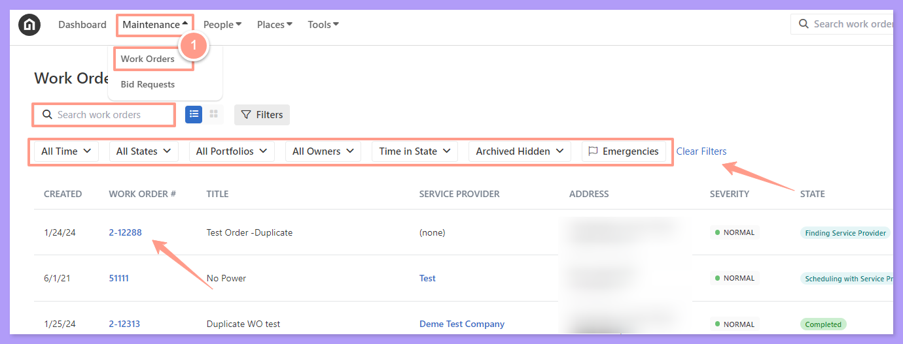
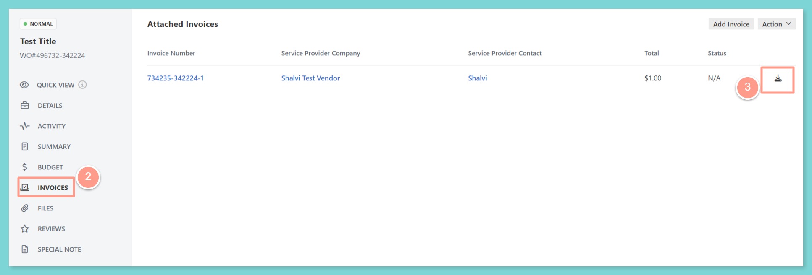
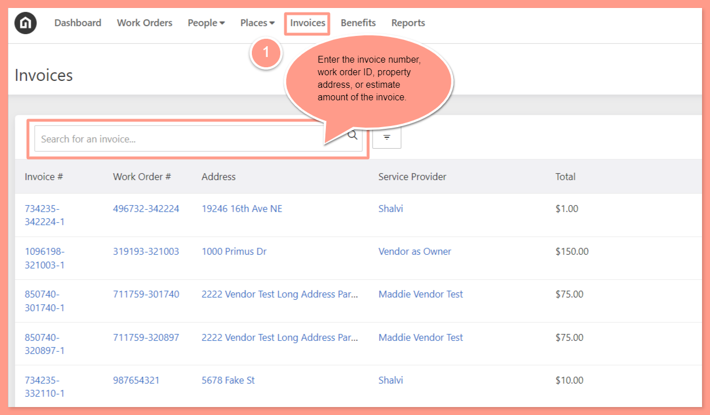
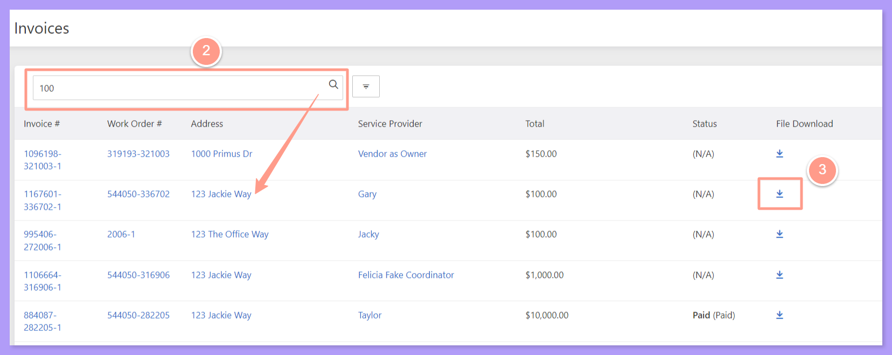

## **How to Download a Work Order Invoice**

<Steps>
  <Step title="**Open the work order**" icon="1" iconType="sharp-solid" stepNumber={1} titleSize="p">
    First, from the dashboard, click on the **Maintenance tab**, and open the work order by either searching and/or clicking the specific order number. You can also use the **Filter** and **Clear Filters** option for a more refined search. To learn more about how to use the Filter, check out this help guide:

    <Card title="How to Use the Filter Options in the Work Order Tab Page" color="#ff9b8a" icon="filter-list" iconType="duotone" href="/s/topic/0TO5e000000h9wqGAA/How-to-Use-the-Filter-Options-in-the-Work-Order-Tab-Page">
      Learn how to use filters in the Work Order tab to quickly sort, find, and manage the requests you care about most.
    </Card>

    <Frame>
      
    </Frame>
  </Step>
  <Step title="**Download the invoice from the work order**" icon="2" iconType="sharp-solid" stepNumber={2} titleSize="p">
    On the work order page, click **Invoices**. Then click the **download icon** across the invoice you need to download. Once done, the invoice is saved on your computer downloads.

    <Frame>
      
    </Frame>
  </Step>
  <Step title="**Or search from the Invoices tab**" icon="3" iconType="sharp-solid" stepNumber={3} titleSize="p">
    Another option is to go to the **Invoices** tab located at the top of the page. From there, you can search for the work order ID by entering either the **invoice number**, the **work order ID**, or the **property address**. Additionally, with the new experience, you can also find the work order by entering an estimated invoice amount you want to download.

    <Frame>
      
    </Frame>
  </Step>
  <Step title="**Download the matching invoice**" icon="4" iconType="sharp-solid" stepNumber={4} titleSize="p">
    For this example, we will search for the invoice using an **estimated amount**. From the list of invoices that appear, make sure you are downloading the invoice from the correct property address. Click the **download icon** on the right side of the page, aligned with the correct property address.

    <Frame>
      
    </Frame>
  </Step>
</Steps>