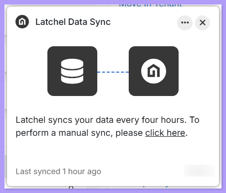

## **How to Activate the Latchel Data Sync**

<Steps>
  <Step title="**Download and install the extension**" icon="1" iconType="sharp-solid" stepNumber={1} titleSize="p">
    First, go through the help guide below to **download and install** the Latchel Data Sync Extension.

    <Card title="How to Install the Latchel Data Sync Extension" icon="plug-circle-check" iconType="duotone" href="/s/topic/0TO5e000000h9wqGAA/How-to-Install-the-Latchel-Data-Sync-Extension">
      Follow these steps to download and install the Latchel Data Sync Extension.
    </Card>

    Once signed into the extension successfully, you will see text on the extension drop-down that states, **"Logged in as PM Company Name"**.
  </Step>
  <Step title="**Create the Team Latchel user**" icon="2" iconType="sharp-solid" stepNumber={2} titleSize="p">
    In your Property Management Software (PMS), **create a new user** that **will be used to activate the Latchel Data Sync**. Use the following information:

    - **Email Address:** This can be any email address that you manage that isn’t tied to an existing user in your system.

    - **Recommended User Role:** On-Site Manager
    - **First Name:** Team
    - **Last Name:** Latchel

    <Warning>
      Please be sure to assign Team Latchel as a user, **NOT** a service provider.
    </Warning>
  </Step>
  <Step title="**Give Team Latchel access to your properties**" icon="3" iconType="sharp-solid" stepNumber={3} titleSize="p">
    In AppFolio, assign the **Team Latchel** user as property staff on each property you want Latchel to manage. Work orders only sync for properties that are assigned to Team Latchel.

    1. Go to the **Properties** tab and select the property you want to update.
    2. Click **Edit** on the property details page.
    3. Locate the **Property Staff** or **Site Manager / Owner's Agent** section.
    4. Choose or assign **Team Latchel** from your AppFolio users.
    5. Click **Save** to confirm the assignment.

    {/* TODO: screenshot of the Property Staff section on an AppFolio property page */}
  </Step>
  <Step title="**Create a test work order for Team Latchel**" icon="4" iconType="sharp-solid" stepNumber={4} titleSize="p">
    To verify the sync is running correctly, create a **test** **work order** in your PMS and **assign this test work order to the Team Latchel user**.
  </Step>
  <Step title="**Sign out of the extension and back in**" icon="5" iconType="sharp-solid" stepNumber={5} titleSize="p">
    Sign out of the Latchel Data Sync extension, and then sign back in.
  </Step>
  <Step title="**Sign out of your PMS and back in**" icon="6" iconType="sharp-solid" stepNumber={6} titleSize="p">
    Sign out of your property management software and then sign back in.
  </Step>
  <Step title="**Find the floating Latchel logo**" icon="7" iconType="sharp-solid" stepNumber={7} titleSize="p">
    Navigate back to your property management software dashboard where you should see a floating Latchel logo at the top right.
       <Frame>
         
       </Frame>
       **To know more about navigating the new extension, visit:**
       <Card title="Navigating the Latchel Data Sync Extension" icon="plug-circle-check" iconType="duotone" href="/s/topic/0TO5e000000h9wqGAA/Navigating-the-Latchel-Data-Sync-Extension-New-Version">
         Explore the layout and key functions of the latest Latchel Data Sync Extension.
       </Card>
  </Step>
  <Step title="**Let auto-sync refresh every 4 hours**" icon="8" iconType="sharp-solid" stepNumber={8} titleSize="p">
    **Auto-sync is now always on by default** with the new Latchel Data Sync Extension, **refreshing data every 4 hours.**
  </Step>
  <Step title="**Complete or close the test work order**" icon="9" iconType="sharp-solid" stepNumber={9} titleSize="p">
    Once the sync has been initialized, you can **complete** or **close** the test work order in your property management software (PMS).
  </Step>
</Steps>
