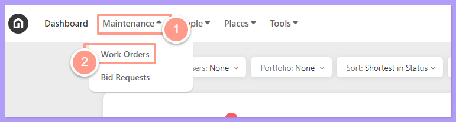
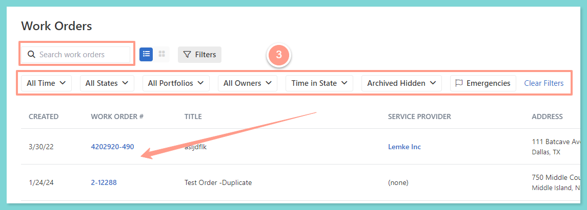
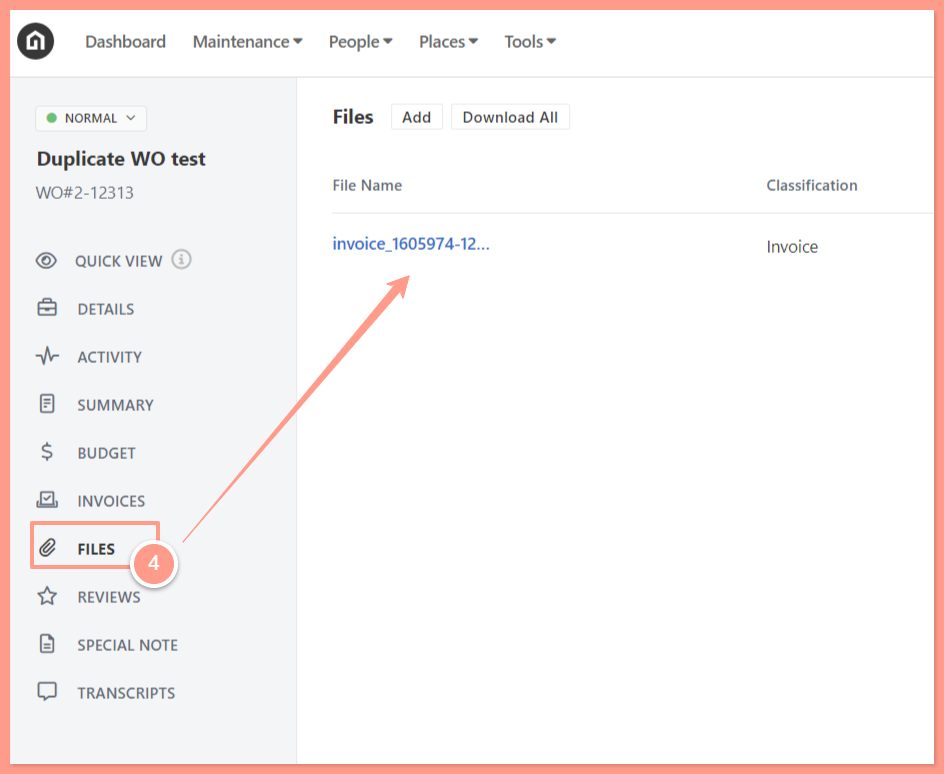
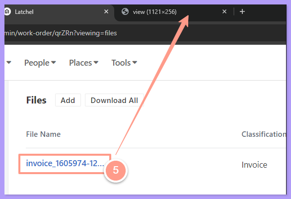
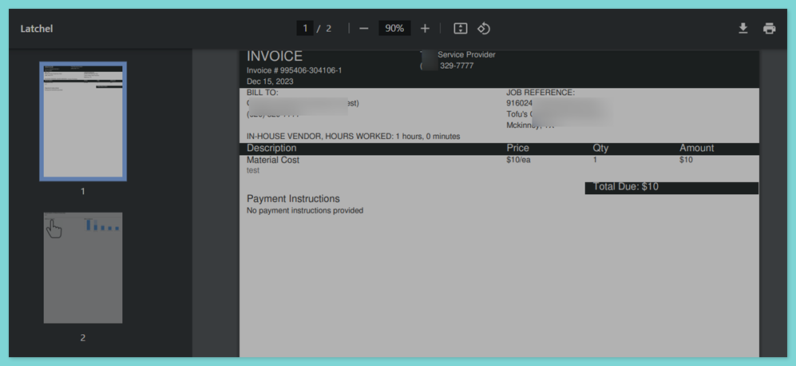
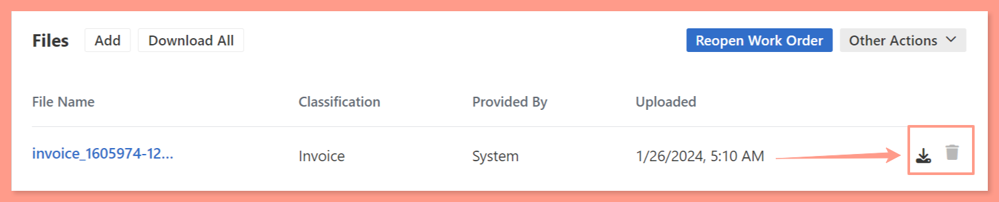

## **How to Download or Manage Files from Work Orders**

<Steps>
  <Step title="**Open Work Orders from the Maintenance dropdown**" icon="1" iconType="sharp-solid" stepNumber={1} titleSize="p">
    From your Dashboard, click the **Maintenance** dropdown and select **Work Orders**.

    <Frame>
      
    </Frame>
  </Step>
  <Step title="**Search for the work order**" icon="2" iconType="sharp-solid" stepNumber={2} titleSize="p">
    Now to select the desired work order, use the **Search Bar** then click on the Work Order ID on the Work Order page. You can also use **Filter** for easy search. 

    <Frame>
      
    </Frame>
  </Step>
  <Step title="**Go to the Files tab**" icon="3" iconType="sharp-solid" stepNumber={3} titleSize="p">
    From the work order page, go to the **Files** tab, the saved file/s can be previewed before downloading or deleting. 

    <Frame>
      
    </Frame>
  </Step>
  <Step title="**Preview the file**" icon="4" iconType="sharp-solid" stepNumber={4} titleSize="p">
    To preview the file, click on the **File Name** and a new window will appear. You may view if it’s the right file you wish to manage. 

    <Frame>
      
    </Frame>

    Sample Preview File: Invoice

    <Frame>
      
    </Frame>
  </Step>
  <Step title="**Download or delete the file**" icon="5" iconType="sharp-solid" stepNumber={5} titleSize="p">
    Once you have confirmed it's the file you need to manage, you can either download a file by clicking the **download icon** or delete it, when necessary, by clicking the **trash icon**.

    <Frame>
      
    </Frame>

    <Info>
      **NOTE:**

      - _All downloaded files are saved in the downloads folder of the Property Manager or Latchel Admin user's computer._
      - __Deleting a file is irreversible.__
      - _Different types of files can be saved and previewed such as (.)png, (.)pdf, movie or a gif, and docx._
    </Info>
  </Step>
</Steps>