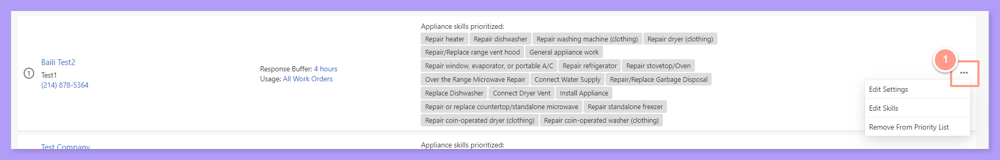
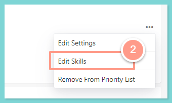
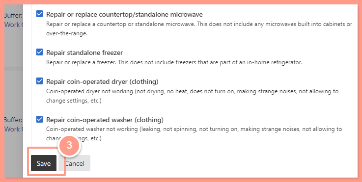

## **How to Edit Service Provider Skills in the Category and Prioritization Page**

<Steps>
  <Step title="**Click the three dots**" icon="1" iconType="sharp-solid" stepNumber={1} titleSize="p">
    Click on the **three dots** on the right side of the service provider that you want to edit. You will get the option to either **Edit Settings**, **Edit Skills** or **Remove Service Provider from the Priority list**.

    <Frame>
      
    </Frame>
  </Step>
  <Step title="**Click Edit Skills**" icon="2" iconType="sharp-solid" stepNumber={2} titleSize="p">
    Click on **Edit Skills** and you will see a list of skills the service provider has added to their profile.

    <Frame>
      
    </Frame>
  </Step>
  <Step title="**Check or uncheck skills and save**" icon="3" iconType="sharp-solid" stepNumber={3} titleSize="p">
    From here, you can **check** (add) or **uncheck** (remove) skills. Click **Save** to enter your skill selection. [**_Click here to see How to Navigate Preferred Service Provider Profiles._**](/s/topic/0TO5e000000h9wqGAA/How-to-Navigate-Preferred-Service-Providers-Profiles)

    <Frame>
      
    </Frame>

    _Please note that checking or unchecking skills will NOT change the service provider's skills in their profile. It will only add or remove skills from the Categories & Priorities page._
  </Step>
</Steps>
